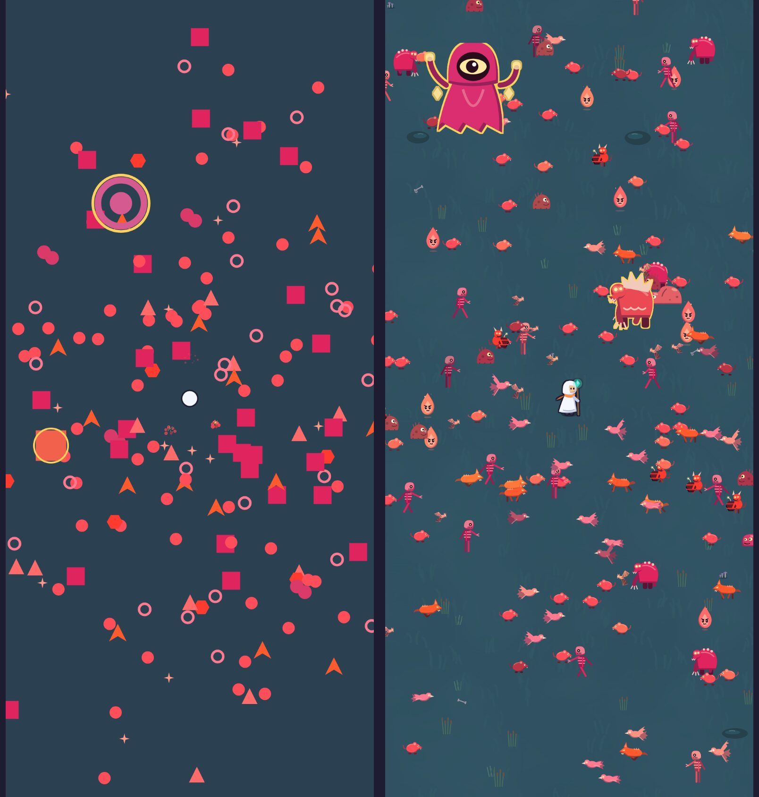
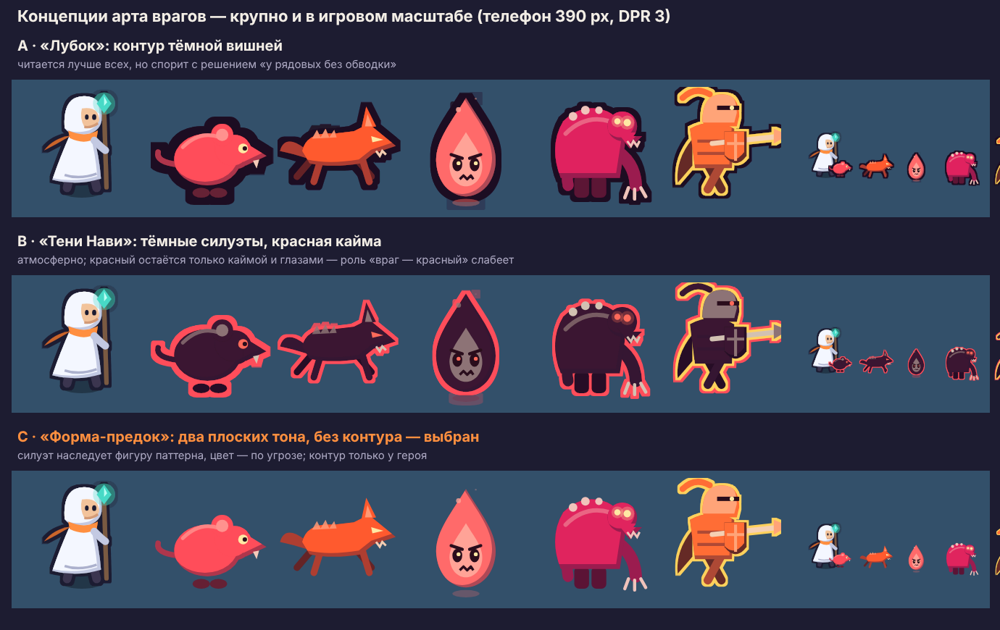
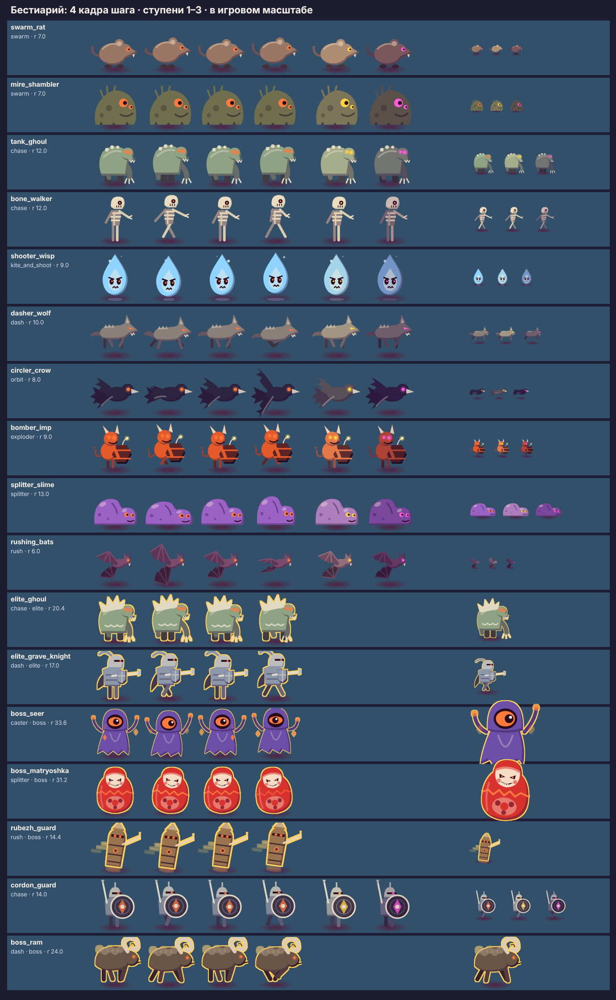
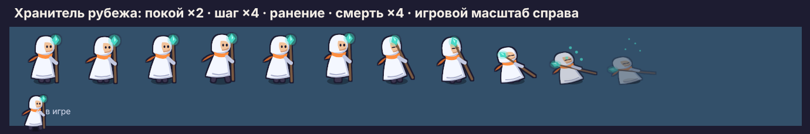
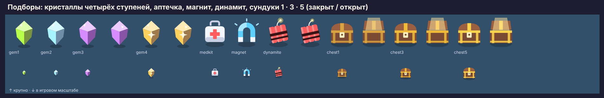

# Персонажи и 2D-ресурсы забега

> **Статус: черновик дизайнера `claude-design-10`, до одобрения тимлидом.**
> Спрайты готовы как файлы и проверены в прототипе арены
> (`prototype/arena.html`), в игру **не подключены**: это работа в зоне
> участника 1 (`packages/core-game/src/game/render/*`), план — в конце.

## 1. Исходное состояние

Мир забега рисуется фигурами, которые движок генерирует при старте сцены
(`core-game/src/game/render/shapes.ts`, `looks.ts`): враг — красный круг,
квадрат, клин, кольцо; герой — белый круг в тёмном канте. Это решение
«цвет по угрозе» (`design/README.md`, «Вид боя») — читаемое, но черновое:
у врагов нет характера, у героя нет образа, и игра не продаёт себя ни
скриншотом, ни видео.



Слева — нынешние фигуры, справа — эталонный набор в том же масштабе
(телефон 390×844, 220 врагов, снимок прототипа).

## 2. Художественное направление: сравнение и выбор



| Концепция | Что это | Плюсы | Минусы |
|---|---|---|---|
| **A · «Лубок»** | плоские формы с контуром тёмной вишни | лучшая читаемость на любом фоне | спорит с решением «у рядовых без обводки»; контур съедает мелких (крыса, нетопырь) в толпе — каша из тёмных колец |
| **B · «Тени Нави»** | тёмные силуэты, красная кайма и глаза | атмосферно, «страшно» | роль «враг — красный» слабеет до каймы; тёмное тело на средней земле теряется на ходу; тяжелее для стихийных тонов (тон состояния заливает тёмное тело) |
| **C · «Форма-предок»** — **выбрана** | два плоских тона без контура; силуэт наследует фигуру паттерна | органично развивает утверждённый «вид боя»: цвет по угрозе, ступень тоном, кайма ранга — всё на месте; заливка попадания и тона состояний работают как сейчас | без контура мелкие враги чуть слабее отделяются от земли — компенсируется тем, что земля — средний тон, а не тёмный |

**Почему C.** Она ничего не ломает из уже утверждённого: правила
`design/README.md` и `looks.ts` (цвет тела по паттерну, смешение ранга,
ступени, золотая кайма элиты и босса) переносятся в спрайты один к одному —
палитра спрайтов считается теми же функциями (`src/palette.mjs`). Смена
визуального языка проекта не нужна.

### Правила стиля

1. **Силуэт наследует фигуру-предка.** Крыса — шар, упырь — горбатый короб,
   волк — клин мордой вперёд, ворон — дуга крыльев, бес — шестигранный
   бочонок, слизень — два шара, нетопырь — лучи крыльев, вещун — глаз.
   Привычка игрока и гайдбук не теряют смысла.
2. **Два плоских тона.** Тело и тень снизу-справа (`twoTone`), плюс
   одна-две световые линии. Градиентов, бликов и текстур нет: на 20 px они
   — шум.
3. **Цвет — по угрозе.** Тело — цвет паттерна из `looks.ts`; тень и свет —
   сдвиг к сумеречному фиолетовому и к тёплому свету, а не к чёрному и белому.
4. **Глаза светятся** у тех, кто опасен на расстоянии или в рывке (упырь,
   ворон, бес, нетопырь); у остальных — обычные. Глаз — единственная
   светлая точка на красном теле и главный признак «смотрит на тебя».
5. **Контур — признак героя.** Только у героя тёмный кант по силуэту: так
   «я» читается в толпе красных тел без подсветки и стрелок.
6. **Тело ≈ хитбокс.** Масса тела занимает круг хитбокса; хвосты, крылья,
   копья выходят за него. Иначе урон приходит «не коснувшись» (поэтому
   ячейка — 1,75 радиуса, `CELL_K` в `src/build.mjs`).
7. **Элита и босс — кайма, а не новый цвет.** Золотая кайма 2 и 3 единицы,
   как в `enemyRim`. Элита — тот же вид, но вожак (упырь-вожак — упырь с
   костяным гребнем); босс — свой образ.

## 3. Ростер







Подборы — `src/pickups.mjs`, кадры `pickup/<id>/<k>` в атласе `core`:
кристаллы четырёх ступеней (`GEM_TIERS`: цвет и размер растут с
ценностью, у двух старших — два кадра блика, у самого ценного — искра
внутри), аптечка, магнит, динамит с искрящим фитилём и сундуки трёх
размеров — закрытый и открытый (для окна наград). В прототипе кристаллы
падают с убитых и летят к герою в радиусе подбора.

| Персонаж | Паттерн | Фигура-предок → образ | Кадры | Статус |
|---|---|---|---|---|
| Хранитель рубежа (герой) | — | белый круг → светлый плащ с капюшоном, посох с бирюзовым оберегом, тёплый шарф | покой 2, шаг 4, ранение 1, смерть 4 | эталон, проверен в прототипе |
| Крыса `swarm_rat` | swarm | круг → шар с острой мордой и хвостом | шаг 4 × 3 ступени | эталон |
| Болотный увалень `mire_shambler` | swarm | круг → куча тины с одним большим глазом | 4 × 3 | черновик; хитбокс паттерна 7 мал для образа — §6 |
| Упырь `tank_ghoul` | chase | квадрат → горбатый, рука до земли | 4 × 3 | эталон |
| Костяной ходок `bone_walker` | chase | квадрат → высокий скелет | 4 × 3 | черновик: тонок, на 320 px проверить |
| Блуждающий огонёк `shooter_wisp` | kite_and_shoot | треугольник → язык пламени со злым лицом | 4 × 3 | эталон |
| Волк `dasher_wolf` | dash | клин → поджарый волк мордой вперёд | 4 × 3 (галоп) | эталон |
| Ворон `circler_crow` | orbit | кольцо → птица с раскрытыми крыльями | 4 × 3 (взмах) | черновик |
| Бес-подрывник `bomber_imp` | exploder | шестиугольник → бес с бочонком, фитиль искрит | 4 × 3 | эталон |
| Слизень `splitter_slime` | splitter | два круга → двойной шар | 4 × 3 (сжатие) | черновик |
| Нетопыри `rushing_bats` | rush | четыре луча → летучая мышь с перепонками | 4 × 3 (взмах) | эталон |
| Упырь-вожак `elite_ghoul` | chase · элита | упырь + костяной гребень + кайма | 4 | черновик |
| Могильный рыцарь `elite_grave_knight` | dash · элита | клин → таран с копьём и щитом | 4 | черновик |
| Вещун `boss_seer` | caster · босс | глаз → капюшон с одним оком, руны вокруг | 4 | эталон |
| Матрёшка `boss_matryoshka` | splitter · босс | два круга → кукла с горящим швом посередине | 4 (покачивание) | черновик |

Ступени (`content/stages.ts`) — запечённые варианты палитры: вторая
светлеет к золоту, третья темнеет к вишне, глаза у ступеней светлее
(`STAGES` в `src/palette.mjs` повторяет `STAGE_LOOKS`). Элиты и боссы
ступеней не получают — как в игре.

## 4. Направления и состояния

**Ракурс** — вид сбоку в три четверти, как у Vampire Survivors: камера
сверху, но персонажи «стоят» на земле. **Направлений два: вправо и
отражение влево** (`flipX` по знаку скорости). Восемь направлений не нужны:
у врагов нет атак «в сторону», у героя нет прицеливания — направление
читается по морде и по движению, а восемь направлений умножили бы атлас
вчетверо.

| Состояние | Чем показано | Почему так |
|---|---|---|
| Шаг / полёт | 4 кадра цикла, ~8 кадров/с, фаза по номеру врага | меньше 4 кадров — рывками, больше — не видно на 20 px |
| Попадание | заливка белым `setTintFill`, как сейчас | уже работает в `WorldRenderer.applyLook`, кадров не нужно |
| Телеграф (рывок, фитиль, каст) | мигание заливкой, как сейчас + наклон волка по направлению рывка | телеграф уже читается; спрайт его не должен ломать |
| Тон состояния (горение, холод…) | заливка тоном стихии, как сейчас | заливка сохраняет силуэт по альфе — работает и на спрайте |
| Гибель врага | запечённое развеивание 6 кадров (`fx/death`), тинт цветом врага | одна текстура на всех; кадр смерти на каждого — ×14 атласа |
| Ранение героя | кадр отдачи + заливка красным | заливка — обратная связь, кадр — характер |
| Смерть героя | 4 кадра: оседает на колено и рассеивается бирюзой | падение плашмя не влезает в ячейку и читается как «ещё жив» |
| Покой героя | 2 кадра дыхания | герой стоит часто — неподвижная картинка выглядит паузой |

## 5. Форматы и вес

**Выбор: запечённые спрайт-листы в атласах + процедурные трансформации.**

| Подход | Качество | Трудозатраты | Вес и память | Вывод |
|---|---|---|---|---|
| Процедурные фигуры (сейчас) | заглушка | ноль | минимум | остаются запасным видом и режимом «Упрощённая графика» |
| **Векторный рисунок → запечённый атлас** | ровный стиль, любые варианты палитры бесплатно | средние: рисунок кодом, кадр — параметр | 2 атласа по ~1024×1100–1450, 67 + 83 КБ PNG | **выбран** |
| Покадровая ручная анимация (Aseprite) | лучшая выразительность | высокие: каждый кадр × ступень × рост ростера | как у выбранного | для боссов и героя на чистовом этапе |
| Составные модели из частей (кости) | гибко | высокие, своя система анимации | меньше атлас, больше объектов в кадре | сотни врагов × 5 частей = ×5 спрайтов — против бюджета кадра |
| Шейдеры и процедурная графика | эффектно | высокие | вызов на объект | только для полноэкранного (виньетка, ночь), не для тел |

**Почему векторный рисунок кодом.** Генератора изображений в этой среде
нет, а рисунок кодом даёт то, что для проекта важнее: одна правка формы
обновляет все кадры, ступени и ранги; палитра считается теми же числами,
что у движка; сборка повторяется побайтно. Ограничение — рисунок проще
ручного; для чистового этапа рисунки кодом становятся эталоном пропорций
и цвета для художника (§7).

**Плотность атласа** — 2,5 пикселя на игровую единицу. Телефон 390×844 с DPR 3
видит 2,8 физ. пикселя на единицу в движении и 3,4 стоя: растяжение не
больше 1,35×, плоский рисунок его не выдаёт. 3 пикселя дают атлас на треть
тяжелее без видимой разницы на телефоне (`ART_PPU=3` — проверить на
планшете).

| Файл | Кадров | Размер | PNG / WebP | Видеопамять |
|---|---|---|---|---|
| `out/atlas-core.png` — герой, враги первых трёх минут, эффекты | 100 | 1024×1116 | 67 КБ | 4,4 МБ |
| `out/atlas-late.png` — остальные враги, элита, боссы | 72 | 1024×1444 | 83 КБ | 5,6 МБ |
| `out/atlas-env.png` — декор | 21 | 1024×228 | 10 КБ | 0,9 МБ |
| `out/ground-neutral.webp` — земля, цвет зоны — окраской по вершинам (`environment.md`) | 1 | 512×512 | 4 КБ | 1 МБ |

Атласы — палитра 256 цветов с альфой (`src/quantize.py`): плоский рисунок
ложится без видимых потерь, PNG легче в 4–5 раз (полноцветный `core` —
329 КБ). Пак `core` весит меньше чанка движка — как требует
`docs/27-design-system-and-app-shell.md` §3.5. Половину `late` занимают боссы
(кадр 294 px); если видеопамять станет узким местом — у боссов 2 кадра
вместо 4, они медленные.

## 6. Ограничения и открытые вопросы

- **Хитбокс задаётся паттерном, а не врагом.** Болотный увалень — тяжёлый
  танк — живёт в хитбоксе роя (7 единиц) и потому выглядит мелким. Нужен ли
  множитель размера у врага в контенте — решение тимлида (сейчас правило
  «свободного размера нет», `CLAUDE.md`).
- **Облик — по врагу, а не по паттерну.** Сейчас вид врага берётся из
  паттерна (`ENEMY_LOOKS`), поэтому костяной ходок выглядит как упырь, а
  рыцарь — как волк. Спрайты ключуются по `id` врага с запасным видом по
  паттерну — это меняет контракт `looks.ts` и гайдбука.
- **Тень под врагом** снята после живого теста (T-0096). В спрайтах её нет;
  у героя тень запечена, как сейчас.
- **На устройстве не проверено.** Прототип снят в Chromium без GPU
  (SwiftShader). Чек-лист приёмки — `checklists.md`.

## 7. Интеграция — план для участника 1

Атласы подключаются отдельной задачей в `core-game/src/game/render/*`;
всё ниже — предложение, не сделанная работа.

1. **Загрузка.** `core` — в этап «Мир» экрана загрузки, `late` — в фоне после
   первого кадра; до прихода `late` враг рисуется нынешней фигурой того же
   размера и цвета (`docs/27` §3.5, «Забег не ждёт необязательного»).
   Манифест пака — с хэшем в имени и размером в байтах.
2. **`WorldRenderer`.** Текстура врага — кадр атласа
   `${id}/s${stage}/walk${k}` вместо `ensureShapeTexture`; масштаб спрайта —
   `unitScale / PPU`. Кадр шага считается из тика симуляции и номера врага:
   `((tick + i * 7) >> 3) & 3` — без нового состояния в мире. Смена кадра —
   только при смене индекса, как сейчас с видом (`enemySpriteLook`).
3. **Направление** — `flipX` по знаку `vx` с гистерезисом (`Uint8Array`
   последнего направления, порог ~0,2 скорости): иначе враг, бегущий
   вертикально, мерцает отражением. Поворот клина у волка заменяется
   наклоном ±15° по вертикальной составляющей рывка.
4. **Попадание, телеграф, тон состояния** — без изменений: `setTintFill`
   работает по альфе спрайта.
   **Порядок по `y`** — новое: у фигур сверху порядок отрисовки был не
   важен, а у спрайтов вида сбоку нижний обязан перекрывать верхнего, иначе
   толпа на 400 врагах — каша (видно в прототипе). Глубина = `y` раз в кадр;
   если сортировка тысячи объектов окажется заметной в профиле — полосами по
   8 единиц.
5. **Гибель** — `fx/death` из пула вспышек `CombatFeedback`, тинт цветом
   врага; кадр — каждые 3 тика.
6. **Гайдбук** — рисует тот же кадр атласа (CSS `background-position` по
   JSON атласа), а не фигуру: «картинка в гайдбуке совпадает с канвой».
7. **Настройки** — переключатель «Упрощённая графика» возвращает фигуры:
   слабым устройствам и тем, кому так читаемее.
8. **Сборка атласов** — `node design/art/src/build.mjs` переезжает в
   `scripts/art/` после одобрения; атласы коммитятся готовыми (Chromium в CI
   ради них не ставим), а тест сверяет, что у каждого врага из
   `content/enemies.ts` есть кадры в атласе.
9. **`pnpm budget`** — строка «Арт забега: core» с порогом ~90 КБ.

На баланс и golden-тесты спрайты не влияют: это рендер, `CONTENT_HASH` не
меняется.

## 8. Как пересобрать

```bash
node design/art/src/build.mjs       # атласы, земля, отчёт о весе
node design/art/src/previews.mjs    # листы концепций, бестиария и героя
```

Нужны Playwright с Chromium (`PLAYWRIGHT_MODULE` — путь к его `index.mjs`) и
Pillow для палитры. Новый враг — функция рисунка в `src/creatures.mjs` и
строка в `ENEMY_ART`; ступени, ранг и кайма добавятся сами.
