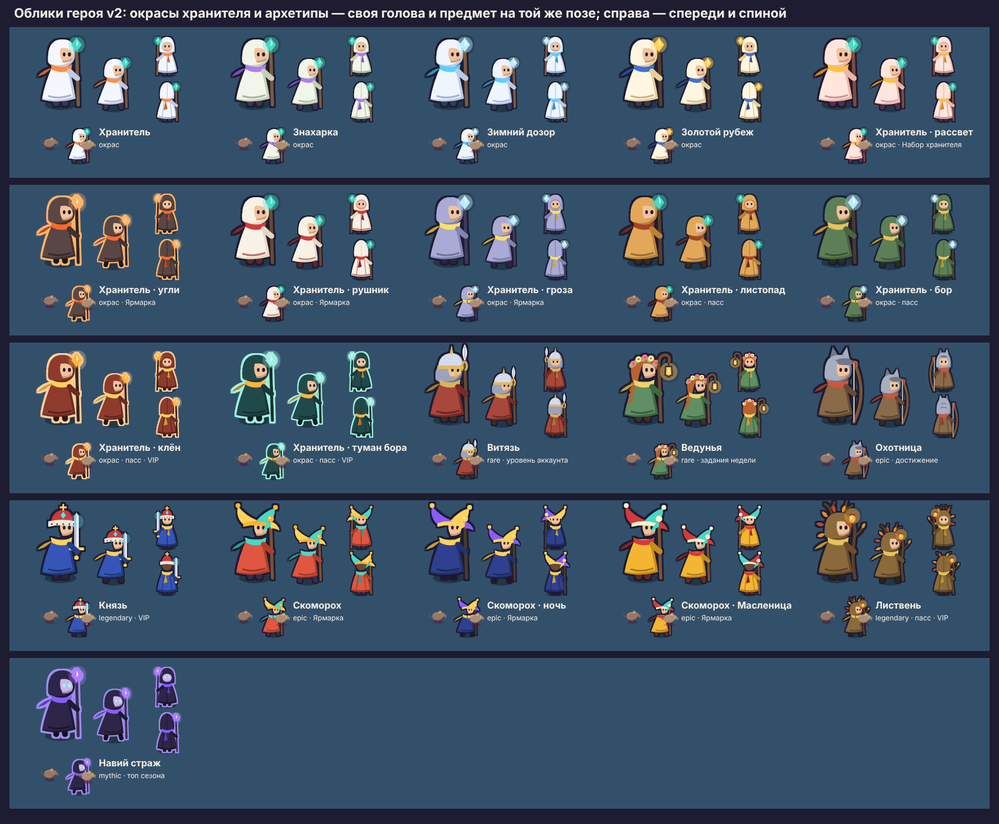

# Персонажи и 2D-ресурсы забега

> **Статус: черновик дизайнера `claude-design-10`, до одобрения тимлидом.**
> Спрайты готовы как файлы и проверены в прототипе арены
> (`prototype/arena.html`), в игру **не подключены**: это работа в зоне
> владельца (`packages/core-game/src/game/render/*`), план — в конце.

## 1. Исходное состояние

Мир забега рисуется фигурами, которые движок генерирует при старте сцены
(`core-game/src/game/render/shapes.ts`, `looks.ts`): враг — красный круг,
квадрат, клин, кольцо; герой — белый круг в тёмном канте. Это решение
«цвет по угрозе» (`design/README.md`, «Вид боя») — читаемое, но черновое:
у врагов нет характера, у героя нет образа, и игра не продаёт себя ни
скриншотом, ни видео.

*до и после* — кадр `out/preview/arena-before-after.jpg` в галерее.

Слева — нынешние фигуры, справа — эталонный набор в том же масштабе
(телефон 390×844, 220 врагов, снимок прототипа).

## 2. Художественное направление: сравнение и выбор


| Концепция | Что это | Плюсы | Минусы |
|---|---|---|---|
| **A · «Лубок»** | плоские формы с контуром тёмной вишни | лучшая читаемость на любом фоне | спорит с решением «у рядовых без обводки»; контур съедает мелких (крыса, нетопырь) в толпе — каша из тёмных колец |
| **B · «Тени Нави»** | тёмные силуэты, красная кайма и глаза | атмосферно, «страшно» | роль «враг — красный» слабеет до каймы; тёмное тело на средней земле теряется на ходу; тяжелее для стихийных тонов (тон состояния заливает тёмное тело) |
| **C · «Форма-предок»** — **выбрана** | два плоских тона без контура; силуэт наследует фигуру паттерна | органично развивает утверждённый «вид боя»: цвет по угрозе, ступень тоном, кайма ранга — всё на месте; заливка попадания и тона состояний работают как сейчас | без контура мелкие враги чуть слабее отделяются от земли — компенсируется тем, что земля — средний тон, а не тёмный |

**Почему C.** Она ничего не ломает из уже утверждённого: правила
`design/README.md` и `looks.ts` (цвет тела по паттерну, смешение ранга,
ступени, золотая кайма элиты и босса) переносятся в спрайты один к одному —
палитра спрайтов считается теми же функциями (`src/palette.mjs`). Смена
визуального языка проекта не нужна.

### Правила стиля

1. **Силуэт наследует фигуру-предка.** Крыса — шар, упырь — горбатый короб,
   волк — клин мордой вперёд, ворон — дуга крыльев, бес — шестигранный
   бочонок, слизень — два шара, нетопырь — лучи крыльев, вещун — глаз.
   Привычка игрока и гайдбук не теряют смысла.
2. **Два плоских тона.** Тело и тень снизу-справа (`twoTone`), плюс
   одна-две световые линии. Градиентов, бликов и текстур нет: на 20 px они
   — шум.
3. **Цвет — по угрозе.** Тело — цвет паттерна из `looks.ts`; тень и свет —
   сдвиг к сумеречному фиолетовому и к тёплому свету, а не к чёрному и белому.
4. **Глаза светятся** у тех, кто опасен на расстоянии или в рывке (упырь,
   ворон, бес, нетопырь); у остальных — обычные. Глаз — единственная
   светлая точка на красном теле и главный признак «смотрит на тебя».
5. **Контур — признак героя.** Только у героя тёмный кант по силуэту: так
   «я» читается в толпе красных тел без подсветки и стрелок.
6. **Тело ≈ хитбокс.** Масса тела занимает круг хитбокса; хвосты, крылья,
   копья выходят за него. Иначе урон приходит «не коснувшись» (поэтому
   ячейка — 1,75 радиуса, `CELL_K` в `src/build.mjs`).
7. **Элита и босс — кайма, а не новый цвет.** Золотая кайма 2 и 3 единицы,
   как в `enemyRim`. Элита — тот же вид, но вожак (упырь-вожак — упырь с
   костяным гребнем); босс — свой образ.

### 2.1. Палитра v2 — свой цвет существа (22.10.2026)

Мандат v2 (`direction-v2.md` §1) снял правило «враги — красные»: оно было
нужно фигурам. «Форма-предок» остаётся — силуэт по-прежнему наследует
фигуру паттерна, — но цвет теперь говорит о существе, а враждебность —
общие для всех врагов знаки:

- **горящие глаза**: рядовой — огненные, закалённый — золотые, древний —
  фиолетовые; ступень читается и глазами, и тоном тела (закалённый
  выцветает к кости, древний темнеет к Нави);
- **свечение Нави под ногами** — тёмно-вишнёвое пятно на земле, у героя и
  декора его нет;
- **кайма ранга** — золото у элиты и босса, как было.

Цвета тел — `SPECIES_COLOR` в `src/palette.mjs`; запретные — салатовый
(кристаллы), чистое золото (кайма, монеты), бирюза (обереги героя).
Сравнение v1 и v2 на трёх зонах — `out/sheet-palette.png`, в движке —
`out/preview/palette-v2-engine.jpg`. Режим фигур (без чернового арта)
остаётся с «цветом по угрозе»: круг без глаз иначе не прочитать.

### 2.2. Запланированные существа (облик до контента)

Облик готов раньше, чем задачи возьмут, — исполнителю не придётся
рисовать фигуру-заглушку (`out/sheet-planned.png`, записи с `planned` в
`ENEMY_ART`):

| id | Задача | Облик |
|---|---|---|
| `rubezh_guard` | T-0120 | **Чур** — хранитель границ славянских поверий: резной деревянный идол-воин с копьём и знаком-оберегом на груди, летит над землёй и оставляет след. Размер — `size: 2` по T-0120 (Р144); в забеге на 320 проверен, §2.3 |
| `cordon_guard` | T-0171 | **Щитоносец**: латник с круглым щитом, развёрнутым к игроку; кольцо таких стражей читается стеной щитов |
| `boss_ram` | T-0197 | **Таран** — зверь-баран, рога вперёд: силуэт острия, как у волка, но тяжёлый |
| `ice_spirit` | T-0281 | **Ледяной дух** — кристалл с осколками-крыльями и хвостом позёмки: кружит, как ворон, но читается холодом |
| `bog_lurker` | T-0282 | **Болотник** — приземистый водяной с жабьим ртом и камышом, с него капает: следом остаются лужи. От болотного увальня — ростом, ртом и парой глаз |
| `kikimora` | T-0283 | **Кикимора** — копна спутанных волос до земли, руки-коряги, глаза из-под чёлки: узкий высокий силуэт, его ищут глазами после исчезновения |
| `leshy` | T-0284 | **Леший** (элита) — кора вместо тела, рога-ветви, борода мха; руки уходят в землю — оттуда его корни |
| `boss_gorynych` | T-0285 | **Змей Горыныч** — три головы на шеях, крылья. Кадры по фазам `s0…s2`: пройденная голова гаснет и опускается, текущая светится тоном стихии — огонь, холод, ярость |

Снаряды и следы нового оружия, лужа Болотника, метки Кикиморы и корней —
тоже в `atlas-r157` (`fx/<id><кадр>`, лист `out/sheet-planned-fx.png`);
имена кадров — в задачах T-0281…T-0284, T-0288…T-0290.

Новый контент Р157 — в своём паке `atlas-r157` (§5): `late` не перерастает
2048 px, а видеопамять не растёт, пока этих врагов нет в забеге. Горыныч
нарисован в масштабе 0,8: тело — в хитбокс, головы и пламя — в клетку без
большого запаса, у него 12 кадров.

### 2.3. Проверки в забеге: Чур в размере и строй на 320 (31.10.2026)

Живой забег разработчика на 320×568, режим арта, бессмертие; лист —
`out/sheet-frame-fit.png` (очередь дизайнера, п. 4 и п. 10).

- **Чур при `size: 2`** — временной строкой контента, до T-0120. Идол в
  2,5 раза выше героя, золотая кайма босса толщиной как у остальных, след и
  тень под ногами на месте, полоса фаз читается. **Нашлось:** копьё и макушка
  выходили за клетку кадра −50…50, и атлас их срезал — на `size` 2 копьё
  кончалось плоским торцом в кайме. Тот же срез — у меча и плюмажа рыцаря,
  рога Барана, копья стража кольца, крыла ворона и шапки Провидицы.
  **Исправлено:** у врага в `ENEMY_ART` есть `pad` — запас клетки; клетка
  шире, масштаб рисунка тот же, движок берёт размер из пикселей кадра, и тело
  в мире не меняется. Запас мерит `src/frame-fit.mjs` (код выхода 1 — не
  влезает). Цена — +0,2 МБ видеопамяти у `late`.
- **Строй стражей на 320** — событие на 3:00, 24 стража, радиус 170. Строй
  читается стеной щитов, проход на месте убитых виден разрывом, стражи не
  путаются с роем. Кольцо радиуса 170 стоя занимает 89 % ширины: видно
  382 единицы мира стоя и 463 в движении. **Кольца 200 и 240** из
  бесконечного режима на 320 в первые 2–8 с шире кадра по бокам — там их
  показывает радар, а за эти секунды строй сжимается внутрь. Арт не
  меняется; если плейтест скажет, что проход сбоку теряется, — это радиус
  события (`content/waves.ts`), а не рисунок.
- **Облики героя — тот же срез** (31.10, п. 7 очереди): шлем Витязя, венец
  Князя, уши Охотницы, бубенцы Скомороха и его окрасов, рожки Листвня
  выходили за верх клетки. У облика в `HERO_SKINS` тот же `pad`; лист
  обликов и атласы `atlas-skin-<id>` рисуют с ним. Замер `frame-fit.mjs`
  теперь меряет поле в пикселях атласа (2 px) и сверяет собранные атласы: ни
  один кадр врага и облика не касается края слева, сверху и справа.
- **Не проверено:** телефон с GPU — снято в Chromium на SwiftShader. На
  первых забегах низ кольца закрывает подсказка «Проведи пальцем» — она
  уходит после обучения.

## 3. Ростер




**Облики героя** (G-05) — палитры того же рисунка (`HERO_SKINS` в
`src/hero.mjs`). Окрасы хранителя: Хранитель, Знахарка, Зимний дозор,
Золотой рубеж, Хранитель · рассвет («Набор хранителя», Р155) и три окраса
Ярмарки (Р154) — угли, рушник, гроза. Окрасы отличаются друг от друга тоном
плаща — белый, травяной, ледяной, сливочно-золотой, персиковый, угольный,
льняной с красным подолом, грозовой, — а не цветом роли. У тёмного плаща
(угли) кант светлый, как у Навьего стража: тёмный кант на тёмном плаще не
держит героя в толпе. Архетипы v2 — своя голова и предмет на той же позе
(`direction-v2.md` §7.3); у Скомороха два окраса Ярмарки — ночь и
Масленица. Пасс каждый месяц даёт окрасы хранителя и облик сезона —
архетип со своей головой и предметом; первый месяц «Листопад»: листопад,
бор, клён, туман бора и Листвень (капюшон в листьях, посох-коряга с
горящим жёлудем). Окрасов заработанных архетипов нет: за самоцветы они продавали бы
сам архетип.

**У каждого облика свой атлас** `out/atlas-skin-<id>.png` — шесть кадров,
только покой и шаг (ранение и смерть — кадры обычного героя), 7–9 КБ и
0,2–0,3 МБ видеопамяти. Игрок в забеге качает только свой; общий пак на все
облики весил бы 3,7 МБ видеопамяти уже на 15 обликах и рос бы с каждым
окрасом пасса. Новый окрас — строка палитры, без нового рисунка. В прототипе —
`?skin=keeper_ember`.


Подборы — `src/pickups.mjs`, кадры `pickup/<id>/<k>` в атласе `core`:
кристаллы четырёх ступеней (`GEM_TIERS`: цвет и размер растут с
ценностью, у двух старших — два кадра блика, у самого ценного — искра
внутри), аптечка, магнит, динамит с искрящим фитилём и сундуки трёх
размеров — закрытый и открытый (для окна наград). В прототипе кристаллы
падают с убитых и летят к герою в радиусе подбора.

| Персонаж | Паттерн | Фигура-предок → образ | Кадры | Статус |
|---|---|---|---|---|
| Хранитель рубежа (герой) | — | белый круг → светлый плащ с капюшоном, посох с бирюзовым оберегом, тёплый шарф | покой 2, шаг 4, ранение 1, смерть 4 | эталон, проверен в прототипе |
| Крыса `swarm_rat` | swarm | круг → шар с острой мордой и хвостом | шаг 4 × 3 ступени | эталон |
| Болотный увалень `mire_shambler` | swarm | круг → куча тины с одним большим глазом | 4 × 3 | черновик; хитбокс паттерна 7 мал для образа — §6 |
| Упырь `tank_ghoul` | chase | квадрат → горбатый, рука до земли | 4 × 3 | эталон |
| Костяной ходок `bone_walker` | chase | квадрат → высокий скелет | 4 × 3 | черновик: тонок, на 320 px проверить |
| Блуждающий огонёк `shooter_wisp` | kite_and_shoot | треугольник → язык пламени со злым лицом | 4 × 3 | эталон |
| Волк `dasher_wolf` | dash | клин → поджарый волк мордой вперёд | 4 × 3 (галоп) | эталон |
| Ворон `circler_crow` | orbit | кольцо → птица с раскрытыми крыльями | 4 × 3 (взмах) | черновик |
| Бес-подрывник `bomber_imp` | exploder | шестиугольник → бес с бочонком, фитиль искрит | 4 × 3 | эталон |
| Слизень `splitter_slime` | splitter | два круга → двойной шар | 4 × 3 (сжатие) | черновик |
| Нетопыри `rushing_bats` | rush | четыре луча → летучая мышь с перепонками | 4 × 3 (взмах) | эталон |
| Упырь-вожак `elite_ghoul` | chase · элита | упырь + костяной гребень + кайма | 4 | черновик |
| Могильный рыцарь `elite_grave_knight` | dash · элита | клин → таран с копьём и щитом | 4 | черновик |
| Вещун `boss_seer` | caster · босс | глаз → капюшон с одним оком, руны вокруг | 4 | эталон |
| Матрёшка `boss_matryoshka` | splitter · босс | два круга → кукла с горящим швом посередине | 4 (покачивание) | черновик |

Ступени (`content/stages.ts`) — запечённые варианты палитры: вторая
светлеет к золоту, третья темнеет к вишне, глаза у ступеней светлее
(`STAGES` в `src/palette.mjs` повторяет `STAGE_LOOKS`). Элиты и боссы
ступеней не получают — как в игре.

## 4. Направления и состояния

**Ракурс** — вид сбоку в три четверти, как у Vampire Survivors: камера
сверху, но персонажи «стоят» на земле. **У врагов направлений два: вправо и
отражение влево** (`flipX` по знаку скорости). Восемь направлений не нужны:
у врагов нет атак «в сторону», у героя нет прицеливания — направление
читается по морде и по движению, а восемь направлений умножили бы атлас
вчетверо.

| Состояние | Чем показано | Почему так |
|---|---|---|
| Шаг / полёт | 4 кадра цикла, ~8 кадров/с, фаза по номеру врага | меньше 4 кадров — рывками, больше — не видно на 20 px |
| Попадание | заливка белым `setTintFill`, как сейчас | уже работает в `WorldRenderer.applyLook`, кадров не нужно |
| Телеграф (рывок, фитиль, каст) | мигание заливкой, как сейчас + наклон волка по направлению рывка | телеграф уже читается; спрайт его не должен ломать |
| Тон состояния (горение, холод…) | заливка тоном стихии, как сейчас | заливка сохраняет силуэт по альфе — работает и на спрайте |
| Гибель врага | запечённое развеивание 6 кадров (`fx/death`), тинт цветом врага | одна текстура на всех; кадр смерти на каждого — ×14 атласа |
| Ранение героя | кадр отдачи + заливка красным | заливка — обратная связь, кадр — характер |
| Смерть героя | 4 кадра: оседает на колено и рассеивается бирюзой | падение плашмя не влезает в ячейку и читается как «ещё жив» |
| Покой героя | 2 кадра дыхания | герой стоит часто — неподвижная картинка выглядит паузой |

### 4.1. Герой в четыре стороны (Р143, 31.10.2026)

Герой — единственный, на кого игрок смотрит весь забег, поэтому у него
четыре стороны: вправо, влево (тот же бок зеркалом), **спереди** и
**спиной**. Спереди и спиной — свои кадры покоя (2), шага (4) и отдачи (1),
смерть одна: герой оседает боком в любую сторону.

| Движение | Вид | Кадры | Предмет в руке |
|---|---|---|---|
| вправо и по диагонали | бок | `hero/idle0…1`, `hero/walk0…3`, `hero/hurt0` | справа |
| влево и по диагонали | бок зеркалом (`flipX`) | те же | слева |
| вниз по экрану | спереди, лицом к игроку | `hero/front/idle0…1`, `walk0…3`, `hurt0` | слева на экране — в правой руке героя |
| вверх по экрану | спиной | `hero/back/idle0…1`, `walk0…3`, `hurt0` | справа |

Правила выбора — для задачи движка «поза по направлению»:

- **Бок — основной вид.** Спереди или спиной — только когда движение
  заметно вертикальнее горизонтали: |vy| больше |vx| в 1,5 раза, то есть
  в пределах 34° от вертикали. Диагональ остаётся боком: у бокового вида
  читаются посох и шаг, а передний силуэт уже и в толпе теряется быстрее.
- **Без дрожания.** Новый вид включается, когда направление продержалось
  0,15 с; шатание джойстика у границы 34° не перебирает виды каждый кадр.
  Выбор вида — дело рендера, в симуляцию и снимок забега он не входит.
- **Стоит — смотрит туда же.** Остановился — покой того вида, в котором
  шёл; отдача — кадр того же вида.
- **Зеркала у переднего и спинного вида нет.** Предмет в руке у них
  нарисован на своей стороне; `flipX` сбрасывается при переходе с бока.
- **Облики.** У каждого облика в своём атласе `atlas-skin-<id>` — те же
  `hero-<id>/front/…` и `hero-<id>/back/…`, только покой и шаг, как и у
  бокового вида; отдача — кадр обычного героя.

Головы архетипов анфас и с затылка — те же детали, что в профиль:
шлем с наносником, венок с косой, волчьи уши, шапка с мехом, колпак с
бубенцами, рожки Лиственя. Под шапкой со спины — волосы (`hair` палитры
героя), а не кожа: на 20 px светлый затылок читался вторым лицом. Лист —
`out/sheet-hero.png` (кадры и четыре стороны в игровом масштабе),
облики — `out/sheet-skins.png`; поля кадра проверяет
`src/frame-fit.mjs`.

## 5. Форматы и вес

**Выбор: запечённые спрайт-листы в атласах + процедурные трансформации.**

| Подход | Качество | Трудозатраты | Вес и память | Вывод |
|---|---|---|---|---|
| Процедурные фигуры (сейчас) | заглушка | ноль | минимум | остаются запасным видом и режимом «Упрощённая графика» |
| **Векторный рисунок → запечённый атлас** | ровный стиль, любые варианты палитры бесплатно | средние: рисунок кодом, кадр — параметр | 2 атласа по ~1024×1100–1450, 67 + 83 КБ PNG | **выбран** |
| Покадровая ручная анимация (Aseprite) | лучшая выразительность | высокие: каждый кадр × ступень × рост ростера | как у выбранного | для боссов и героя на чистовом этапе |
| Составные модели из частей (кости) | гибко | высокие, своя система анимации | меньше атлас, больше объектов в кадре | сотни врагов × 5 частей = ×5 спрайтов — против бюджета кадра |
| Шейдеры и процедурная графика | эффектно | высокие | вызов на объект | только для полноэкранного (виньетка, ночь), не для тел |

**Почему векторный рисунок кодом.** Генератора изображений в этой среде
нет, а рисунок кодом даёт то, что для проекта важнее: одна правка формы
обновляет все кадры, ступени и ранги; палитра считается теми же числами,
что у движка; сборка повторяется побайтно. Ограничение — рисунок проще
ручного; для чистового этапа рисунки кодом становятся эталоном пропорций
и цвета для художника (§7).

**Плотность атласа** — 2,5 пикселя на игровую единицу. Телефон 390×844 с DPR 3
видит 2,8 физ. пикселя на единицу в движении и 3,4 стоя: растяжение не
больше 1,35×, плоский рисунок его не выдаёт. 3 пикселя дают атлас на треть
тяжелее без видимой разницы на телефоне (`ART_PPU=3` — проверить на
планшете).

| Файл | Кадров | Размер | PNG / WebP | Видеопамять |
|---|---|---|---|---|
| `out/atlas-core.png` — герой в четыре стороны, враги первых трёх минут, подборы, эффекты | 155 | 1020×1012 | 94 КБ | 3,9 МБ |
| `out/atlas-late.png` — остальные враги, элита, боссы | 92 | 1024×1588 | 113 КБ | 6,2 МБ |
| `out/atlas-r157.png` — новый контент Р157: пять врагов (Горыныч по фазам), снаряды и следы четырёх оружий с эволюциями, лужа Болотника, метки Кикиморы и корней; грузится с контентом T-0281…T-0290 | 80 | 1008×1716 | 125 КБ | 6,6 МБ |
| `out/atlas-skin-<id>.png` — облик героя, только свой и по требованию; бок, спереди и спиной | 18 | ~960×236–264 | 19–24 КБ | 0,9–1,0 МБ |
| `out/atlas-env.png` — декор и тайники | 33 | 1020×324 | 23 КБ | 1,3 МБ |
| `out/ground-neutral.webp` — земля, цвет зоны — окраской по вершинам (`environment.md`) | 1 | 512×512 | 4 КБ | 1 МБ |

Кадры **обрезаны по альфе** (`trimmed` в JSON Phaser): в атлас идёт только
непрозрачная часть с полем в пиксель, а Phaser ставит её на место в исходной
ячейке — центр, масштаб и якорь спрайта прежние. Тело занимает 57–70 %
бывшей ячейки: атлас на треть меньше в видеопамяти, и на каждого врага
заливается меньше прозрачных пикселей (A-06).

Атласы — палитра 256 цветов с альфой (`src/quantize.py`): плоский рисунок
ложится без видимых потерь, PNG легче в 4–5 раз (полноцветный `core` —
329 КБ). Пак `core` весит меньше чанка движка — как требует
`docs/27-design-system-and-app-shell.md` §3.5. Половину `late` занимают боссы
(кадр 294 px); если видеопамять станет узким местом — у боссов 2 кадра
вместо 4, они медленные.

## 6. Ограничения и открытые вопросы

- **Хитбокс задаётся паттерном, а не врагом.** Болотный увалень — тяжёлый
  танк — живёт в хитбоксе роя (7 единиц) и потому выглядит мелким. Нужен ли
  множитель размера у врага в контенте — решение тимлида (сейчас правило
  «свободного размера нет», `CLAUDE.md`).
- **Облик — по врагу, а не по паттерну.** Сейчас вид врага берётся из
  паттерна (`ENEMY_LOOKS`), поэтому костяной ходок выглядит как упырь, а
  рыцарь — как волк. Спрайты ключуются по `id` врага с запасным видом по
  паттерну — это меняет контракт `looks.ts` и гайдбука.
- **Тень под врагом** снята после живого теста (T-0096). В спрайтах её нет;
  у героя тень запечена, как сейчас.
- **На устройстве не проверено.** Прототип снят в Chromium без GPU
  (SwiftShader). Чек-лист приёмки — `checklists.md`.

## 7. Интеграция

**Сделано — за флагом разработчика.** Лист режима разработчика → «Вид» →
«Черновой арт: спрайты вместо фигур» (`RunDevVisuals.sprites`). Движок
по первому включению грузит атласы `core` и `late` прямо из `design/art/out`
и рисует героя и врагов кадрами: шаг по тику, отражение по ходу с порогом,
порядок врагов по `y` в своём подслое, попадание, телеграф и тон
состояния — прежней заливкой. Там же — кристаллы, аптечки, магниты,
динамит и сундуки кадрами `pickup/*` и развеивание гибели `fx/death*`
вместо кольца. В режиме арта враги рисуются под героем (спрайты крупнее
фигур, и толпа прятала героя), а вспышка попадания у спрайта короче —
3 тика и раздувание ×1,1 (F-06). Земля и декор — тоже: нейтральная
плитка с окраской по вершинам и декор кучками по чанкам
(`render/art-ground.ts`, перенос решения из прототипа, `environment.md`).

*движок: полный черновой арт* — кадр `out/preview/engine-full-art.jpg` в галерее. Выключено — забег рисуется ровно как
раньше. Код — `core-game/src/game/render/art-atlas.ts` (`ArtMode`), в
`WorldRenderer` — только вызовы; тест — `core-game/test/art-atlas.test.ts`.

*движок: фигуры и черновой арт* — кадр `out/preview/engine-shapes-vs-sprites.png` в галерее.

Слева — фигуры, справа — черновой арт в настоящем забеге на 4-й минуте.
Видно две вещи для решения: белая заливка попадания на крупной элите
громкая (F-06), кольцо здоровья режет спрайт героя (F-05).

Ниже — что остаётся для полной интеграции после одобрения направления.

1. **Загрузка.** `core` — в этап «Мир» экрана загрузки, `late` — в фоне после
   первого кадра; до прихода `late` враг рисуется нынешней фигурой того же
   размера и цвета (`docs/27` §3.5, «Забег не ждёт необязательного»).
   Манифест пака — с хэшем в имени и размером в байтах.
2. **`WorldRenderer`.** Текстура врага — кадр атласа
   `${id}/s${stage}/walk${k}` вместо `ensureShapeTexture`; масштаб спрайта —
   `unitScale / PPU`. Кадр шага считается из тика симуляции и номера врага:
   `((tick + i * 7) >> 3) & 3` — без нового состояния в мире. Смена кадра —
   только при смене индекса, как сейчас с видом (`enemySpriteLook`).
3. **Направление** — `flipX` по знаку `vx` с гистерезисом (`Uint8Array`
   последнего направления, порог ~0,2 скорости): иначе враг, бегущий
   вертикально, мерцает отражением. Поворот клина у волка заменяется
   наклоном ±15° по вертикальной составляющей рывка.
4. **Попадание, телеграф, тон состояния** — без изменений: `setTintFill`
   работает по альфе спрайта.
   **Порядок по `y`** — новое: у фигур сверху порядок отрисовки был не
   важен, а у спрайтов вида сбоку нижний обязан перекрывать верхнего, иначе
   толпа на 400 врагах — каша (видно в прототипе). Глубина = `y` раз в кадр;
   если сортировка тысячи объектов окажется заметной в профиле — полосами по
   8 единиц.
5. **Гибель** — `fx/death` из пула вспышек `CombatFeedback`, тинт цветом
   врага; кадр — каждые 3 тика.
6. **Гайдбук** — рисует тот же кадр атласа (CSS `background-position` по
   JSON атласа), а не фигуру: «картинка в гайдбуке совпадает с канвой».
7. **Настройки** — переключатель «Упрощённая графика» возвращает фигуры:
   слабым устройствам и тем, кому так читаемее.
8. **Сборка атласов** — `node design/art/src/build.mjs` переезжает в
   `scripts/art/` после одобрения; атласы коммитятся готовыми (Chromium в CI
   ради них не ставим), а тест сверяет, что у каждого врага из
   `content/enemies.ts` есть кадры в атласе.
9. **`pnpm budget`** — строка «Арт забега: core» с порогом ~90 КБ.

На баланс и golden-тесты спрайты не влияют: это рендер, `CONTENT_HASH` не
меняется.

## 8. Как пересобрать

```bash
node design/art/src/build.mjs       # атласы, земля, отчёт о весе
node design/art/src/previews.mjs    # листы концепций, бестиария и героя
```

Нужны Playwright с Chromium (`PLAYWRIGHT_MODULE` — путь к его `index.mjs`) и
Pillow для палитры. Новый враг — функция рисунка в `src/creatures.mjs` и
строка в `ENEMY_ART`; ступени, ранг и кайма добавятся сами.
