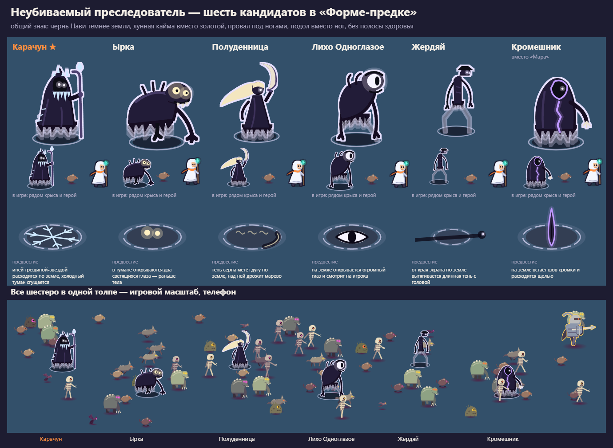

# Неубиваемый преследователь: концепты кандидатов

> **Статус: черновик дизайнера `claude-design` (10.11.2026) на выбор
> владельца.** Механики в игре нет, задачи нет. Облик — концепт в языке
> «Формы-предка» (`../../characters.md` §2, `../../direction-v2.md`), не
> кадры атласа.

Задача владельца: враг, которого нельзя убить, как Немезис из Resident Evil
или Дахака из Prince of Persia. Появляется внезапно и с любой стороны:
сначала предвестие (холодный туман и звук за ~1,5 с), потом погоня 15–30 с (Р223),
потом растворяется и выходит снова неизвестно когда. Касание — тяжёлый удар
(около трети здоровья) с отбросом. Удары оружия его не убивают, а только
ненадолго отталкивают. Курс на врагов — славянская мифология: малоизвестные
фигуры, без Кощея.

## Что в папке

| Файл | Что это |
|---|---|
| `sheet-stalkers.png` | сводный лист: шестеро рядом, крупно и в игровом масштабе, предвестие, все в одной толпе |
| `sheet-<id>.png` | лист кандидата: крупный план, 4 кадра шага, палитра, предвестие по времени, выход → погоня → мерцание → растворение, сцена забега на телефоне и сравнение с упырём, элитой и боссом |
| `<id>.svg`, `<id>-omen.svg` | рисунок и предвестие вектором |

Пересборка: `node design/art/src/stalker-concepts.mjs`. Нужен Playwright
(`PLAYWRIGHT_MODULE`). Если своего Chromium у Playwright нет, задайте
`PW_CHANNEL=chrome`: возьмётся установленный Chrome.

## Общий знак неубиваемого

Игрок должен с первого взгляда отличить его от элиты и босса, иначе он будет
тратить на него удары. Знак общий для любого кандидата:

- **Тело — чернь Нави**, темнее земли и любого врага. Тёмный ворон рядом с
  ним светлее.
- **Кайма лунная, а не золотая.** Толщина та же, что у элиты, 2 единицы.
  Золото значит «убей, получишь награду», бледная кайма — «не трогай».
- **Под ногами провал с бледным кольцом**, а не свечение Нави.
- **Ног нет.** Низ тела — рваный подол тремя плоскими ступенями
  прозрачности: он не стоит на земле. У Лиха и Жердяя ноги есть, но
  полупрозрачные.
- **Полосы здоровья нет.**
- **Размер — между рядовым и элитой**, радиус 15–18 единиц, у Жердяя
  13 и высокий кадр. Ростом он с героя или выше.

Предвестие у каждого своё, но с общей основой: тёмное пятно холодного тумана
с прерывистым бледным кольцом растёт полторы секунды. Сверху — знак
кандидата.

## Кандидаты

| Кандидат | Миф простыми словами | Предвестие | Движение | Плюсы для игры | Минусы |
|---|---|---|---|---|---|
| **Карачун** ★ | Дух внезапной смерти и самой длинной ночи года. Само слово значит «внезапная смерть»: «пришёл карачун». | иней трещиной-звездой расходится по земле, туман сгущается | шагает ровно и не спеша, за ним тает иней | механика заложена в имени; холодный туман из задания — его природа, а не натяжка; высокий силуэт в капюшоне с посохом не путается ни с кем; слово знакомо по присказке, но как персонаж почти не занят | иней близок к стихии холода (тон заморозки `#b8ecff`), поэтому холод у него только в мелких сосульках, а тело тёмное; слово грубовато звучит («дать карачун») |
| **Ырка** | Ночной дух полей, душа, которую не приняла земля. Ходит за одинокими путниками, глаза светятся; оглянешься — пропал. | в тумане открываются два глаза раньше тела | крадётся низко, перебежками | миф прямо про преследование путника; глаза в темноте пугают и хорошо читаются; почти неизвестен | приземистый силуэт похож на упыря и болотника; «душа самоубийцы» в мифе — тема, которую в описании лучше обойти |
| **Полуденница** | Полевой дух зноя: дева с серпом, наказывает тех, кто работает в полдень. | тень серпа метёт дугу, дрожит марево | скользит, волосы текут назад | серп — ясная угроза, силуэт уникален | зной спорит с сумеречным миром и с холодным туманом из задания; по мифу она в белом, а светлое тело — знак героя; серп уже есть у оружия «Серп» (Р157) |
| **Лихо Одноглазое** | Тощее одноглазое чудище, воплощённая беда: привяжется — ходит по пятам. | на земле открывается глаз | ходит вразвалку, руки до земли | «Не буди лихо, пока оно тихо» — готовая подпись; глаз смотрит на игрока | самый известный из шести (сказка); один огромный глаз повторяет уходящего Вещуна (T-0172) |
| **Жердяй** | Долговязый ночной дух, заглядывает в окна. | от края экрана тянется длинная тень с головой | переступает толпу, качаясь, голова над всеми | самый узнаваемый силуэт в толпе: вертикаль выше всех; предвестие-тень читается издали | тонкий, поэтому масса тела не совпадает с кругом хитбокса: касание «не коснувшись» на ногах; высокий кадр дороже в атласе; миф скорее смешной, чем страшный |
| **Кромешник** (вместо Мары) | Житель «кромешного» мира, того, что за кромкой. Кромка и есть рубеж: выходит из щели между мирами, лица нет. | на земле встаёт шов кромки и расходится щелью | выходит из щели, уходит в новую | имя связано с названием игры (кромка = рубеж); щель — ясное «откуда появится» | фигура книжная, не из быличек; «кромешники» — ещё и прозвище опричников; щель Нави близка к тайнику «Разлом Нави» (Р153), их легко спутать |

**Почему Кромешник вместо Мары.** Мара (Морена) тоже дух смерти и зимы и
повторяет Карачуна, но она известнее: чучело на Масленицу, Морана в играх и
кино. Кромешник незнаком и даёт другую идею появления: щель в мире вместо
тумана.

## Рекомендация

**Карачун.** Имя прямо значит «внезапная смерть», и этим и занимается враг.
Холодный туман за полторы секунды — его собственная стужа, а не украшение
сверху. Силуэт старика в капюшоне с посохом высокий и тёмный и не путается
ни с элитой, ни с боссом, ни с рядовыми.

Запасной вариант — **Жердяй**, если важнее всего читаемость в толпе:
вертикаль выше всех видна сразу. Но хитбокс у него придётся решать отдельно.

## Что нужно до задачи

- **Звук предвестия** — скилл `game-sound`, класс «угроза»: холодный выдох
  с нарастанием за 1,5 с, отличный от телеграфа рывка.
- **Цвет** нового тела и лунной каймы сначала добавить в
  `packages/core-game/src/game/render/looks.ts` (задачей движка), потом в
  палитру арта.
- **Поведение** — новый паттерн (появление, погоня, отталкивание вместо
  урона, растворение). Это код владельца, его продумывают скиллом
  `game-design`.
- **Гайдбук**: строка «его нельзя убить — уходи». Иначе первый же игрок
  будет стрелять в него до смерти.
- **Настройки**: предвестие и удар обязательны для чтения боя, под
  «Эффекты оружия» они не выключаются.
- Что не проверено: телефон, движение в прототипе арены, цветовая слепота
  (`src/cvd.py`).
