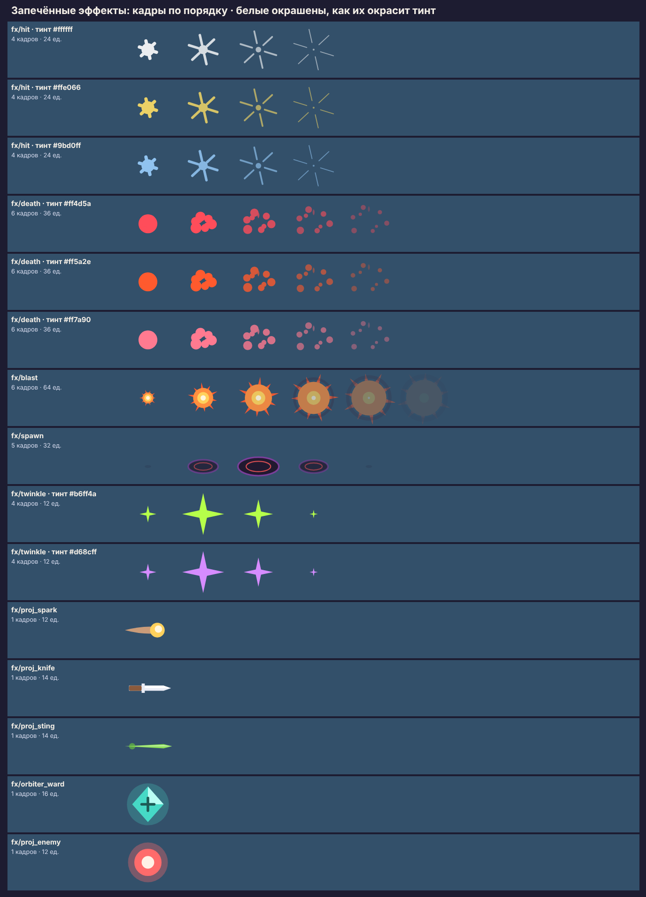

# Анимации и эффекты

> **Статус: черновик, до одобрения тимлидом.** Запечённые эффекты лежат в
> атласе `out/atlas-core.png` (кадры `fx/*`) и проверены в прототипе арены;
> в игре — нынешние процедурные эффекты, их разбор — §3.

## 1. Правила

1. **У эффекта есть работа.** Сообщить: попал, убил, сейчас ударит, подобрал,
   вырос. Эффект без вопроса, на который он отвечает, — не делаем.
2. **Угроза важнее награды, награда важнее украшения.** Телеграф врага не
   перекрывается ничем; числа урона и искры — под телеграфами по глубине.
3. **Короче, чем кажется.** Искра — 0,13 с, развеивание — 0,3 с: к следующему
   попаданию предыдущее уже исчезло. Длинный эффект в толпе — это туман.
4. **Без свечения поверх.** Свечение — только слабый ореол самого объекта
   (снаряд, оберег); полноэкранных вспышек и `ADD`-смешивания на толпе нет:
   на сотне врагов они выжигают картинку и заливку GPU.
5. **Пул и потолок.** Каждый вид эффекта — пул с потолком одновременных
   (`MAX_BURSTS`, `MAX_BLASTS` — уже так); сверх потолка — перезапись
   старейшего, а не новый объект.
6. **Время — в тиках симуляции**, как сейчас: на паузе эффекты замирают.
7. **Под переключатель.** Всё, кроме обратной связи о попадании по игроку и
   телеграфов, выключается «Эффектами оружия» (`docs/27` §7.1).

## 2. Что запекать, что оставлять процедурным

| Эффект | Решение | Почему |
|---|---|---|
| Искра попадания | **запечь** 4 кадра, белая, тинт стихии | сотни за забег, форма не зависит от обстоятельств |
| Развеивание гибели | **запечь** 6 кадров, серое, тинт цвета врага | одна текстура на всех врагов вместо кадра смерти у каждого |
| Взрыв беса | **запечь** 6 кадров, свой цвет | огонь всегда огонь; радиус — масштабом спрайта |
| Вход из Нави (спавн) | **запечь** 5 кадров | нового в игре нет: враги сейчас возникают из воздуха за краем |
| Блеск подбора | **запечь** 4 кадра, тинт ступени | мерцание ценного кристалла сейчас — процедурное, кадры дешевле |
| Снаряды оружий | **запечь** по кадру на оружие | вместо одинаковых жёлтых точек — искра, нож, жало, камень-оберег |
| Аура «Очага» | **процедурная** | радиус растёт с уровнем, кадры пришлось бы масштабировать с потерей толщины линии |
| Молния «Грозы» | **процедурная** | путь каждый раз новый, это и есть её характер |
| Волны магнита и динамита | **процедурные** | радиус из события, кольцо — дешёвая текстура |
| Телеграфы (кольцо, полоса, прицел) | **процедурные** | длина и направление из параметров паттерна |
| Числа урона | **процедурные** (текст) | уже с потолком 18 и слиянием попаданий; менять не нужно |

## 3. Разбор нынешних эффектов

| Эффект в коде | Оценка | Предложение |
|---|---|---|
| Вспышка попадания по врагу: белая заливка + масштаб 1,25 (`applyLook`) | работает | оставить; со спрайтами масштаб 1,25 снизить до 1,12 — крупный спрайт «прыгает» сильнее круга |
| Вспышка гибели `bh-burst` — кольцо цвета врага | читается как «щёлк», без материала | заменить на `fx/death`: клочья цвета врага и искра души |
| Взрыв `bh-blast` — кольцо | бес взрывается кольцом — нет огня | заменить на `fx/blast` |
| Мигание телеграфа (рывок медленнее, фитиль чаще) | хорошая грамматика | оставить; на спрайте добавить наклон волка по рывку |
| Кольца здоровья и опыта вокруг героя | читаются, но со спрайтом героя кольцо режет капюшон и посох | §5, предложение П-кольца |
| Числа урона | хорошо: потолок, слияние | крит — жёлтый, как в «Виде боя»; проверить, что не перекрывает телеграф (глубина) |
| Подскок кристалла, мерцание ценного | хорошо | мерцание — кадрами `fx/twinkle` |
| Кольца лечения, щита, магнита | работают | оставить |

## 4. Каталог запечённых эффектов

| Кадр атласа | Событие | Длительность | Размер | Тинт | Взаимодействие | Реализация в Phaser |
|---|---|---|---|---|---|---|
| `fx/hit0–3` | попадание снаряда/удара | 4 кадра × 2 тика ≈ 0,13 с | 24 ед. | стихия оружия (`STATUS_TONE_COLORS`), без стихии — белый | под числами урона; не больше 3 новых за кадр (как числа) | пул `Image` в `CombatFeedback`, кадр по тику |
| `fx/death0–5` | враг убит игроком | 6 × 3 тика ≈ 0,3 с | 36 ед. × радиус/10 | цвет врага (`colorByType`) | заменяет `bh-burst`; потолок `MAX_BURSTS` | тот же пул, что `bh-burst` |
| `fx/blast0–5` | `SIM_EVENT.explosion` | 6 × 3 тика | масштаб до радиуса взрыва | нет | под телеграфами; над врагами | `startBlast` с кадрами вместо кольца |
| `fx/spawn0–4` | появление врага (по новому слоту в пуле) | 5 × 5 тиков ≈ 0,4 с | 32 ед. | нет | только в поле зрения; за краем — не играть | новый пул; кадр спавна у элиты и босса крупнее |
| `fx/twinkle0–3` | ценный кристалл лежит | цикл 48 тиков | 12 ед. | цвет ступени кристалла | — | вместо процедурного мерцания в `PickupRenderer` |
| `fx/proj_spark`, `proj_knife`, `proj_sting`, `orbiter_ward`, `proj_enemy` | снаряды | — | 12–16 ед. | нет | поворот по скорости — `projectileLook` | текстура по виду оружия вместо `bh-projectile` |

**Сколько это стоит.** Все кадры — в атласе `core` вместе с героем и
врагами: смена эффекта не ломает батч (одна текстура). Одновременно на
экране при плотном бою: ≤24 развеиваний, ≤24 взрывов/волн, ≤18 чисел,
≤~30 искр — порядок сотни квадов, против сотен врагов.

**Проверено:** развеивание, искра и спавн — в прототипе арены на 220 и 400
врагах (визуально, Chromium). **Не проверено:** снаряды в движении и блеск
кристалла — в прототипе их нет; на устройстве — ничего.

## 5. Предложения

- **П-кольца.** Кольца здоровья и опыта — эллипсом у ног героя, а не кругом
  вокруг тела: спрайт выше круга, и кольцо режет капюшон. Эллипс у ног
  читается как «пятно под героем», как в ARPG. Решение — тимлиду: кольца
  утверждены вместе с «Видом боя».
- **Наклон по рывку.** Волк и рыцарь на рывке — наклон ±15° по вертикальной
  составляющей скорости вместо поворота клина.
- **Покачивание шага.** Для врагов без кадров (если атлас не пришёл):
  процедурное покачивание ±4° по фазе — фигура перестаёт «скользить».
- **Вход из Нави только у крупных.** Если 400 входов в минуту окажутся шумом
  на плейтесте — оставить вход элите, боссу и событиям «кольцо»/«фланг».

## 6. Интерфейс: переходы и анимации

Движение интерфейса — токены `docs/27` §4.5 (длительности и кривые), правила
— только `transform` и `opacity`. Что предлагается в рамках этой работы:

| Где | Сейчас | Предложение |
|---|---|---|
| Выбор улучшения | окно появляется целиком | карточки — лесенкой по 40 мс снизу; выбранная — короткий «вдавленный» масштаб 0,97 и уход вверх |
| Награда дня, сундук | число появляется сразу | счётчик набегает за 400 мс; монеты — горстью к балансу в шапке (траектория — `transform`) |
| Новый уровень аккаунта | строкой на экране смерти | полоса доливается до конца, затем кольцо с открытым предметом — §4.4 `docs/27` |
| Свечение плитки награды на главной | круглое пятно за квадратной плиткой, мигает | свечение формой плитки (скругление `--radius-md`), не мигать — реестр, U-05 |

Макет состояния выбора улучшения и награды — `mockups/ui-fixes.html`.
