# Схемы: база данных и архитектурные связи

Единственное место, где живут диаграммы проекта. Формат — Mermaid: он
рендерится прямо в GitHub и в редакторах, лежит в git текстом, поэтому
изменения видны в диффе, а не скрыты внутри картинки.

## Правило поддержки

**Схема, отставшая от кода, хуже отсутствующей** — ей верят, а она врёт.
Отсюда требование:

1. Меняется схема БД — **в том же PR** обновляется §1.
2. Меняются связи между пакетами, модулями или сервисами — обновляется §2-§3.
3. Появляется новый значимый поток (новый способ оплаты, новая интеграция) —
   добавляется диаграмма в §4.
4. Проверка входит в подготовку PR (скилл `pre-pr`, шаг 5).

Пока схема БД маленькая, диаграммы ведутся руками. Когда таблиц станет
больше полутора десятков — подключаем генерацию ER-диаграммы из
`schema.prisma` и проверку в CI, что закоммиченная диаграмма совпадает со
сгенерированной. До этого автоматика дороже пользы.

Диаграммы отвечают на вопрос «как связано», а не «как устроено внутри» —
подробности живут в профильных документах, ссылки под каждой схемой.

---

## 1. База данных

### 1.1 Текущая схема (что есть в базе сегодня)

Соответствует `backend/api/prisma/schema.prisma`. Таблицы появляются вместе с
кодом, который в них пишет, а не лежат пустыми заранее.

```mermaid
erDiagram
    ACCOUNT {
        uuid account_id PK
        enum platform "telegram|max|vk|web"
        string platform_user_id "id на стороне площадки"
        string display_name
        string username "nullable"
        string photo_url "nullable"
        datetime created_at
        datetime last_seen_at
        datetime banned_at "nullable: отметка блокировки целиком для входа — из ACCOUNT_RESTRICTION"
        string ban_reason "nullable: текст игроку — что, до когда и почему"
        datetime tester_at "nullable: знак «Тестер» — играл до вайпа; ставится снимком, навсегда"
        string platform_name "nullable: ник с площадки как пришёл, до 256 знаков; обновляется при каждом входе, виден только в панели"
        datetime name_locked_at "nullable: ник закреплён модератором, вход display_name не перезаписывает"
        datetime supporter_at "nullable: знак «Поддержал проект» (Р109) — когда подтверждён первый донат; снимается внешним возвратом, если других донатов нет"
    }

    ACCOUNT ||--o{ ACCOUNT_ROLE : "имеет"
    ACCOUNT ||--o{ RUN : "играет"
    ACCOUNT ||--o{ PURCHASE : "оплачивает"
    RUN |o--o{ PURCHASE : "продолжен за; вайп обнуляет ссылку"
    PURCHASE ||--o{ PURCHASE : "продлена"
    ACCOUNT ||--o{ ACCOUNT_SESSION : "запускает игру"
    ACCOUNT ||--o| ACQUISITION : "пришёл через"
    ACCOUNT ||--o| ACCOUNT_FUNNEL : "прошёл вехи"
    ACCOUNT ||--o| ACCOUNT_MESSAGING : "можно ли писать"
    ACCOUNT ||--o{ WALLET_ENTRY : "журнал кошелька"
    ACCOUNT ||--o{ WALLET_BALANCE : "баланс по ресурсу"
    ACCOUNT ||--o{ WALLET_DAILY : "начислено за сутки"
    ACCOUNT ||--o{ ITEM : "инвентарь"
    ITEM ||--o{ ITEM_EVENT : "журнал предмета"
    ACCOUNT ||--o{ RUN_BOOST : "бусты на забег"
    ACCOUNT ||--o| ACCOUNT_PROGRESS : "уровень и опыт"
    ACCOUNT ||--o| ACCOUNT_SETTINGS : "настройки для всех устройств"
    ACCOUNT ||--o{ NOTIFICATION : "лента уведомлений"
    ACCOUNT ||--o| DAILY_REWARD : "награда дня"
    ACCOUNT ||--o| CHANGELOG_SEEN : "открывал журнал обновлений"
    CHANGELOG_SOURCE |o--o| CHANGELOG_ENTRY : "строка пришла из PR"
    ACCOUNT ||--o{ RUN_REWARD : "награды за забеги"
    ACCOUNT ||--o| FRIEND_LINK : "ссылка дружбы"
    ACCOUNT ||--o{ FRIENDSHIP : "дружит (обе стороны пары)"
    ACCOUNT ||--o{ FRIEND_REQUEST : "заявки: от кого и кому"
    ACCOUNT ||--o{ FRIEND_GIFT : "подарки: от кого и кому"
    ACCOUNT ||--o| REFERRAL_BINDING : "кем приглашён — один раз"
    ACCOUNT ||--o{ REFERRAL_BINDING : "кого пригласил"
    ACCOUNT ||--o{ FRIEND_RETURN : "вернулся по ссылке друга / помог вернуть"
    ACCOUNT ||--o{ FRIEND_BONUS : "забранные ступени бонуса за друзей"
    LINK ||--o{ LINK_CLICK : "клики; краулеры превью и проверки доступности не пишутся"
    LINK_CLICK ||--o{ ACCOUNT_SESSION : "start_ref = click_id"
    LINK |o..o{ ACCOUNT_SESSION : "start_ref = auto_key, вид tagged (Р116), без внешнего ключа"
    LINK ||--o{ AD_CONVERSION : "конверсии в сеть ссылки"
    LINK_CLICK ||--o{ AD_CONVERSION : "клик, который привёл новичка"
    ACCOUNT ||--o{ AD_CONVERSION : "новичок из рекламы"
    PURCHASE |o--o{ AD_CONVERSION : "оплата — первая или повторная покупка, по строке на назначение"
    FEATURE_FLAG }o..o{ ACCOUNT : "доля — хэш ключа и аккаунта, без хранения"
    BROADCAST ||--o{ BROADCAST_DELIVERY : "доставка каждому получателю"
    ACCOUNT ||--o{ BROADCAST_DELIVERY : "получал рассылки"
    BROADCAST }o..o| LINK : "кнопка — ссылка кампании, без внешнего ключа"
    ACCOUNT ||--o{ WHEEL_SPIN : "крутки колеса"
    ACCOUNT ||--o{ TASK_PROGRESS : "прогресс заданий по срокам"
    TASK_DEF ||--o{ TASK_PROGRESS : "цель каталога"
    TASK_DEF ||--o{ TASK_PARTICIPANT : "игроки партнёрской цели"
    ACCOUNT ||--o{ TASK_PARTICIPANT : "переходы и выполнения партнёрских целей"
    MEDIA_IMAGE |o--o{ TASK_DEF : "картинка 1:1 партнёрской цели"
    MEDIA_IMAGE |o--o{ HOME_SLIDE : "картинка 1:1 слайда команды"
    ACCOUNT ||--o{ TASK_RUN : "забеги, засчитанные заданиям"
    ACCOUNT ||--o| TEST_NOTICE : "принял предупреждение о тесте"
    AD_NETWORK ||--o{ AD_BLOCK : "блоки мест в кабинете сети"
    AD_NETWORK ||--o| NETWORK_TASK : "строка её заданий во вкладке «Партнёры»"
    AD_BLOCK ||--o{ AD_SESSION : "выдан в показ"
    ACCOUNT ||--o{ AD_SESSION : "показы рекламы"
    RUN ||--o{ RUN_AD_CONTINUE : "продолжен за рекламу"
    ACCOUNT ||--o{ RUN_AD_CONTINUE : "рекламные продолжения за сутки"
    RUN ||--o{ RUN_GEM_CONTINUE : "продолжен за самоцветы"
    ACCOUNT ||--o{ RUN_GEM_CONTINUE : "продолжения за самоцветы"
    ACCOUNT ||--o{ VIP_SUBSCRIPTION : "подписки VIP"
    PURCHASE ||--o| VIP_SUBSCRIPTION : "первая покупка — id подписки"
    VIP_SUBSCRIPTION ||--o{ VIP_PERIOD : "оплаченные периоды"
    PURCHASE ||--o| VIP_PERIOD : "период за оплату"
    ACCOUNT ||--o| VIP_DAILY : "самоцветы VIP дня"
    ACCOUNT ||--o{ SHOWCASE_OFFER : "витрина снаряжения на сутки"
    ACCOUNT ||--o| TESTER_COMPENSATION : "что вернуть тестеру после вайпа"
    SEASON ||--o{ SEASON_RESULT : "итоги аккаунтов по сложностям"
    SEASON ||--o{ SEASON_REWARD : "награды аккаунтов"
    ACCOUNT ||--o{ SEASON_RESULT : "место в закрытом сезоне"
    ACCOUNT ||--o{ SEASON_REWARD : "награда за сезон"
    PROMO_CAMPAIGN ||--|{ PROMO_CODE : "общий код или пачка"
    PROMO_CAMPAIGN ||--o{ PROMO_REDEMPTION : "активации"
    ACCOUNT ||--o{ PROMO_REDEMPTION : "активировал промокод"
    PARTNER ||--o{ PROMO_CAMPAIGN : "коды партнёра"
    PARTNER ||--o{ PARTNER_BINDING : "привёл игроков"
    ACCOUNT ||--o| PARTNER_BINDING : "приведён партнёром"
    PROMO_CAMPAIGN ||--o{ PARTNER_BINDING : "чем привязан"
    PARTNER |o--o{ LINK : "ссылки партнёра: владелец задаётся при создании"
    LINK |o--o{ PARTNER_BINDING : "по какой ссылке; ссылка удалена — код пуст"
    ACCOUNT ||--o{ ACCOUNT_RESTRICTION : "ограничения игрока"
    ACCOUNT |o--o{ ACCOUNT_RESTRICTION : "наложил и снял — команда"
    ACCOUNT ||--o{ BOT_MENTION_TASK : "задания «юзернейм бота»: имя и bio"

    RUN {
        string run_id PK "ключ идемпотентности от клиента"
        uuid account_id FK
        enum status "started|finished"
        enum difficulty "easy|normal|hard"
        string starting_weapon_id
        string content_hash
        datetime started_at "nullable: по часам сервера; старт не дошёл — пусто"
        datetime finished_at "nullable"
        enum outcome "nullable: died|abandoned"
        float survival_sec "nullable"
        int level "nullable"
        int enemies_killed "nullable"
        json weapons "nullable: id, уровень и урон к концу"
        json details "nullable: навыки, получено урона, опыт, отрезок, пятёрка врагов, счётчики итога (боссы, элиты, сундуки, кристаллы) — лист забега и задания"
        boolean cheats
        float[] continues "секунда каждого второго шанса"
        boolean ranked "в рейтинге: вердикт ok, без читов, рейтинг игроку не закрыт"
        string rating_restricted "nullable: notified|silent — сдан под ограничением рейтинга, в рейтинг не идёт и потом"
        enum verdict "nullable: ok|suspicious|rejected"
        string[] verdict_reasons
    }

    ACCOUNT_SESSION {
        uuid session_id PK
        uuid account_id FK
        enum platform
        enum place "miniapp|web|channel: channel — /start бота"
        enum start_kind "organic|click|invite|telegram_affiliate|friend|notification|link|tagged|unknown"
        string start_param "nullable: из подписанного initData"
        string start_ref "nullable: код клика, id партнёра Telegram, набор пар ссылки с метками"
        string client_platform "nullable: подсказка клиента"
        string client_version "nullable"
        enum device_class "mobile|desktop|web|unknown"
        string os
        string ip_prefix "nullable: /24 или /48, не адрес"
        datetime started_at
    }

    ACQUISITION {
        uuid account_id PK,FK
        datetime first_at "самая ранняя сессия"
        enum first_start_kind
        string first_start_param "nullable"
        string first_start_ref "nullable"
        string first_client_platform "nullable"
        enum first_device_class
        datetime last_seen_at
        datetime last_touch_at "nullable: последняя сессия по ссылке"
        enum last_start_kind "nullable"
        string last_start_param "nullable"
        string last_start_ref "nullable"
    }

    ACCOUNT_FUNNEL {
        uuid account_id PK,FK
        datetime entered_at "nullable: вошёл в канал площадки"
        datetime app_opened_at "nullable: полная регистрация"
        datetime first_run_started_at "nullable"
        datetime first_run_finished_at "nullable"
        int runs_recorded "счётчик для вех второго и пятого"
        datetime runs_2_at "nullable"
        datetime runs_5_at "nullable"
        datetime returned_d1_at "nullable: по московским суткам"
        datetime returned_d7_at "nullable"
        datetime first_purchase_at "nullable: только настоящая оплата"
    }

    ACCOUNT_MESSAGING {
        uuid account_id PK,FK
        boolean can_message
        enum reason "entered|write_access|blocked|unblocked"
        datetime changed_at "побеждает более позднее событие"
    }

    WALLET_ENTRY {
        uuid entry_id PK
        uuid account_id FK
        enum resource "coins|gems|shard_common…shard_mythic"
        bigint amount "со знаком, 0 — упёрлось в потолок"
        string reason "run_reward, purchase, unlock, admin_adjust…"
        string source "nullable: забег, покупка, admin:<кто>"
        string idempotency_key UK "повтор упирается в индекс"
        datetime created_at
    }

    WALLET_BALANCE {
        uuid account_id PK,FK
        enum resource PK
        bigint balance "не меньше нуля, проекция журнала"
        datetime updated_at
    }

    ITEM {
        uuid item_id PK
        uuid account_id FK
        enum slot "weapon|amulet|gloves|armor|belt|boots"
        enum rarity "common…mythic"
        int level
        bigint seed "зерно броска, Р14"
        json rolls "броски свойств, не значения"
        boolean equipped "в слоте один — частичный уникальный индекс"
        string source "loot:<runId>, merge:<ключ>"
        datetime removed_at "nullable: разобран или объединён"
        datetime seen_at "nullable: лист не открывали — новый, знак арсенала"
    }

    RUN_BOOST {
        string run_id PK "одна покупка на забег"
        uuid account_id FK
        string_array boosts "id бустов контента движка"
        json cost "сколько списано: coins, gems"
        datetime created_at
        datetime refunded_at "nullable: забег так и не начался"
    }

    ITEM_EVENT {
        uuid event_id PK
        uuid item_id FK
        uuid account_id FK
        string kind "obtained|equipped|upgraded|rerolled|salvaged|merged…"
        json payload "цена, зерно, было и стало"
        string idempotency_key UK "повтор упирается в индекс"
        datetime created_at
    }

    FX_QUOTE {
        string source PK
        string currency PK "код ядра: RUB, GRAM, XTR…"
        decimal usd_per_unit "numeric(80,50): цена единицы в долларах"
        datetime observed_at "когда курс видели у источника"
        datetime saved_at
    }

    FX_RATE_CURRENT {
        string currency PK
        decimal usd_per_unit
        string_array sources "голоса медианы"
        datetime observed_at "по нему считается свежесть"
        datetime accepted_at
    }

    FX_RATE_HISTORY {
        uuid id PK
        string currency
        decimal usd_per_unit
        string_array sources
        datetime observed_at
        datetime accepted_at "неизменный курс — не чаще раза в час"
    }

    FX_MANUAL_RATE {
        uuid id PK
        string currency "только валюты площадок"
        string purpose "price — игроку, payout — нам"
        decimal price "цена единицы в валюте котировки"
        string quote "USD, EUR, RUB: звезда игроку — в рублях"
        string set_by "кто поставил — и в аудите"
        datetime set_at
        datetime expires_at "просрочен — алерт и вне снимка"
        string note
    }

    FX_SNAPSHOT {
        uuid id PK "на него ссылаются цена и платёж"
        datetime taken_at
        json rates "цены для игрока, десятичные строкой"
        json payout "курсы выплаты валют площадок"
    }

    FX_SOURCE_STATE {
        string source PK
        string month "ГГГГ-ММ по UTC"
        int used "запросов в этом месяце"
        datetime paused_until "nullable: после 429"
        datetime next_poll_at
    }

    FX_SOURCE_LIMIT {
        string source PK "строки нет — тариф из кода"
        int per_month "nullable: запросов в месяц по UTC, null — без лимита"
        string note "причина правки, и в аудите"
        uuid updated_by "кто поменял в панели"
        datetime updated_at
    }

    ACCOUNT_PROGRESS {
        uuid account_id PK,FK
        bigint xp "только растёт"
        int level "по кривой из progress-rules.ts"
        datetime updated_at
    }

    ACCOUNT_SETTINGS {
        uuid account_id PK,FK
        int version "версия набора ключей у последнего писавшего"
        json values "ключ: значение и когда выбрано, мс UTC"
        datetime updated_at
    }

    NOTIFICATION {
        uuid notification_id PK
        uuid account_id FK
        string kind "вид: friend_request, friend_gift, rare_loot, boosts_refunded, team_message, app_update, task_unsubscribed"
        json payload "данные вида, по его схеме"
        string dedupe_key "одно событие — одно уведомление: уникален у аккаунта"
        datetime created_at
        datetime read_at "nullable: не прочитано"
        enum bot_outcome "nullable: sent|blocked|failed — дубль в бота"
        datetime bot_at "nullable"
    }

    DAILY_REWARD {
        uuid account_id PK
        int claimed_days "сколько дней забрано всего: день недели и ступень — отсюда"
        date last_claim_day "игровые сутки по Москве последнего забора"
        datetime updated_at
    }

    CHANGELOG_ENTRY {
        uuid entry_id PK
        string version "X.Y.Z; рядом три числа для порядка — проверка базы не даёт им разойтись"
        enum platforms "массив Platform; пусто — все площадки"
        enum kind "added|changed|fixed"
        string text "одно изменение, до 500 символов"
        datetime published_at "nullable: черновик"
        datetime created_at
        datetime updated_at
        uuid updated_by "nullable, без FK"
    }

    CHANGELOG_RELEASE {
        string version PK
        enum platforms "кому раздавать: площадки опубликованных строк версии"
        datetime published_at "последняя публикация — поколение раздачи"
        uuid cursor "nullable: последний аккаунт, которому раздали"
        datetime done_at "nullable: раздача не закончена"
    }

    CHANGELOG_SEEN {
        uuid account_id PK
        datetime seen_at "когда открывал журнал; только растёт"
    }

    CHANGELOG_SOURCE {
        string source_key PK "pr-<номер>-<строка>: раздел «Для игроков» влитого PR"
        uuid entry_id FK "nullable, unique: строку удалили в панели — ключ остаётся"
        datetime imported_at
    }

    RUN_REWARD {
        string run_id PK "повтор задания упирается в ключ"
        uuid account_id FK
        int coins "по формуле забега"
        int coins_credited "nullable: пусто, пока монеты не в кошельке"
        int xp
        int level_before
        int level_after
        string skipped "nullable: too_short, cheats, rejected"
        datetime created_at
        string double_session_id UK "nullable: сессия показа удвоения за рекламу, одна на забег"
        datetime doubled_at "nullable: удвоение начислено; только с сессией"
    }

    WALLET_DAILY {
        uuid account_id PK,FK
        enum resource PK
        string reason PK
        date day PK "игровые сутки, по Москве"
        bigint granted "блокируется на время начисления"
    }

    PURCHASE {
        uuid purchase_id PK "он же payload счёта"
        uuid account_id FK "Restrict: деньги не уходят вместе с аккаунтом"
        enum product "continue_run|shop_item|vip|donation"
        string run_id FK "nullable: только у второго шанса; SetNull — вайп стирает забеги, покупка остаётся; UK вместе с continue_no"
        int continue_no "nullable: какое продолжение забега, с единицы"
        float elapsed_sec "nullable: секунда забега, по которой посчитана цена"
        string sku "nullable: товар каталога магазина, план VIP или donation у доната — пусто только у continue_run"
        string once_key UK "nullable: разовый товар — одна строка на товар и аккаунт"
        int price_stars "цена по правилу Р5.1 — её видит игрок"
        int charged_stars "сколько списано: в тестовом режиме — одна звезда"
        enum mode "live|test"
        enum status "pending|paid|refunded"
        string telegram_charge_id UK "nullable: id оплаты в Telegram"
        datetime invoiced_at "когда выставлен последний счёт"
        datetime paid_at "nullable: продолжение выдано"
        enum refund_reason "nullable: test_mode|unused|external|undeliverable|manual"
        datetime refund_requested_at "nullable"
        datetime refunded_at "nullable"
        datetime fulfilled_at "nullable: товар магазина выдан журналом кошелька, период VIP — записан"
        uuid renewal_of FK "nullable: продление подписки — первая её покупка, по счёту которой площадка списывает периоды"
    }

    ACCOUNT_ROLE {
        uuid account_id PK,FK
        enum role PK "owner|admin|game_designer|moderator|marketer|finance|analyst|stakeholder"
        uuid granted_by "nullable: выдано на старте по списку в окружении"
        datetime granted_at
    }

    AUDIT_ENTRY {
        uuid entry_id PK
        uuid actor_account_id "nullable: действие системы, а не человека"
        string action "roles.assign, roles.revoke, …"
        string target "nullable"
        json before "nullable"
        json after "nullable"
        datetime created_at
    }

    FEATURE_FLAG {
        string key PK "shop.v2"
        boolean enabled
        enum platforms "пусто — все площадки"
        int percent "доля игроков, 0–100"
        string note "nullable"
        uuid updated_by "nullable, без внешнего ключа"
        datetime updated_at
    }

    APP_SETTING {
        string key PK "notify.chat.general — ключ из каталога в коде"
        json value "по схеме ключа, разбирается при чтении"
        uuid updated_by "nullable, без внешнего ключа"
        datetime updated_at
    }

    ANALYTICS_EVENT {
        uuid event_id PK
        string event_type
        int schema_version
        string install_id "устройство"
        string platform_user_id "nullable, только при проверенной подписи"
        string session_id
        enum platform
        string app_version
        json payload
        datetime occurred_at
        datetime received_at
    }

    DIAGNOSTIC_REPORT {
        uuid report_id PK
        enum kind "bench|run"
        string install_id
        string platform_user_id "nullable"
        enum platform
        json device
        json summary
        json payload
        datetime occurred_at
        datetime received_at
    }

    FEEDBACK {
        uuid feedback_id PK
        string install_id
        string platform_user_id "nullable"
        json answers "ответы опроса"
        string text
        int runs "забегов к моменту отзыва"
        datetime created_at
    }

    DATA_EXPORT {
        uuid export_id PK
        enum source "bot|cli"
        string requested_by "Telegram ID администратора"
        enum status
        datetime period_to
        datetime created_at
    }

    FRIEND_LINK {
        string code PK "случайный, ключ к строке — не данные"
        uuid account_id FK,UK "одна ссылка на аккаунт, постоянная"
        datetime created_at
    }

    FRIENDSHIP {
        uuid account_a PK,FK "меньший идентификатор пары, CHECK a < b"
        uuid account_b PK,FK
        enum source "link|request"
        datetime created_at
    }

    FRIEND_REQUEST {
        uuid from_account_id PK,FK
        uuid to_account_id PK,FK "CHECK: не самому себе"
        datetime created_at "принятая или отклонённая — удаляется"
    }

    FRIEND_GIFT {
        uuid from_account_id PK,FK
        uuid to_account_id PK,FK
        date day PK "игровые сутки по Москве: второй подарок дня — в ключ"
        datetime created_at
        datetime claimed_at "nullable: ещё не забран"
    }

    FRIEND_BONUS {
        uuid account_id PK,FK
        int friends PK "порог ступени: каждая один раз навсегда"
        int coins "сколько обещала ступень в момент забора"
        datetime claimed_at
    }

    REFERRAL_BINDING {
        uuid referred_account_id PK,FK "привязка одна и навсегда"
        uuid referrer_account_id FK "CHECK: не сам себе"
        enum status "bound|activated|rejected"
        datetime bound_at
        datetime activated_at "nullable"
        string reject_reason "nullable: same_network, moderator"
    }

    FRIEND_RETURN {
        uuid returned_account_id PK,FK "CHECK: не сам себе"
        uuid friend_account_id PK,FK
        int period PK "сутки эпохи / длина периода: пара — раз в период"
        datetime returned_at
        datetime rewarded_at "nullable: ещё не сыграл"
    }

    LINK {
        string code PK "случайный: /r/<код>"
        enum platform "куда ведёт прямой режим"
        string campaign
        string source "nullable"
        string medium "nullable"
        string network "nullable: adsgram — сеть, куда уходят конверсии; CHECK"
        string registration_on "first_run|launch: что сеть считает регистрацией"
        string target "app|bot|landing: куда ведёт, по умолчанию app (Р95)"
        uuid partner_id FK "nullable: владелец-партнёр, ссылка команды — пусто; не меняется; партнёра со ссылками не удалить"
        boolean auto "источник заведён сам по параметру запуска (Р116)"
        string auto_key UK "nullable: канонический набор известных пар src-…_cmp-…"
        string partner_tag "nullable: метка prt-… (Р116), не владелец; к карточке партнёра не привязана"
        string title "nullable: название из панели; пусто — показывается кампания"
        datetime hidden_at "nullable: скрыт в панели; запуски по нему считаются"
        uuid created_by "nullable, без внешнего ключа"
        datetime created_at
    }

    LINK_CLICK {
        string click_id PK "уходит в параметр запуска c-<код>"
        string link_code FK
        datetime at
        string utm_source "nullable, и прочие utm_*"
        string referer_host "nullable: только хост"
        string device_class "nullable"
        string ip_prefix "nullable: подсеть, не адрес"
        string language "nullable"
        json network_params "nullable: подставленные сетью макросы; обнуляются через 31 сутки"
    }

    AD_CONVERSION {
        uuid conversion_id PK "идентификатор события для приёмника: один на событие и назначение"
        string network "имя назначения, как destination: колонка нужна откату кода"
        string destination "adsgram|s2s|partner; CHECK"
        string link_code FK
        string click_id FK "уникален с целью и назначением при цели 1, 2, 4: одна регистрация, первая покупка и возврат на клик"
        uuid account_id FK
        int goal "код события: 1 регистрация, 2 первая покупка, 3 повторная, 4 возврат на следующий день; CHECK 1–4"
        uuid purchase_id FK "nullable, уникален с назначением: у целей 2 и 3 — всегда, у остальных — никогда"
        enum status "pending|sent|failed|skipped"
        string reason "nullable: no_token, team, no_macros"
        int attempts
        datetime next_attempt_at "очередь отправки"
        int http_status "nullable: последний ответ сети"
        string last_error "nullable: ответ сети, без токена"
        datetime created_at
        datetime sent_at "nullable: есть ровно у отправленной, CHECK"
    }

    FEATURE_FLAG {
        string key PK "shop.v2: читает игра"
        bool enabled
        enum_array platforms "пусто — все площадки"
        int percent "0–100, CHECK в базе"
        string note "nullable"
        uuid updated_by "nullable, без внешнего ключа"
        datetime updated_at
    }

    BROADCAST {
        uuid broadcast_id PK
        string title
        enum platform "бот какой площадки пишет"
        string text "до 4096, неизменен после старта"
        string button_text "nullable"
        string button_url "nullable: /r/<код> на домене клиента"
        string link_code "nullable: ссылка кампании рассылки"
        json segment "фильтры аудитории, разбираются схемой"
        enum status "draft|sending|paused|done|cancelled"
        int audience "nullable: набрано на старте"
        uuid created_by "без внешнего ключа, как и approved_by, started_by"
        datetime started_at "nullable"
        datetime finished_at "nullable"
    }

    BROADCAST_DELIVERY {
        uuid broadcast_id PK,FK
        uuid account_id PK,FK "пара — ключ: дважды не напишет"
        enum status "queued|sent|blocked|failed"
        int attempts "сколько раз площадка просила подождать"
        string error "nullable: код отказа"
        datetime sent_at "nullable"
        datetime claimed_until "nullable: срок захвата заданием очереди"
    }

    WHEEL_SPIN {
        uuid spin_id PK "ключ начисления в кошельке"
        uuid account_id FK
        enum source "free|ad; бесплатная — одна в сутки: частичный уникальный индекс"
        date game_day "игровые сутки по Москве"
        int sector "номер на экране, по часовой от стрелки"
        enum resource "coins|shard_common|shard_uncommon"
        int amount "сколько выпало, больше нуля"
        datetime created_at
        datetime granted_at "nullable: выпало, но кошелёк ещё не начислил"
        string ad_session_id UK "nullable: сессия показа крутки за рекламу, одна крутка на сессию"
    }

    TASK_DEF {
        string task_id PK "правится из панели; не удаляется, а выключается"
        enum period "daily|weekly|achievement"
        string kind "вид цели: runs, kills, survive_sec, best_survival_sec, run_level, xp_collected, weapon_runs, element_runs, difficulty_runs, difficulty_survive_sec, boost_runs; партнёрские — channel, link, bot"
        json params "nullable: ровно у партнёрских — ссылка, площадка, у channel — канал"
        string tier "nullable: ступень пула ротации easy|medium|hard, только у daily и weekly (CHECK); null — в игре всегда"
        json filter "nullable: оружие, стихия или сложность цели забега (weapon_runs, element_runs, difficulty_runs, difficulty_survive_sec); схема в коде, не params — партнёрскую цель отличает params"
        int target "больше нуля"
        string title "nullable: текст по виду цели у клиента"
        int coins
        int gems
        int shards "обычные осколки; награда не пустая"
        int pass_points "очки батл-пасса (WP26)"
        int completion_limit "nullable: сколько игроков получат награду партнёрской цели (Р82), 1–1 000 000"
        int completions "игроков, выполнивших цель; растёт под блокировкой строки"
        string image_id FK "nullable: картинка 1:1 партнёрской цели (Р82); пока ссылается — картинку не удалить"
        int sort
        boolean active
        datetime created_at
        datetime updated_at
        uuid updated_by "nullable, без FK: null — строка из миграции"
    }

    MEDIA_IMAGE {
        string image_id PK "SHA-256 содержимого: одинаковый файл — одна строка и один адрес"
        string content_type "только image/webp"
        int width
        int height
        int size_bytes "до 200 КБ, равен длине data"
        bytea data "хранение EXTERNAL: WebP уже сжат"
        datetime created_at
        uuid created_by "nullable, без FK: картинка переживает аккаунт"
    }

    HOME_SLIDE {
        uuid slide_id PK
        string title "одна строка, до 32 знаков"
        string text "одна строка, до 40 знаков"
        string image_id FK "nullable: картинка 1:1; нет — значок icon"
        string icon "megaphone, gift, trophy, calendar, sparkles"
        string target_kind "screen или link — CHECK: ровно одно из target_screen и target_url"
        string target_screen "nullable: экран игры из списка"
        string target_url "nullable: только https"
        enum_array platforms "Platform[], не пусто"
        string audience "all, newbies, payers, nonpayers, vip"
        boolean pinned "первым в карусели — раньше акции"
        datetime starts_at
        datetime ends_at "позже starts_at; не дольше 60 дней — сервис"
        datetime created_at
        uuid created_by "без FK: запись переживает аккаунт"
        datetime updated_at
        uuid updated_by "без FK"
        datetime archived_at "nullable: снят; строка не удаляется"
        uuid archived_by "nullable, вместе с archived_at"
    }

    TASK_PARTICIPANT {
        string task_id PK,FK "только партнёрские цели"
        uuid account_id PK,FK "одна строка на игрока, а не на срок"
        datetime opened_at "nullable: последний переход до исчерпания — начало мягкого часа"
        datetime completed_at "nullable: первое выполнение, место занято"
    }

    TASK_PROGRESS {
        uuid account_id PK,FK
        string task_id PK,FK
        date period_start PK "сутки или понедельник по Москве; у достижений — общий день"
        int value "не больше цели"
        int target "цель на момент последнего движения"
        datetime completed_at "nullable"
        datetime claimed_at "nullable: только у выполненного"
        datetime updated_at
    }

    TASK_RUN {
        string run_id PK "забег засчитан заданиям однажды"
        uuid account_id FK
        datetime applied_at
    }

    TEST_NOTICE {
        uuid account_id PK,FK
        int version "последняя принятая версия текста, с первой"
        datetime accepted_at "когда принята эта версия"
        datetime first_accepted_at "первое принятие — не переписывается"
    }

    AD_NETWORK {
        string network_key PK "adsgram, adsonar, richads, taddy"
        string name
        boolean active "из миграции — выключены"
        int priority "меньше — раньше в круге"
        json keys "публичные ключи по профилю сети: pubId, appId; объект"
        datetime updated_at
    }

    NETWORK_TASK {
        string network_key PK "FK ad_network; строки заводит миграция"
        boolean active "выключено — строки сети у игроков нет"
        int daily_cap "1–50 заданий за игровые сутки"
        int pause_min "5–1440 минут после выполненного"
        int coins
        int gems
        int shards "обычные осколки; награда не пустая"
        datetime updated_at
        uuid updated_by "nullable, без FK: null — строка из миграции"
    }

    AD_BLOCK {
        uuid block_id PK
        string network_key FK
        enum place "second_chance|wheel_spin|run_double|task|interstitial"
        string external_id "nullable: блок в кабинете сети; нет — показ по ключам сети"
        enum success "view|click|cpa — условие успеха"
        boolean active
        enum_array platforms "пусто — все площадки"
        string_array devices "android, ios, desktop, web; пусто — все"
        datetime created_at
        datetime updated_at
        uuid updated_by "nullable, без FK"
    }

    AD_SESSION {
        string session_id PK "12 случайных байт, не токен"
        uuid account_id FK
        enum place
        uuid block_id FK "nullable: сессия пропуска рекламы (VIP) — без блока и ролика"
        string network_key "копией: круг сетей без соединения; у пропуска — его имя"
        enum success
        enum status "pending|shown|completed|claimed|failed|expired"
        datetime created_at
        datetime shown_at "nullable"
        datetime clicked_at "nullable"
        datetime completed_at "nullable: условие успеха выполнено"
        datetime claimed_at "nullable: только у выполненной"
        datetime failed_at "nullable"
        string fail_reason "nullable: код отказа SDK или сети с API"
        datetime expires_at "позже created_at"
        string creative_id "nullable: креатив сети с API — по нему сервер отмечает сети показ и досмотр"
        int view_sec "nullable: досмотр креатива — не раньше стольких секунд от выдачи"
    }

    RUN_AD_CONTINUE {
        string run_id PK "FK на run; вместе с continue_no"
        int continue_no PK "какое по счёту продолжение забега, от 1"
        uuid account_id FK "суточный потолок рекламных продолжений (Р4)"
        string session_id UK "сессия показа места second_chance; без FK — модуль рекламы"
        string network_key "сеть показа; у пропуска VIP — его имя"
        datetime granted_at
    }

    RUN_GEM_CONTINUE {
        string run_id PK "FK на run (каскад); вместе с continue_no"
        int continue_no PK "какое по счёту продолжение забега, от 1"
        uuid account_id FK "каскад с аккаунтом"
        float elapsed_sec "секунда забега, по которой посчитана цена; по ней итог сверяется с оплатой (Р5.2)"
        int price_gems "списано самоцветов, больше нуля; списание — запись wallet_entry с причиной continue в той же транзакции"
        datetime granted_at
    }

    VIP_SUBSCRIPTION {
        uuid subscription_id PK,FK "первая покупка: по её счёту площадка списывает периоды"
        uuid account_id FK
        enum renewal "on|cancelled|failed"
        enum cancelled_by "nullable: player|game — ровно у cancelled"
        datetime created_at
        datetime updated_at "оплата продления старше отмены её не перебивает"
    }

    VIP_PERIOD {
        uuid purchase_id PK,FK "одна оплата — один период"
        uuid subscription_id FK
        uuid account_id FK
        datetime starts_at "конец прежнего периода, если он не кончился к оплате, иначе оплата"
        datetime ends_at "позже starts_at; конец VIP — самый поздний"
        datetime created_at
    }

    VIP_DAILY {
        uuid account_id PK,FK
        date last_day "московские сутки последнего забора"
        datetime updated_at
    }

    SHOWCASE_OFFER {
        uuid offer_id PK
        uuid account_id FK
        date game_day "московские сутки; UK вместе с account_id и position"
        int position "место на витрине"
        enum slot
        enum rarity
        int level "1..30"
        bigint seed "зерно бросков, как у предмета"
        json rolls "броски: купленное совпадает с показанным"
        int price_gems "больше нуля; цена на момент выставления"
        datetime created_at
        datetime sold_at "nullable"
        uuid item_id "nullable, без FK: купленный предмет; есть ровно у проданного"
    }

    SHOP_PROMO {
        uuid promo_id PK
        string sku "товар каталога в коде, без FK"
        int percent "5..80 — скидка от цены каталога"
        datetime starts_at
        datetime ends_at "позже начала; не дольше 14 дней"
        string title "nullable: подпись баннера"
        datetime created_at
        uuid created_by "без FK: кто завёл"
        datetime cancelled_at "nullable: снята раньше срока"
        uuid cancelled_by "nullable, есть ровно у снятой"
    }

    PROMO_CAMPAIGN {
        uuid campaign_id PK
        string title "для команды, игрок не видит"
        string kind "shared|batch"
        json reward "coins, gems, shard_common, shard_uncommon"
        string message "nullable: текст игроку после активации"
        int max_redemptions "nullable у shared; у batch — число кодов"
        int redeemed "не больше max_redemptions"
        datetime starts_at
        datetime ends_at "nullable: бессрочно; позже начала"
        int new_players_days "nullable: 1..90 — только аккаунтам не старше"
        string_array platforms "пусто — все площадки"
        datetime paused_at "nullable"
        string note "nullable: для команды"
        uuid partner_id FK "nullable: код партнёра; null — подарок команды"
        uuid created_by "без FK: кто завёл"
        datetime created_at
        datetime updated_at
    }

    PARTNER {
        uuid partner_id PK
        string name "как зовёт команда"
        string contact "nullable: @имя, ссылка"
        string note "nullable: договорённости"
        uuid created_by "без FK"
        datetime created_at
        datetime updated_at
        string telegram_id "nullable, UK: вход в будущий кабинет"
        string status "applied|active|paused|rejected, по умолчанию active: привязывает новых игроков только active"
        string country "nullable: ISO-код двух букв, где получает выплаты"
        string payout_currency "nullable: код из ядра курсов"
        string payout_method "nullable: реквизиты словами"
        decimal share_percent "nullable, 0–100: записывается, не начисляется до модели учёта (О44)"
    }

    PARTNER_BINDING {
        uuid account_id PK,FK "слот источника один: либо это, либо REFERRAL_BINDING"
        uuid partner_id FK "партнёра с игроками не удалить"
        uuid campaign_id FK "nullable: каким кодом"
        string link_code FK "nullable: по какой ссылке партнёра; у привязки кодом пусто"
        datetime bound_at
    }

    PROMO_CODE {
        string code PK "ключ: без регистра и разделителей, кириллица-двойник — латиницей"
        string display "как показывать: ZIMA-K7MP-3XTE"
        uuid campaign_id FK
        uuid redeemed_by "nullable, без FK: кто погасил код пачки"
        datetime redeemed_at "nullable, есть ровно у погашенного"
    }

    PROMO_REDEMPTION {
        uuid campaign_id PK,FK "кампанию с активациями не удалить"
        uuid account_id PK,FK
        string code "какой код ввёл"
        datetime redeemed_at
        datetime rewarded_at "nullable: награда ещё не легла"
        json credited "nullable: сколько легло — потолок кошелька мог срезать"
    }

    INTEGRATION_SECRET {
        string key PK "fx.coingecko-pro — ключ из каталога в коде"
        string key_id "отпечаток ключа шифрования, не сам ключ"
        bytes iv "12 байт, своё на каждую запись"
        bytes auth_tag "16 байт подписи GCM"
        bytes ciphertext "значение — только шифртекстом"
        uuid updated_by "nullable, без внешнего ключа"
        datetime updated_at
    }

    ACCOUNT_RESTRICTION {
        uuid restriction_id PK
        uuid account_id FK "удалённый аккаунт уносит свои строки"
        string kind "вид из каталога в коде: referral_rewards, promo_codes… и all — блокировка целиком"
        datetime starts_at
        datetime ends_at "nullable: бессрочно; позже начала"
        string reason "ключ шаблона причины: его текст видит игрок"
        string comment "nullable: для команды, игроку не показывается"
        boolean notify "сообщить игроку; у all — всегда"
        uuid imposed_by "nullable, без FK: кто наложил"
        datetime lifted_at "nullable: снято раньше срока или заменено новым того же вида"
        uuid lifted_by "nullable, без FK"
        string lift_comment "nullable, есть ровно у снятого"
        datetime settled_at "nullable: последствия сняты — отметка входа убрана, кеш сброшен"
    }

    TESTER_COMPENSATION {
        uuid account_id PK "и FK: удалённый аккаунт уносит свою строку"
        boolean tester "играл до вайпа: знак и бонус"
        int level "уровень аккаунта в момент снимка"
        int bonus_gems "5 за уровень, не больше 250; у не тестера 0"
        json grants "[{ purchaseId, resource, amount }] — что начислили живые невозвращённые покупки"
        int continue_stars "звёзды за второй шанс: выдача переводит их в самоцветы по курсу О43"
        datetime snapshot_at
        datetime claimed_at "nullable: окно «Спасибо за тест» выдало компенсацию"
    }

    SEASON {
        string season_key PK "дата понедельника UTC: 2026-11-02"
        datetime starts_at
        datetime ends_at
        datetime closed_at "когда закрыт; строки нет, пока сезон не закрыт"
        int players "аккаунтов в итогах хоть одной сложности"
        int rewarded "скольким назначена награда"
    }

    SEASON_RESULT {
        string season_key PK "и FK на SEASON"
        uuid account_id PK "и FK на ACCOUNT"
        enum difficulty PK "easy / normal / hard"
        float best_sec "лучшее рейтинговое время недели"
        int place "с единицы; при равном времени выше показавший раньше"
        int board_size "игроков в таблице сложности"
    }

    SEASON_REWARD {
        string season_key PK "и FK на SEASON"
        uuid account_id PK "и FK на ACCOUNT: одна награда на пару"
        int coins
        int prestige "только записан: хранилища очков пока нет"
        enum difficulty "nullable: у награды за место"
        int place "nullable: у награды за место"
        string kind "place или threshold"
        string status "pending или claimed"
        datetime claimed_at "nullable: забрано"
    }

    OUTBOUND_CALL {
        bigint id PK
        datetime at "когда начата попытка"
        string service "из списка сервисов клиента исходящих: fx.cbr, telegram.bot…"
        string method
        string host "без порта и учётных данных"
        string path "без query, токены и ключи заменены звёздочками"
        int status "nullable: ответа не было"
        boolean ok
        int duration_ms
        string via "direct или id прокси"
        int attempt
        string error "nullable: timeout, network или aborted"
    }

    INBOUND_MINUTE {
        datetime minute PK "начало минуты, UTC"
        string method PK
        string route PK "шаблон маршрута /api/v1/runs/:runId, не адрес"
        string status_class PK "2xx, 3xx, 4xx или 5xx"
        int count
        int[] buckets "ответы по корзинам 25, 50, 100, 250, 500, 1000, 2500, 5000 мс и «дольше»"
    }

    BOT_MENTION_TASK {
        uuid account_id PK "и FK на ACCOUNT: аккаунт уносит свои строки"
        string kind PK "name или bio (CHECK)"
        datetime started_at "когда игрок начал задание: первая проверка"
        int streak "серия на последние сутки с наградой; на экране — если last_day сегодня или вчера"
        int best_streak
        int rewarded_days "всего суток с наградой"
        date last_day "nullable: последние игровые сутки по Москве с наградой"
        date checked_day "nullable: игровые сутки последней проверки с исходом; по индексу ночной проход выбирает очередь"
        datetime checked_at "nullable"
        string last_result "nullable: present, absent, hidden или unavailable (CHECK); текста имени и bio нет"
    }

    START_PARAM_KEY {
        string key PK "незнакомый ключ параметра запуска ключ-значение (Р116), до 16 знаков; значения не храним"
        int hits "сколько раз встретился"
        datetime first_at
        datetime last_at
    }
```

Что важно понимать по этой схеме:

- **Связей внешними ключами здесь нет, и это осознанно.** Телеметрия
  закрытого теста писалась до аккаунтов: событие и отчёт опознают
  **устройство** (`install_id`), а Telegram ID кладут только при проверенной
  подписи запуска. Связать историю с аккаунтом можно запросом по
  `platform_user_id`, но внешнего ключа между ними нет: событие не должно
  пропадать оттого, что аккаунт завели позже или не завели вовсе.
- **Аккаунты не связываются между платформами.** Один человек в Telegram и в
  MAX — две разные строки `ACCOUNT`, уникальность по паре
  `(platform, platform_user_id)`. Обоснование — `08-web-and-identity.md` §3.
- **Сессии игрока в Postgres не хранятся.** Токены продления живут в Redis:
  им нужен срок жизни, атомарное гашение и мгновенный отзыв, а не история
  (`34-stage3-plan.md`, WP1).
- **Роль — данные, состав роли — код.** В базе лежит только «у кого какая
  роль»; какие права даёт роль, меняется через ревью
  (`29-admin-panel.md` §3.2).
- **`RUN` — источник истины по результатам.** Лидерборд живёт в Redis
  ZSET как проекция отсюда и пересобирается одной командой
  (`pnpm --filter backend-api runs:rebuild-leaderboard`,
  `14-scalability.md` §4.3). Строка появляется на **старте** забега — сервер
  ставит своё время начала, и по нему потом проверяет, что заявленное время
  выживания вообще могло пройти (`34-stage3-plan.md`, Р5.2). Отклонённые и
  подозрительные забеги не выбрасываются: они лежат здесь с вердиктом и ждут
  разбора.
- **`ACCOUNT_PROGRESS` — уровень аккаунта, `RUN_REWARD` — награда за забег**
  (`35-stage4-plan.md`, WP4). Опыт — счётчик аккаунта, а не валюта: его не
  тратят, и журнал ему не нужен. Повтор не удваивает опыт тем же приёмом,
  что кошелёк: строка награды с первичным ключом `run_id` вставляется в одной
  транзакции с прибавкой опыта. Монеты начисляет кошелёк по своему ключу;
  `coins_credited` показывает, сколько легло после суточного потолка.
  Удвоение за рекламу (WP12) привязывает к строке сессию показа условным
  `UPDATE`: забег удваивается одной сессией, одна сессия удваивает один
  забег, повтор той же дожимает начисление ключом `run_double:<run_id>`.
- **`NOTIFICATION` — лента уведомлений игрока** (`35-stage4-plan.md`, Р51,
  §3.17, WP28): заявка и подарок друга, редкая добыча, возврат бустов,
  сообщение команды из панели. Пишут доменные модули после своего действия и
  не ждут записи, панель — ждёт, чтобы показать команде исход; ключ события
  уникален у аккаунта, поэтому повтор задания или запроса второй строки не
  заводит. Имя другого игрока — копией на момент события. Хранится 90 дней:
  чистка — пачками под распределённым локом. `bot_outcome` — чем кончился
  дубль в бота: доставлено, игрок заблокировал бота, площадка отказала;
  пишется один раз, повтор задания его не перепишет. Пусто — в бота не
  уходило: вид не дублируется, игрок выключил его или писать нельзя.
- **`DAILY_REWARD` — награда дня** (`35-stage4-plan.md`, Р45, WP13): одна
  строка на аккаунт, появляется с первым забранным днём. Прогресс не
  сбрасывается: пропуск дня его останавливает. День недели и ступень
  выводятся из `claimed_days`, а не хранятся рядом, — им нечем разойтись.
  Отметка дня — условным `UPDATE` по числу дней и суткам, монеты и осколки
  кладёт кошелёк ключом дня, поэтому под гонкой день даёт награду однажды.
- **`CHANGELOG_ENTRY`, `CHANGELOG_RELEASE`, `CHANGELOG_SEEN` — журнал
  обновлений** (`35-stage4-plan.md`, Р61, WP31): строка — одно изменение с
  версией, видом и площадками; черновик игрок не видит. Опубликованные строки
  сервер держит в памяти и собирает по версиям площадки игрока. Публикация
  версии заводит строку раздачи: уведомление `app_update` в ленту каждому
  игроку площадок версии, пачками по курсору — перезапуск продолжает с
  места. Публикация новых строк раздаёт заново с новым поколением, а ключ
  события в ленте не даёт второго уведомления. `CHANGELOG_SEEN` — когда игрок
  открывал журнал: знак меню считает версии, вышедшие после; нет строки —
  считается от регистрации, новичку история игры не новость.
  `CHANGELOG_SOURCE` — откуда строка пришла при выкате: из раздела «Для
  игроков» влитого PR. Ключ занимается первым и остаётся после удаления
  строки, поэтому повтор выката не задваивает строки и не возвращает
  удалённое; черновик, который правил человек (`updated_by` задан), выкат не
  трогает.
- **`WHEEL_SPIN` — крутки колеса** (`35-stage4-plan.md`, Р45, WP13): сектор
  выбирает сервер и записывает строкой до начисления, поэтому повтор после
  обрыва дожимает тот же сектор, а не бросает заново. Бесплатная крутка —
  одна в игровые сутки: её держит частичный уникальный индекс по аккаунту и
  суткам, крутки за рекламу (WP12) под него не попадают — у них свой
  уникальный ключ, сессия показа `ad_session_id`: одна сессия — одна крутка,
  а кулдаун держит забор сессии в модуле рекламы. `granted_at` — кошелёк
  начислил ключом крутки; пусто — следующая крутка дожмёт.
- **`TASK_DEF`, `TASK_PROGRESS`, `TASK_RUN` — задания и достижения**
  (`35-stage4-plan.md`, Р52, WP13): каталог в базе правится из панели без
  релиза, вид цели — строкой, новый вид приходит кодом. Прогресс — строка на
  срок: сутки и неделя по Москве, у достижений — один общий день, поэтому
  сбрасывать ничего не нужно, новый срок — новая строка. Прогресс двигает
  записанный забег; `TASK_RUN` занимается в той же транзакции, и повтор
  события не удваивает прогресс. Забор — начисление кошельком ключом
  задания и срока, потом условная отметка `claimed_at`. Партнёрские цели
  забег не двигает: `params` (ссылка, площадка, у канала — канал; схема в
  коде, у остальных видов пусто, это держит `CHECK`). Подписку на канал
  читает бот площадки в момент забора, ссылку и бота засчитывает переход
  через сервер — и строка прогресса появляется сразу выполненной.
  Подписка на канал бывает ежедневной и еженедельной (Р82): срок — тот же
  `period`, каждый срок — своя строка прогресса, бот спрашивается при
  каждом заборе. У ссылки и бота повтора нет — переход не проверить.
  Ротация (`39-retention-mechanics.md` П1, Р102): у строк пула есть ступень
  `tier`, из которой чистая функция от игровых суток или недели (по
  Москве) выбирает набор — 2/2/1 дневных, 2/3/1 недельных. Набор нигде не
  хранится: он одинаков у всех игроков и реплик, забег двигает только
  выбранные, невыбранные нельзя забрать, знак меню их не считает.
- **`MEDIA_IMAGE` — картинки из панели** (`35-stage4-plan.md`, О42, Р82):
  в базе до CDN. id — хэш содержимого, строка не меняется никогда, поэтому
  адрес `/api/v1/media/<id>.webp` кешируется навсегда и при переезде на CDN
  останется тем же. Формат, размер и стороны держат `CHECK` и
  `media/image-rules.ts`; на картинку ссылаются `TASK_DEF.image_id` и
  `HOME_SLIDE.image_id` (`RESTRICT`: пока задание или слайд её показывает,
  удалить нельзя).
- **`HOME_SLIDE` — слайды команды на главной** (`35-stage4-plan.md` WP42,
  часть 2): анонс от команды в карусели — кому (`audience` по регистрации
  аккаунта, первой настоящей оплате из `ACCOUNT_FUNNEL` и VIP), где
  (`platforms`) и на какой срок. Цель — экран игры или ссылка https, ровно
  одно из двух держит `CHECK`. Идущих — единицы, главная читает их по
  индексу `ends_at` и держит в памяти полминуты. Снятый слайд остаётся
  строкой с `archived_at`: история — в разделе панели и в аудите.
- **`TASK_PARTICIPANT` — лимит выполнений партнёрской цели**
  (`35-stage4-plan.md`, Р82, WP13, часть 7): строка на игрока и цель, а не
  на срок — место занимает первое выполнение, повтор подписки места не
  тратит. Счётчик `TASK_DEF.completions` растёт условным `UPDATE` под
  блокировкой строки цели: мест нет и мягкий час игрока истёк — 0 строк, и
  выполнение не записывается; поэтому одновременный забор не превышает
  лимит. Мягкий час идёт от `opened_at` — перехода к каналу, пока места
  были; переход после исчерпания его не продлевает. Строки — у каждой
  партнёрской цели, с лимитом и без: счётчик показывает панель
  («Выполнили»), и лимит, заданный позже, считает от него, а не с нуля.
  Лимит у цели забега запрещает `CHECK`. Удалённый игрок уносит свою
  строку, а его выполнение в счётчике остаётся — награда выдана.
- **`TEST_NOTICE` — предупреждение об открытом тесте** (`35-stage4-plan.md`,
  Р59, WP33): строка на аккаунт, а не на устройство. Версия текста только
  растёт — новый текст показывается заново тем, кто принимал прежний; первое
  принятие не переписывается: по нему проверяется, что игрок видел
  предупреждение до первой покупки. Видно в карточке игрока в панели.
- **`AD_NETWORK`, `AD_BLOCK`, `AD_SESSION` — реклама** (`35-stage4-plan.md`,
  §3.7, WP12). Сеть и её блоки мест — данными: площадки и устройства блока
  списками, без ветвлений в коде. Что сеть умеет и что ей нужно — профиль в
  коде (`ads/ad-networks.ts`): публичные ключи сети лежат в `keys`, блок
  встаёт только в место формата сети и с идентификатором её вида, а у
  форматов, которые показываются по ключам сети, блока в кабинете нет —
  `external_id` пуст. Секреты подтверждений сети в базу не пишутся (Р53). Сессия показа — воронка с меткой каждого
  шага; выполненной её делает досмотр от клиента только там, где успех —
  показ, клик и целевое действие подтверждает сервер. Выбор сети и кулдаун
  места считаются по сессиям игрока в месте с начала вчерашних суток —
  одним запросом по индексу, без счётчиков рядом. Награду выдаёт хозяин
  места, забирая сессию: забор мест игрока идёт под транзакционной
  блокировкой на аккаунт и место, поэтому ни одна сессия, ни две разом не
  дают второй награды в кулдаун. Забор без выполнения база не примет.
  Креатив сети с API (Taddy, Р78) рисует наш блок: сессия помнит его
  `creative_id` и срок досмотра `view_sec` — раньше срока от выдачи
  досмотр не засчитывается, а показ сеть узнаёт однажды. Сеть с API, не
  давшая креатива, остаётся в истории сессией `failed` — и уходит на паузу
  места, как отказавшая на клиенте.
  Сессия без блока — пропуск рекламы (VIP, §3.6): выдана сразу выполненной,
  с именем пропуска вместо сети, и забирается хозяином места как обычная, в
  тот же кулдаун; иначе как выполненный досмотр база её не примет.
- **`NETWORK_TASK` — задания рекламных сетей** (`35-stage4-plan.md` WP13,
  часть 6, Р80): строка на сеть — сколько её заданий игрок получит за
  игровые сутки, пауза после выполненного и награда. Сами задания приходят
  от сети, выполнение — сессией места `task`: открытая сессия сети у игрока
  одна, новую заводит модуль заданий по истории места под той же
  блокировкой, что забор, и выполненной её делает только подтверждение сети
  (адрес награды AdsGram, проверка Taddy `exchange/check`). Потолок и пауза
  считаются по `completed_at` сессий места с начала вчерашних суток —
  счётчиков рядом нет. VIP задания не пропускает: пропуск заменяет ролик, а
  не подписку. Задание ленты Taddy — `creative_id` сессии: игрок выполняет
  его однажды — выбор обходит выполненные, а частичный уникальный индекс
  `(account_id, network_key, creative_id)` выполненных сессий места не даст
  записать второе выполнение в обход.
- **`RUN_AD_CONTINUE` — второй шанс за рекламу** (`35-stage4-plan.md` WP11,
  Р4): вторая книга продолжений забега рядом с `PURCHASE`. Хозяин места
  `second_chance` — модуль забегов: забирает сессию показа и записывает
  продолжение. Ключ `(run_id, continue_no)` и уникальная `session_id` не
  дают выдать одно продолжение дважды и потратить одну сессию на два.
  Итог забега сверяется с обеими книгами, а счёт за продолжение, уже взятое
  за рекламу, предварительная проверка оплаты не пропускает. Суточный
  потолок — счёт строк игрока с полуночи по Москве по индексу
  `(account_id, granted_at)`, порознь для рекламы (`network_key` — сеть) и
  VIP (`network_key = 'vip'`, Р162); счёт и запись — под одной блокировкой на
  аккаунт, поэтому два параллельных забора потолок не пробивают.
- **`RUN_GEM_CONTINUE` — второй шанс за самоцветы** (`35-stage4-plan.md` Р162,
  T-0324): третья книга продолжений забега рядом с `PURCHASE` (звёзды) и
  `RUN_AD_CONTINUE` (реклама). Цена в самоцветах — цена в звёздах от начатых
  минут по курсу 6 к 5 (`payments/continue-price.ts`). Покупка — одна
  транзакция: строка книги и списание самоцветов в `WALLET_ENTRY` (причина
  `continue`, ключ `continue:<run_id>:<continue_no>:gems`); не хватило
  самоцветов — откатывается и строка. Ключ `(run_id, continue_no)` не даёт
  купить одно продолжение дважды, а повтор запроса возвращает прежний ответ без
  второго списания. Один номер двумя способами не берётся: покупка и выдача
  рекламного продолжения берут одну блокировку на аккаунт и смотрят в таблицу
  друг друга внутри транзакции, а проверка перед оплатой звёздами
  (`checkout`) видит номер, взятый самоцветами, так же, как взятый рекламой.
  Суточного потолка у покупки нет — только число
  продолжений за забег. Вайп стирает забеги, строки уходят каскадом
  (`WIPE_PLAN` — «оставляем», своего шага стирания нет).
- **`TESTER_COMPENSATION` — снимок перед вайпом** (`35-stage4-plan.md` Р87,
  T-0040). Вайп стирает кошелёк, журнал покупок в нём и уровень, поэтому «кому
  что вернуть» записывается заранее — в той же транзакции, что вайп. Таблица
  в плане вайпа остаётся. Строка есть только у того, кому есть что выдать:
  тестер, или у него есть невозвращённая покупка, или звёзды за второй шанс.
  Знак `ACCOUNT.tester_at` ставится снимком, а не при выдаче, и не
  перезаписывается. Звёзды за второй шанс хранятся звёздами: курс в самоцветы
  (О43) применяет выдача. Выдача (T-0042) сначала начисляет по ключам, потом
  ставит `claimed_at` условным `UPDATE` — повтор безопасен.
- **`SEASON`, `SEASON_RESULT`, `SEASON_REWARD` — недельный сезон рейтинга**
  (`39-retention-mechanics.md` Р1, `tasks/T-0110`, поток закрытия — §4.27).
  Таблицы появляются закрытием: строка `SEASON` вставляется в транзакции
  первой, и её первичный ключ делает закрытие идемпотентным при любом числе
  реплик. Незакрытых сезонов в таблице нет — идущую неделю показывает живая
  таблица в Redis (`seasons:<сезон>:<сложность>`, проекция `run`). Итог
  считается из `run` (`ranked`, `finished_at` в окне недели), а не из Redis,
  поэтому снятие забега модератором до закрытия учтено само. Награда одна на
  пару (сезон, аккаунт) и ждёт «Забрать»: монеты кладёт кошелёк ключом
  `season:<сезон>:<аккаунт>` с причиной `season_reward`, потом `status`
  становится `claimed` условным `UPDATE`. Проверки вида, статуса и места —
  `CHECK` в миграции. Всё уходит вместе с аккаунтом; план вайпа оставляет
  таблицы (`wipe-plan.ts`, решение тимлидов — открытый вопрос `T-0110`).
- **`BOT_MENTION_TASK` — задания «юзернейм бота»** (`35-stage4-plan.md` Р110,
  `tasks/T-0162`, поток — §4.32). Строка на аккаунт и вид (имя или bio) —
  «задание начато»; заводит её первая проверка игрока, просмотр экрана — нет.
  Серию, число награждённых суток и отметку проверки меняет один `UPDATE`
  (`rewardDay`) с условием `last_day < сутки`: две одновременные проверки или
  повтор тех же суток дают один рост серии, а награда задним числом не
  проходит. Отметка «убрал» (`markChecked`) награждённые сутки не перекрывает
  и по суткам не идёт назад. Индекс по `checked_day` нужен ночному проходу:
  «кого пора проверять» — строки, чьи сутки проверки не сегодняшние. Игровые
  сутки (граница — полночь по Москве) считает код (`gameDayOf`), в базе —
  `date`. Текст имени и bio не хранится нигде: порт отдаёт только итог. План
  вайпа таблицу стирает (`wipe-plan.ts`): серия и награждённые сутки — прогресс
  того же рода, что награда дня, а кошелёк после вайпа обнулён.
- **`VIP_SUBSCRIPTION`, `VIP_PERIOD`, `VIP_DAILY` — VIP** (`35-stage4-plan.md`,
  §3.6, Р20, Р44, WP10). Срок VIP — не поле, а журнал периодов: каждая
  оплата — ровно один период, начатый с конца прежнего, и конец VIP — самый
  поздний конец. Повтор выдачи ничего не продлевает дважды, выдачи разом
  идут под транзакционной блокировкой на аккаунт и не начинаются от одного
  конца. Подписка — одна на счёт площадки: её id — первая покупка, по
  которой площадка списывает периоды и отменяет продление. Отменённое
  продление — за тем, кто отменил первым: вернуть отменённое нами можем мы,
  отменённое игроком — только он на площадке. Самоцветы дня — строка на
  аккаунт с последними сутками забора, сутки сдвигаются только вперёд.
- **`SHOWCASE_OFFER` — витрина снаряжения** (`35-stage4-plan.md`, §3.6, Р11,
  WP10): предложение на игровые сутки выставляется при первом открытии и
  хранится с бросками — купленное совпадает с показанным, даже если правила
  бросков поменяются посреди суток. Выставляется целиком под блокировкой на
  аккаунт: два первых открытия разом не смешают два броска. Покупка —
  предмет и списание самоцветов одной транзакцией модуля предметов, ключом
  предложения, отметка `sold_at` — после: повтор найдёт купленное и не
  спишет второй раз.
- **`SHOP_PROMO` — акции магазина** (`35-stage4-plan.md`, WP10, часть 8):
  скидка от цены каталога на срок. Связей нет: товар — каталог в коде, кто
  завёл и снял — без внешнего ключа, запись переживает аккаунт. Строки не
  удаляются: по ним видно, когда и по какой цене продавали. Пределы скидки
  и порядок срока держит и база; пересечение и отдых между акциями товара —
  сервис, проверкой и вставкой под блокировкой товара.
- **`PROMO_*` — промокоды** (`35-stage4-plan.md`, WP41, Р74): кампания —
  то, что заводит команда; код — то, что вводит игрок; активация — один
  игрок в одной кампании, первичным ключом, поэтому второй код той же пачки
  тому же игроку ничего не даст. Ключ кода не зависит от регистра,
  разделителей и раскладки — его считает сервер, а показывается `display`.
  Активация — одна транзакция: запись, занятие кода пачки и счётчик под
  лимитом. Награда ложится после и отмечается `rewarded_at`: упавшая
  доначисляется повторным вводом теми же ключами кошелька. Кампания с
  активациями не удаляется — по ней выданы награды, это держит и внешний
  ключ; код занятой кампании не переиспользуется.
- **`PARTNER`, `PARTNER_BINDING` — партнёры и приведённые ими игроки**
  (`35-stage4-plan.md`, WP41, часть 2): код партнёра (`PROMO_CAMPAIGN.partner_id`)
  при активации привязывает новичка к партнёру — в той же транзакции, что
  и активация. Слот источника у игрока один на две таблицы двух модулей:
  `REFERRAL_BINDING` или `PARTNER_BINDING`, кто первый
  (`23-referral-and-partner-program.md` §5). Внешним ключом это не
  выразить, поэтому обе записи идут под одной блокировкой аккаунта
  (`attribution/source-slot.ts`). Выплат партнёрам нет — они после лонча
  (§1.3). Ссылка партнёра (`LINK.partner_id`, T-0067) привязывает так же,
  но по первому входу: сессия вида `click` или `link` после записи зовёт
  привязку, та берёт тот же слот источника и пишет `PARTNER_BINDING` с
  `link_code`.
- **`ACCOUNT_SETTINGS` — настройки для всех устройств игрока**
  (`35-stage4-plan.md`, Р56, WP29): участие в помощи в тестировании,
  усвоенные подсказки, отображение боя. У каждого ключа — значение и когда
  его выбрали, по часам сервера: устройство присылает возраст выбора, а не
  своё время, поэтому часы телефона, ушедшие вперёд или назад, ничего не
  решают. Слияние ключ за ключом, побеждает выбранное позже; значение,
  сохранённое до настроек аккаунта, приходит засевом с отметкой 1 и
  занимает только пустой ключ; усвоенные подсказки складываются, сбрасывает
  их только пустой список. Запись — под блокировкой строки: два устройства
  одновременно не затирают друг друга. Графика, громкость и вибрация сюда
  не попадают — они у устройства.
- **`FX_*` — курсы валют** (`35-stage4-plan.md`, §3.12, WP9). Таблицы не
  связаны с аккаунтами и друг с другом ключами: курс — факт о мире, а не об
  игроке. Коды валют — строкой, а не перечислением базы: перечень живёт в
  ядре `packages/fx`, и новая валюта не требует миграции. Котировка — одна
  на источник и валюту, текущий курс — один на валюту, история и заданные
  курсы — только добавлением, снимок неизменяем. `FX_SOURCE_LIMIT` — месячный
  лимит источника, заданный в панели (Р89): строки нет — действует тариф из
  кода (`packages/fx/src/sources/*`), «без лимита» — строка с `null`.
- **`WALLET_ENTRY` — журнал кошелька, `WALLET_BALANCE` — его проекция**
  (`35-stage4-plan.md`, WP3). Любая ценность игрока — строка журнала с
  уникальным ключом идемпотентности; баланс меняется в той же транзакции и
  только если строка вставилась, поэтому повтор ничего не удваивает, а сумма
  журнала обязана совпасть с балансом — это проверяет
  `pnpm --filter backend-api wallet:reconcile`. `WALLET_DAILY` — сколько
  источник уже дал за игровые сутки: строка блокируется на время начисления,
  и параллельные начисления не пробивают потолок. Журнал пока не
  партиционирован — почему, в WP3 плана этапа.
- **`ITEM` — инвентарь, `ITEM_EVENT` — его журнал** (`35-stage4-plan.md`,
  §3.4, WP7, Р38). У предмета хранятся броски, а не значения: значение
  считается из редкости, уровня и броска, и улучшение поднимает все свойства
  разом. Операции аккаунта идут по очереди под транзакционной блокировкой на
  аккаунт; изменение предмета, списание из `WALLET_ENTRY` и строка журнала —
  одна транзакция, повтор находит свою строку по ключу. Разобранный и
  объединённый предмет не удаляется, а помечается `removed_at`: журнал на него
  ссылается. Добыча забега — ключ `loot:<runId>`, второй предмет за один забег
  не выпадет.
- **`RUN_BOOST` — бусты, купленные на забег** (`35-stage4-plan.md` §3.5, WP8,
  Р39). Строка и списание из `WALLET_ENTRY` — одна транзакция, ключ — забег:
  повтор покупки ничего не спишет. Внешнего ключа на `RUN` нет сознательно:
  бусты покупаются **до** старта, когда строки забега ещё нет, а после старта
  покупка запрещена. Забег, который так и не начался, получает бусты назад —
  `refunded_at` и строки `boost_refund` в журнале; итог забега сверяет
  заявленные бусты с этой строкой.
- **`ACCOUNT_FUNNEL` — вехи игрока, `ACCOUNT_MESSAGING` — можно ли ему писать**
  (`35-stage4-plan.md`, WP2). Вехи ставят слушатели входа, забегов и оплаты
  одной вставкой с `COALESCE`, поэтому таблица — отметки первого раза, а не
  история: подробности времени — в сессиях. «Можно писать» меняют обновления
  площадки, а не клиент, и более раннее событие не перебивает позднее.
- **`ACCOUNT_SESSION` — запуск игры, `ACQUISITION` — откуда игрок пришёл**
  (`34-stage3-plan.md`, WP6). Сессия пишется из очереди, мимо ответа на
  вход, а повтор запуска в течение 30 секунд отсекает ключ в Redis — не
  блокировка строки, как в источнике переноса (`13-reuse-from-vpnsibcom.md`
  §6). Первое касание — самая ранняя сессия, органическая тоже; последнее —
  последняя сессия по ссылке. Обе строки считает одна вставка с
  `ON CONFLICT`. Персональных данных — минимум: подсеть вместо адреса и
  класс устройства вместо строки User-Agent (`24-attribution-and-sharing.md`
  §6). Уходят вместе с аккаунтом.
- **`PURCHASE` — запись бухгалтерии, а не состояние игры.** Внешние ключи
  на аккаунт и забег запрещают удаление (`Restrict`): удалить игрока, за
  которым числятся звёзды, база не даст — деньги не исчезают вместе с ним.
  Ключей идемпотентности два: `(run_id, continue_no)` — повторный счёт на то
  же продолжение возвращает ту же покупку, `telegram_charge_id` — повтор
  подтверждения оплаты ничего не удваивает. Цены две, показанная и
  списанная, и режим оплаты: тестовые звёзды не попадают в отчёт о выручке
  (`34-stage3-plan.md`, Р14). Звёзды — `int`, а не `decimal`: по протоколу
  Telegram они целые, и точность здесь не теряется. С магазина (WP10) та же
  строка — и товар каталога: `sku` вместо забега, это держит проверка базы.
  Разовый товар — `once_key` с уникальным индексом: второй счёт ложится на
  ту же строку, и дважды его не купить. Товар выдаёт магазин журналом
  кошелька ключом покупки, `fulfilled_at` — выдано. Подписку (VIP) площадка
  продлевает сама — очередной оплатой по счёту первой покупки; каждое
  продление — своя строка со своей оплатой и `renewal_of` на первую, так
  выручка и возвраты видят каждый период.
- **Журнал аудита не связан внешним ключом с аккаунтом** и переживает его
  удаление: «кто это сделал» не должно пропадать вместе с человеком. Роли,
  наоборот, уходят вместе с аккаунтом — держать их без владельца незачем.
- **`FRIENDSHIP` — дружба, одна строка на пару** (`35-stage4-plan.md` §3.8,
  WP14). Меньший идентификатор первым — это проверка базы, а не соглашение
  кода: иначе одна дружба могла бы лечь двумя строками. Потолок друзей и
  заявок проверяется в транзакции под блокировкой строк обоих аккаунтов.
  Заявка живёт до ответа; история дружбы — в самой дружбе (`source`,
  `created_at`). Всё уходит вместе с аккаунтом. `FRIEND_GIFT` — подарок за
  игровые сутки: сутки в ключе, забранный помечается, монеты лежат в журнале
  кошелька с причиной `friend_gift` и ключом подарка.
- **`REFERRAL_BINDING` — привязка реферала** (`23-referral-and-partner-program.md`
  §2). Ключ — приглашённый: привязка одна и навсегда. Отклонённая антифродом
  остаётся строкой со статусом `rejected`, иначе её переприсвоила бы
  следующая ссылка. Награды — в журнале кошелька с причиной
  `referral_reward`: приглашённому ключом `referral_welcome:<id>`,
  пригласившему — `referral:<id>`. `FRIEND_RETURN` — возвращение ушедшего
  по ссылке друга: номер периода в ключе, награда обоим после первого забега
  ключами `friend_return:<вернувшийся>:<друг>:<период>:returned|friend`.
  `FRIEND_BONUS` — забранные ступени бонуса за число друзей; монеты —
  причиной `friend_bonus` и ключом `friend_bonus:<аккаунт>:<порог>`.
- **`FEATURE_FLAG` и `APP_SETTING` — две разные вещи.** Флаг — раскатка
  на игроков: площадка и доля, у каждого игрока своё «да» или «нет» (WP17).
  Настройка — одно значение на весь сервер: адрес чата команды,
  переключатель (WP24, Р53). Строка настройки есть, только пока её
  поменяли в панели: она сильнее окружения, а сброс удаляет строку и
  возвращает `.env`. Ключ и схема значения — в каталоге в коде
  (`modules/settings/setting-catalog.ts`); неизвестный ключ и значение не по
  схеме при чтении пропускаются. Обе таблицы без внешних ключей на аккаунт:
  «кто менял» переживает человека, как журнал аудита.
- **`INTEGRATION_SECRET` — ключи внешних сервисов из панели** (WP46, Р84).
  Как настройка: строка есть, пока ключ задали в панели, сброс возвращает
  `.env`. Но значение — только шифртекстом AES-256-GCM ключом из окружения;
  имя ключа подписано вместе со шифртекстом, и строку не переложить под
  другой ключ. `key_id` — отпечаток ключа шифрования: при его смене прежний
  читает старые строки. Длины IV и подписи держит база.
- **`AD_CONVERSION` — конверсии закупленной рекламы** (WP43, Р86, поток —
  §4.20). Журнал и очередь отправки одной таблицей. Строки не пишет ни
  забег, ни оплата: проход раз в минуту выводит их из фактов — первого
  касания `acquisition`, забегов и оплат, — поэтому упавший слушатель
  конверсию не теряет, а повтор прохода не задваивает её уникальными
  ключами. Новичок — аккаунт, созданный после клика: старый игрок,
  открывший игру по рекламе, сети не отдаётся. Оплата уходит с
  `RESTRICT`: удалить её, пока о ней знает сеть, нельзя. Строка — одно
  событие для одного назначения (T-0069): `destination` — `adsgram`, `s2s`
  или `partner`, `goal` — код события (`registration`, `purchase_first`,
  `purchase_repeat`, `d1_return`), ключи — на (клик, цель, назначение) и
  (оплата, назначение).
- **Рассылки** (WP17, поток — §4.18). `BROADCAST` — черновик до старта,
  после — запись истории: текст неизменен, кто создал, одобрил и запустил —
  без внешних ключей. `BROADCAST_DELIVERY` — доставка каждому получателю,
  пара — ключ; её же читает сегмент следующей рассылки, чтобы не писать
  тому, кто получал недавно.
- **Журнал запросов — `OUTBOUND_CALL` и `INBOUND_MINUTE`** (Р92, поток —
  §4.30). Наблюдение за сервером, а не учёт: ни одной связи с аккаунтом.
  Исходящие — строка на попытку; входящие — сводка по минуте, методу,
  шаблону маршрута и классу статуса, без адресов. Обе таблицы чистятся
  через 7 суток, поэтому при вайпе остаются.

### 1.2 Планируемое расширение (этап 4 и дальше, ещё не реализовано)

Модель, к которой идём при переносе рекламы и рефералки
(`13-reuse-from-vpnsibcom.md` §3, §7). Приведена, чтобы решения принимались с
оглядкой на целевую картину, а не только на сегодняшнюю. Аккаунт, сессии,
касания, роли и покупки отсюда ушли: на этапе 3 они легли в базу — §1.1;
реклама — на этапе 4, там же.

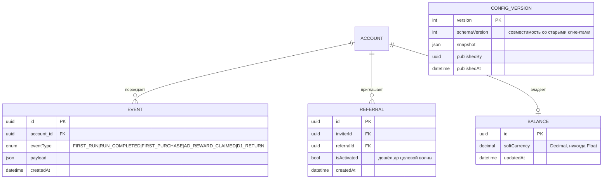

`CONFIG_VERSION` намеренно не связана с `ACCOUNT` внешним ключом: это
неизменяемый снапшот правил игры, а не пользовательские данные
(`19-content-admin.md` §3). `BALANCE` ждёт второго товара: пока за звёзды
продаётся один второй шанс, валюта не нужна (`34-stage3-plan.md`, Р5).
`EVENT` — вехи воронки игрока, которые знает только сервер: первый забег,
первая покупка, возврат на второй день (`13-reuse-from-vpnsibcom.md` §6).
Это не клиентская аналитика — та в `ANALYTICS_EVENT` (§1.1). На этапе 3
таблица не заведена: вехи пока выводятся запросом из `run`, `purchase` и
`account_session`, а понадобится она партнёрским начислениям.

### 1.3 Привлечение, партнёры и аналитика (проектируется)

Вынесено отдельной диаграммой намеренно: это другой домен со своим циклом
жизни, и смешивать его с игровыми сущностями в одной схеме — путь к
нечитаемой картинке.

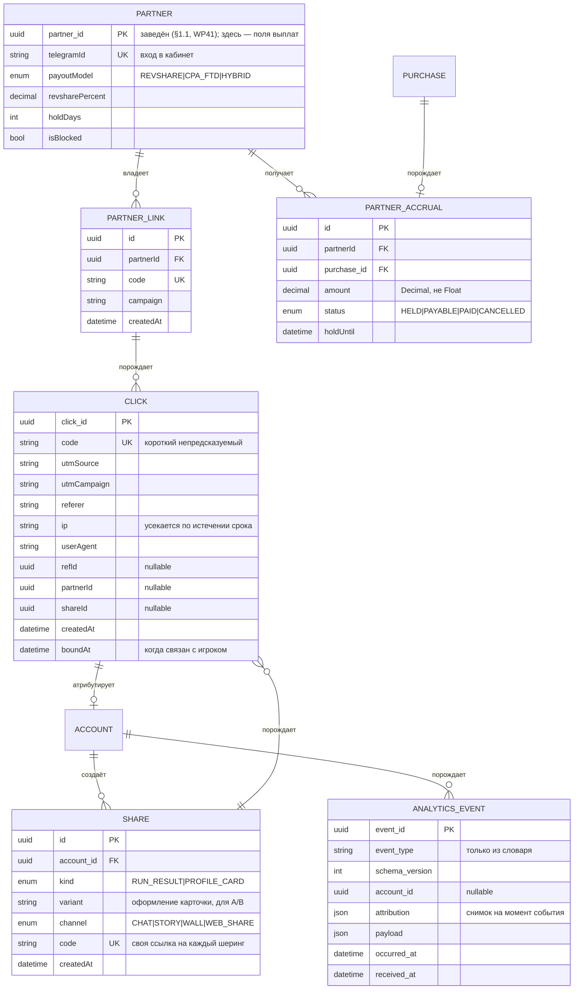

Три решения, которые из схемы не очевидны:

- **`CLICK` существует до игрока.** Строка создаётся в момент клика,
  когда аккаунта ещё нет; `boundAt` заполняется при первом запуске. Код
  клика (`c-<код>` в параметре запуска) уже сейчас пишется в
  `account_session.start_ref` и в касания `acquisition` (§1.1) — строка клика
  свяжется с ними по нему, задним числом тоже.
- **`ANALYTICS_EVENT.attribution` — снимок, а не ссылка.** Иначе
  перепривязка задним числом переписывает историю и отчёт за прошлый месяц
  перестаёт воспроизводиться (`22-analytics-and-metrics.md` §3.1).
- **У каждого шеринга своя ссылка.** `SHARE.code` — отдельный код на каждый
  шеринг, а не общая реферальная ссылка игрока: только так измеряется, что
  конвертит лучше (`24-attribution-and-sharing.md` §7.3).

### 1.4 Телеметрия закрытого теста (этап 2, реализовано)

Первые таблицы в проде: до авторизации, поэтому без внешнего ключа на
`USER`. Схема — `backend/api/prisma/schema.prisma`, миграции — рядом.
Подробности — `28-diagnostics.md` §5.4 и `22-analytics-and-metrics.md` §3.1.

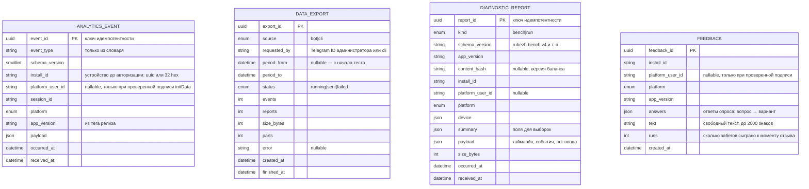

Что важно:

- **Связи с `USER` нет намеренно.** Пользователей до этапа 3 не существует;
  на этапе 3 история закрытого теста привязывается к аккаунтам по
  `platform_user_id`, а не переписывается. Колонка `user_id` и атрибуция
  появятся миграцией вместе с кодом, который их заполняет.
- **`DATA_EXPORT` — журнал доступа к данным, а не данные тестеров**: в нём
  Telegram ID администратора, который выгружал, — это аудит (`28-diagnostics.md`
  §6.1.4), по нему же считается «с последней выгрузки».
- **`FEEDBACK` — слова игрока, а не телеметрия** (`29-admin-panel.md` §5.7).
  Живёт отдельной таблицей: в события отзыв не кладётся, там остаётся только
  факт `feedback_sent`. Уходит и в чат администраторов — база нужна, чтобы
  собрать сводку и пережить недоступный Telegram.
- **Индексы** — по времени приёма (выгрузка и очистка), по установке и по
  `(event_type, received_at)` у событий, по `(app_version, kind)` у отчётов, по
  времени создания и установке у отзывов.
- **IP не хранится ни в одной из таблиц** — он нужен только лимиту частоты
  на приёме.
- Отчёты стенда этапа 1 лежали файлами в `var/bench-reports/`; в прод они
  не переносятся — это другой формат и другие условия замера.

---

## 2. Пакеты монорепо и направления зависимостей

Стрелка означает «импортирует». Красных стрелок здесь быть не может — правила
проверяются линтом и строгой раскладкой `node_modules`
(`15-engineering-standards.md` §2.2, `16-tech-stack-decisions.md` §2.2).

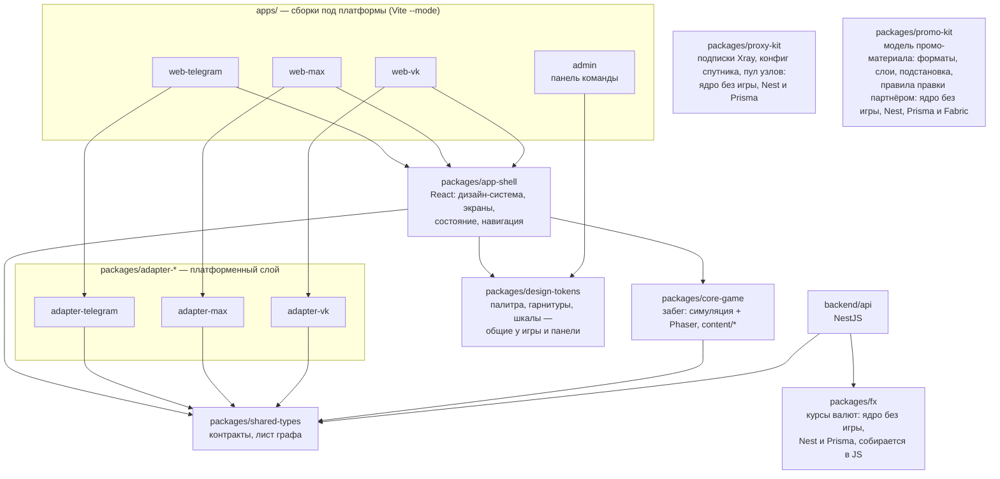

Стрелка из `apps/web-*` в `core-game` осталась одна и узкая: приложение берёт
оттуда отпечаток контента для сведений о сборке, а в Telegram-сборке ещё и
стенд FPS-испытаний. Забег запускает оболочка, и напрямую в движок приложение
не ходит (`27-design-system-and-app-shell.md` §2–§3).

Правила проверяются тестом по исходникам — `scripts/test/layer-boundaries.test.ts`.
Линт границ (`eslint-plugin-boundaries`) остаётся возможной заменой, но правил
пока восемь, и тест с человеческим сообщением «оболочка не знает о площадках»
полезнее настройки плагина.

Чего на схеме **нет** и не должно появиться:

- стрелки из `core-game` в любой `adapter-*` — иначе движок становится
  платформозависимым и порт на MAX превращается в переписывание;
- стрелки из `app-shell` в любой `adapter-*` или в Phaser — адаптер
  приходит объектом, Phaser — отдельным чанком;
- стрелки из `core-game` в `app-shell` — движок не знает, кто рисует меню;
- стрелки между адаптерами — общее выносится в `shared-types`;
- стрелки из `core-game` в `backend/api` — игровой цикл работает офлайн;
- любых стрелок **из** `shared-types` — это лист графа;
- любых стрелок **из** `fx` — ядро курсов станет отдельным сервисом и не
  знает ни об игре, ни о Nest, ни о Prisma. Бэкенд берёт его собранным
  (`dist`), тесты и dev-запуск — исходником.

### 2.1 Внутреннее устройство core-game

Ключевая граница внутри пакета — между симуляцией и отрисовкой. Симуляция
обязана запускаться headless: без этого невозможны ни golden-прогоны баланса,
ни воспроизведение бага по seed'у, ни серверная перепроверка забега
(`17-testing-strategy.md` §3). Проверяется тестом по исходникам, а не только
на ревью.

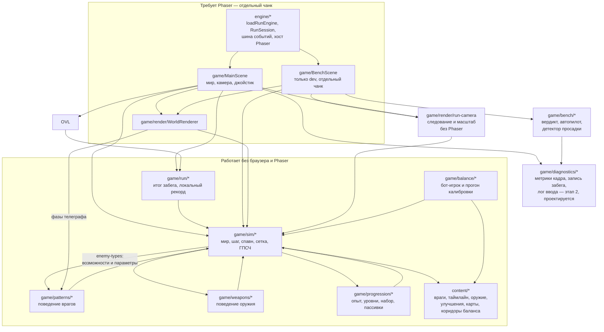

Связь симуляции и паттернов двусторонняя, но без цикла модулей: шаг
симуляции вызывает поведение из реестра `game/patterns/index.ts`, а мир при
создании берёт у `game/patterns/enemy-types.ts` только возможности и
параметры паттернов — этот модуль ничего из `game/sim/*` не импортирует.
Рендер читает у паттернов номера фаз, чтобы показать телеграф; сама
симуляция о рендере по-прежнему не знает — эффекты она пишет в буфер событий
(`game/sim/events.ts`).

На этапе 2 сбор метрик кадра переезжает из `game/bench/*` в общий
`game/diagnostics/*`: им пользуются и стенд, и обычный забег, а отправка
отчётов уходит из движка в оболочку (`28-diagnostics.md` §3.1).

`game/render/run-camera` лежит в подграфе рендера по смыслу, а не по
зависимостям: Phaser он не импортирует и потому проверяется обычным тестом.
Камера **только рендер** — симуляция о масштабе не знает (`26-stage2-plan.md`,
WP4.3). Единственное, что мир берёт из параметров камеры, — радиус кольца
спавна, и берёт его от максимально возможной видимой области, одинаковой на
всех устройствах. Поэтому в камере разрешён `Math.exp`, запрещённый в
симуляции: на исход забега он не влияет.

`game/balance/*` — бот-игрок и прогон калибровки (`pnpm balance:sim`,
WP4.6). Он единственный в headless-подграфе намеренно импортирует `content/*`:
смысл прогона в том, чтобы померить текущие числа, а не поведение движка. На
него распространяются те же запреты приближённой математики — иначе таблица
калибровки меняется от запуска к запуску.

`game/run/*` считает итог забега и ведёт локальный рекорд, но Phaser и DOM не
знает: его гоняет тест статистики, а позже — серверная перепроверка забега
(§3.5 там же). Хранилище он получает портом снаружи, поэтому стрелки в
адаптеры у него нет.

`engine/*` — единственная дверь, за которой начинается Phaser: публичный
`index.ts` пакета его не импортирует, а `loadRunEngine()` подгружает этот
подграф динамически. Экраны на канве (`game/overlays/*`) вместе с WP5 удалены:
пауза, выбор улучшения и смерть — React-оверлеи оболочки, `RunResult` уходит
наружу событием шины.

Чего на схеме нет и не должно появиться:

- стрелок из `game/sim/*` и `game/patterns/*` в Phaser, DOM или `bench/*` —
  симуляция ничего не знает о том, что её рисуют и замеряют;
- стрелок из `content/*` куда бы то ни было в `game/*` — контент это данные;
- `BenchScene` в основном бандле: сцена подключается динамическим импортом,
  иначе стенд испытаний уезжает игрокам.

---

## 3. Бэкенд: модули и инфраструктура

```mermaid
flowchart LR
    subgraph clients["Клиенты"]
        TG["Telegram Mini App"]
        MAX["MAX"]
        VK["VK"]
        ADMIN["Админка<br/>геймдизайнера"]
    end

    CADDY["Caddy<br/>TLS, единственный вход"]

    subgraph api["backend/api"]
        AUTH["auth<br/>initData → JWT, роли, реализовано"]
        ATTR["attribution<br/>сессии, первое и последнее<br/>касание, реализовано"]
        RUNS["runs<br/>приём забегов, антифрод,<br/>рейтинг, реализовано"]
        PAY["payments<br/>второй шанс, товары и подписка за Stars: цена,<br/>счёт, подтверждение, продления, возвраты, выдача, довыдача, реализовано"]
        SHOP["shop<br/>магазин: каталог с фиксированным<br/>составом, цены способа оплаты, акции, реализовано"]
        VIP["vip<br/>подписка площадки: журнал периодов,<br/>продление, самоцветы дня, надбавка к наградам, реализовано"]
        DONATE["donations<br/>донаты проекту: счёт на любую сумму,<br/>знак «Поддержал проект», ссылки Tribute, реализовано"]
        ADS["ads<br/>реклама: выбор сети, воронка показа,<br/>кулдаун места, реализовано ядро"]
        REF["referrals"]
        CONTENT["content<br/>версии конфигурации"]
        INGEST["ingest<br/>выключатели, Origin, лимиты,<br/>подпись запуска, реализовано"]
        EVENTS["events<br/>приём событий, реализовано"]
        DIAG["diagnostics<br/>отчёты стресс-теста, реализовано"]
        TOOLS["roles: инструменты команды<br/>режим разработчика, стресс-тест —<br/>по праву и настройке, реализовано"]
        BOT["platforms/telegram: бот<br/>вебхук или polling,<br/>маршрутизатор команд, реализовано"]
        TGADP["platforms/telegram: адаптер<br/>проверка запуска, оплата Stars,<br/>обновления оплаты, реализовано"]
        WELCOME["welcome<br/>/start с карточкой, реализовано"]
        NOTIFY["admin-notify<br/>карточки отчётов и забегов<br/>на разбор, реализовано"]
        EXPORT["export<br/>выгрузка и срок хранения, реализовано"]
        FXM["fx<br/>курсы валют вокруг packages/fx:<br/>опрос под локом, снимки, реализовано"]
        WALLET["wallet<br/>журнал, балансы, суточные<br/>потолки, реализовано"]
        PROG["progress<br/>уровень аккаунта, награды<br/>за забег, реализовано"]
        ITEMS["items<br/>снаряжение: инвентарь, операции,<br/>добыча, подписанный снимок, реализовано"]
        BOOSTS["boosts<br/>бусты: покупка до старта,<br/>возврат, сверка в итоге, реализовано"]
        ADMINAPI["admin<br/>панель: cookie-сессия, игроки,<br/>роли, курсы, отчёты, выгрузки,<br/>ссылки, флаги, настройки, реализовано"]
        LINKS["links<br/>/r/:код вне префикса API,<br/>клики, краулеры, макросы сети<br/>на клике, реализовано"]
        ADCONV["ad-conversions<br/>конверсии закупок: проход раз в минуту<br/>под локом, событие → назначение,<br/>постбэк с повтором, реализовано"]
        FLAGS["flags<br/>фича-флаги по площадке и доле,<br/>кеш правил 30 с, реализовано"]
        SETTINGS["settings<br/>настройки без релиза: база<br/>сильнее окружения, реализовано"]
        SECRETS["secrets<br/>ключи интеграций: шифртекст<br/>в базе, панель сильнее<br/>окружения, реализовано"]
        BCAST["broadcasts<br/>рассылки: сегмент, очередь<br/>с темпом площадки, реализовано"]
        FRIENDS["friends<br/>дружба, заявки, подарки,<br/>бонус за друзей, реализовано"]
        ACCSET["account-settings<br/>настройки игрока для всех устройств:<br/>слияние по ключам, реализовано"]
        NOTIF["notifications<br/>лента уведомлений: пишут модули,<br/>чистка старше 90 дней, реализовано"]
        NOTIFBOT["notifications-bot<br/>дубль в бота по выбору игрока:<br/>очередь, потолок вида, реализовано"]
        BADGES["badges<br/>знаки меню одним ответом:<br/>счётчики соседей, реализовано"]
        HISTORY["history<br/>история имущества: чтение<br/>журналов кошелька, предметов<br/>и покупок, реализовано"]
        DAILY["daily<br/>награда дня: неделя без сброса,<br/>ступени, множитель уровня, реализовано"]
        CHANGELOG["changelog<br/>журнал обновлений по площадкам,<br/>раздача app_update пачками, реализовано"]
        PLAYERLIST["player-list<br/>список игроков для панели:<br/>фильтры, страница по индексу, реализовано"]
        WHEEL["wheel<br/>колесо: сектора от уровня,<br/>бесплатная крутка в сутки, реализовано"]
        TASKS["tasks<br/>задания и достижения: каталог в базе,<br/>прогресс от забегов, реализовано"]
        MEDIA["media<br/>картинки из панели в базе по хэшу:<br/>проверка WebP, вечный кеш, реализовано"]
        TESTNOTICE["test-notice<br/>предупреждение об открытом тесте:<br/>принятие на аккаунт, реализовано"]
        WIPE["wipe<br/>компенсация тестеру после вайпа:<br/>выдача по кнопке, один раз, реализовано"]
        PROMOC["promo-codes<br/>промокоды и коды партнёров:<br/>ключ кода, активация, реализовано"]
        PARTNERS["partners<br/>карточки партнёров, их ссылки,<br/>привязка по первому входу, реализовано"]
        RESTR["restrictions<br/>ограничения игрока по видам и на срок:<br/>«можно ли» с кешем 30 с, снятие по сроку<br/>под локом, реализовано"]
        SEASONS["seasons<br/>недельный сезон рейтинга: таблица недели,<br/>закрытие по понедельникам UTC, награды<br/>за порог и за место, друзья, реализовано"]
        OUTBOUND["infra/outbound<br/>единый клиент исходящих запросов:<br/>метка сервиса, запись о каждой попытке<br/>в приёмник (пока пустой), реализовано"]
        HOME["home<br/>карусель главной: до пяти слайдов<br/>по ценности из ответов соседей<br/>и слайды команды из панели;<br/>виджеты награды дня, колеса и заданий;<br/>у каждого источника таймаут, реализовано"]
        BOTMENTION["bot-mention<br/>задания «юзернейм бота» в имени и bio:<br/>проверка раз в игровые сутки через порт,<br/>награда и серия, ночной проход, реализовано"]
    end

    FXSRC["Источники курсов<br/>ЦБ, ЕЦБ, ExchangeRate-API,<br/>CoinGecko, TON API, Binance"]

    ADSGRAMAPI["AdsGram<br/>api.adsgram.ai/confirm_conversion;<br/>зовёт адрес награды задания"]

    TADDYAPI["Taddy<br/>api.taddy.pro: креатив и его показы,<br/>лента обмена и проверка задания"]

    TGAPI["Telegram Bot API"]

    subgraph infra["Инфраструктура"]
        PG[("PostgreSQL<br/>источник истины")]
        REDIS[("Redis<br/>кеш, локи, ZSET, очереди")]
        QUEUE["BullMQ<br/>воркеры"]
    end

    CDN["CDN<br/>статика игры + снапшоты конфигурации"]

    TG --> CADDY
    MAX --> CADDY
    VK --> CADDY
    ADMIN --> CADDY

    CADDY --> AUTH
    CADDY --> RUNS
    CADDY --> PAY
    CADDY -- "/api/v1/ads" --> ADS
    CADDY --> REF
    CADDY --> CONTENT
    CADDY --> EVENTS
    CADDY --> DIAG
    CADDY -- "/api/v1/tools" --> TOOLS

    EVENTS --> INGEST
    DIAG --> INGEST
    INGEST --> REDIS
    EVENTS --> QUEUE
    DIAG --> PG
    DIAG -. кому открыт стресс-тест .-> TOOLS
    DIAG -. слушатели нового отчёта .-> NOTIFY
    RUNS -. слушатели записанного забега .-> NOTIFY
    NOTIFY --> QUEUE
    TGAPI -- вебхук --> CADDY
    CADDY --> BOT
    BOT --> WELCOME
    BOT --> EXPORT
    BOT -- обновления оплаты --> TGADP
    BOT -- "очередь bot-updates" --> QUEUE
    TGADP -- проверка и подтверждение оплаты --> PAY
    PAY -- порт оплаты --> TGADP
    AUTH -- порт проверки запуска --> TGADP
    INGEST -- порт проверки запуска --> TGADP
    TGADP -- createInvoiceLink, answerPreCheckoutQuery, refundStarPayment --> OUTBOUND
    OUTBOUND -- "telegram.bot" --> TGAPI
    PAY --> QUEUE
    WELCOME -. рекорд и место .-> RUNS
    EXPORT --> QUEUE
    FXM -- раз в минуту, под локом --> OUTBOUND
    OUTBOUND -- "fx.cbr, fx.ecb, fx.erapi, fx.coingecko, fx.coinmarketcap, fx.tonapi, fx.binance" --> FXSRC
    FXM --> PG
    FXM --> REDIS
    FXM -. алерты курсов .-> NOTIFY
    RUNS -. слушатели записанного забега .-> PROG
    PROG --> QUEUE
    PROG -- монеты, награды за уровень --> WALLET
    WALLET --> PG
    PROG --> PG
    CADDY --> WALLET
    CADDY --> PROG
    CADDY --> ITEMS
    PROG -- добыча забега --> ITEMS
    PROG -. "удвоение: забор сессии места run_double" .-> ADS
    ITEMS -- цена операций, осколки разбора --> WALLET
    RUNS -- порт проверки снимка снаряжения --> ITEMS
    CADDY --> BOOSTS
    BOOSTS -- цена бустов, возврат --> WALLET
    RUNS -- порт сверки бустов --> BOOSTS
    BOOSTS --> PG
    ITEMS --> PG
    EXPORT --> PG
    QUEUE -- sendPhoto, sendDocument --> OUTBOUND

    AUTH --> PG
    AUTH --> REDIS
    AUTH -. слушатели входа .-> ATTR
    ATTR --> REDIS
    ATTR --> QUEUE
    RUNS --> PG
    RUNS --> REDIS
    PAY --> PG
    PAY -. забег, который продолжают .-> RUNS
    CADDY -- "/api/v1/shop" --> SHOP
    SHOP -- "счёт на товар" --> PAY
    PAY -. "выдача оплаченного: регистр выдачи" .-> SHOP
    SHOP -- "состав товара ключом покупки" --> WALLET
    CADDY -- "/api/v1/vip" --> VIP
    VIP -- "счёт с периодом, отмена продления" --> PAY
    PAY -. "период за оплату, продление на площадке" .-> VIP
    PAY -. "хук: покупка не выдана — сообщение в поток «Покупки»" .-> NOTIFY
    VIP -- "самоцветы дня ключом суток" --> WALLET
    WALLET -. "надбавка к наградам: регистр надбавок" .-> VIP
    VIP -- "vip_subscription, vip_period, vip_daily" --> PG
    CADDY -- "/api/v1/donations" --> DONATE
    DONATE -- "счёт на сумму, может ли площадка принять оплату" --> PAY
    PAY -. "выдача знака и его снятие при возврате: регистры выдачи и отзыва" .-> DONATE
    DONATE -- "account.supporter_at, purchase.product = donation" --> PG
    DONATE -. "можно ли: покупки" .-> RESTR
    RUNS -. сверка продолжений с покупками .-> PAY
    RUNS -. "второй шанс: забор сессии места second_chance" .-> ADS
    RUNS -. слушатели записанного забега .-> PAY
    ADS -- "ad_network, ad_block, ad_session" --> PG
    ADSGRAMAPI -. "адрес награды задания: /api/v1/ads/adsgram/reward, секрет в пути" .-> CADDY
    ADS -. "ads/get и показы креатива; exchange/feed, exchange/check — задания ленты" .-> OUTBOUND
    OUTBOUND -. "taddy.api, taddy.exchange" .-> TADDYAPI
    ADMINAPI -. "сети, блоки, воронка показов" .-> ADS
    WHEEL -. "забор сессии места wheel_spin" .-> ADS
    REF --> PG
    CONTENT --> PG
    CONTENT --> CDN

    QUEUE --> PG
    QUEUE --> REDIS

    PANEL["apps/admin<br/>панель команды,<br/>свой поддомен"] -- "/api/v1/admin, cookie" --> CADDY
    CADDY --> ADMINAPI
    CADDY -- "/r/*" --> LINKS
    LINKS --> PG
    LINKS -. "порт AppLinks: ссылка запуска" .-> TGADP
    ADMINAPI -- сессии панели --> REDIS
    ADMINAPI -. сервисы и репозитории соседей .-> AUTH
    ADMINAPI -. карточка: забеги, кошелёк .-> RUNS
    ADMINAPI -. карточка: кошелёк .-> WALLET
    ADMINAPI -. курсы, заданные курсы .-> FXM
    ADMINAPI -. отчёты, архив .-> EXPORT
    ADMINAPI -. флаги и выкат .-> FLAGS
    ADMINAPI -. "настройки, право settings.edit" .-> SETTINGS
    SETTINGS --> PG
    SETTINGS -- "канал settings:changed" --> REDIS
    NOTIFY -. адреса чатов команды .-> SETTINGS
    ADMINAPI -. "ключи, права secrets.view и secrets.edit" .-> SECRETS
    SECRETS --> PG
    SECRETS -- "канал secrets:changed" --> REDIS
    FXM -. ключ CoinGecko на каждом проходе .-> SECRETS
    ADCONV -- "ad_conversion; читает link_click, acquisition, run, purchase" --> PG
    ADCONV -- "лок ad-conversions:lock" --> REDIS
    ADCONV -. токен конверсий на каждой отправке .-> SECRETS
    ADCONV -- "confirm_conversion, таймаут 5 с" --> OUTBOUND
    OUTBOUND -- "ads.postback" --> ADSGRAMAPI
    ADMINAPI -- "проверка ключа интеграции: secrets.check" --> OUTBOUND
    ADMINAPI -. "журнал и повтор конверсий ссылки" .-> ADCONV
    ADMINAPI -. рассылки .-> BCAST
    BCAST --> PG
    BCAST -- "очередь broadcasts, лимитер" --> REDIS
    BCAST -. "порт Messengers: sendMessage" .-> TGADP
    BCAST -. кнопка — ссылка кампании .-> LINKS
    FRIENDS --> PG
    FRIENDS -. подарки и бонус .-> WALLET
    FRIENDS -. "порт Messengers: сообщение о заявке" .-> TGADP
    FRIENDS -. "порт MessagePreparers: приглашение сообщением" .-> TGADP
    CADDY -- "/api/v1/account/settings" --> ACCSET
    ACCSET --> PG
    CADDY -- "/api/v1/me/notifications" --> NOTIF
    NOTIF --> PG
    NOTIF -- "лок чистки" --> REDIS
    FRIENDS -. "заявка, подарок" .-> NOTIF
    ITEMS -. "редкая добыча" .-> NOTIF
    BOOSTS -. "возврат бустов" .-> NOTIF
    ADMINAPI -. "сообщение команды" .-> NOTIF
    NOTIF -. "новая строка, onCreated" .-> NOTIFBOT
    CADDY -- "/api/v1/changelog" --> CHANGELOG
    ADMINAPI -. "журнал: правка, публикация" .-> CHANGELOG
    CHANGELOG --> PG
    CHANGELOG -- "лок раздачи" --> REDIS
    CHANGELOG -. "app_update пачкой, deliverMany" .-> NOTIF
    BADGES -. "версии после «открывал»" .-> CHANGELOG
    ADMINAPI -. "список игроков" .-> PLAYERLIST
    PLAYERLIST --> PG
    CADDY -- "/api/v1/wheel" --> WHEEL
    WHEEL -- "wheel_spin, сутки по Москве" --> PG
    WHEEL -. "награда ключом крутки" .-> WALLET
    WHEEL -. "уровень аккаунта" .-> PROG
    BADGES -. "крутка ждёт" .-> WHEEL
    CADDY -- "/api/v1/tasks" --> TASKS
    TASKS -- "task_def, task_progress, task_run, task_participant" --> PG
    CADDY -- "/api/v1/media/хэш.webp" --> MEDIA
    MEDIA -- "media_image" --> PG
    ADMINAPI -. "загрузка картинки и её показ в панели" .-> MEDIA
    TASKS -. "картинка годится заданию: квадрат" .-> MEDIA
    RUNS -. "записанный забег, RunsHooks" .-> TASKS
    TASKS -. "награда ключом задания и срока" .-> WALLET
    BADGES -. "награды к выдаче" .-> TASKS
    ADMINAPI -. "каталог заданий и строки сетей" .-> TASKS
    TASKS -- "network_task" --> PG
    TASKS -. "задания сетей: сессия места task под потолком и паузой" .-> ADS
    ADS -. "сеть подтвердила задание, AdTaskHooks" .-> TASKS
    TASKS -. "порт ChannelMemberships: getChatMember" .-> TGADP
    CADDY -- "/api/v1/me/test-notice" --> TESTNOTICE
    TESTNOTICE -- "test_notice" --> PG
    ADMINAPI -. "принял ли предупреждение" .-> TESTNOTICE
    CADDY -- "/api/v1/me/compensation" --> WIPE
    WIPE -- "tester_compensation: прочитать, отметить" --> PG
    WIPE -. "начисления по ключам покупок и wipe:*" .-> WALLET
    CADDY -- "/api/v1/seasons" --> SEASONS
    SEASONS -- "season, season_result, season_reward; итоги из run" --> PG
    SEASONS -- "seasons:сезон:сложность, лок закрытия" --> REDIS
    RUNS -. "записанный забег и смена ранга, RunsHooks" .-> SEASONS
    SEASONS -. "награда ключом season:сезон:аккаунт" .-> WALLET
    SEASONS -. "принятые друзья для таблицы друзей" .-> FRIENDS
    SEASONS -. "ограничение рейтинга: убрать, вернуть, исключить из итогов" .-> RESTR
    NOTIFBOT -- "задания, окно вида" --> REDIS
    NOTIFBOT -- "можно ли писать: account_messaging" --> PG
    NOTIFBOT -. "выбор игрока" .-> ACCSET
    NOTIFBOT -. "порт Messengers: sendMessage" .-> TGADP
    CADDY -- "/api/v1/me/badges" --> BADGES
    BADGES -. "новые предметы" .-> ITEMS
    BADGES -. "подарки и заявки" .-> FRIENDS
    BADGES -. непрочитанное .-> NOTIF
    CADDY -- "/api/v1/me/history" --> HISTORY
    CADDY -- "/api/v1/daily" --> DAILY
    DAILY -- "daily_reward, сутки по Москве" --> PG
    DAILY -. "монеты и осколки ключом дня" .-> WALLET
    DAILY -. "уровень аккаунта" .-> PROG
    BADGES -. "награда ждёт" .-> DAILY
    HISTORY -- "wallet_entry, item_event, purchase" --> PG
    CADDY -- "/api/v1/flags" --> FLAGS
    FLAGS --> PG
    CADDY -- "/api/v1/me/restrictions" --> RESTR
    RESTR -- "account_restriction; отметка блокировки в account" --> PG
    RESTR -- "канал restrictions:changed, лок задачи по сроку" --> REDIS
    ADMINAPI -. "наложить и снять; отзыв сессий при блокировке" .-> RESTR
    ADMINAPI -- "возврат и выдача покупки поддержкой" --> PAY
    REF -. "можно ли: награды за друзей" .-> RESTR
    FRIENDS -. "можно ли: подарки, бонус за друзей" .-> RESTR
    ADS -. "можно ли: награды за рекламу" .-> RESTR
    TASKS -. "можно ли: партнёрские задания" .-> RESTR
    RUNS -. "можно ли: рейтинг; хуки наложения и снятия — убрать из досок и вернуть" .-> RESTR
    CADDY -- "/api/v1/promo-codes" --> PROMOC
    PROMOC -. "награда ключом кампании и игрока" .-> WALLET
    PROMOC -. "можно ли: промокоды" .-> RESTR
    PARTNERS --> PG
    ATTR -. "сессия вида click или link: привязка по ссылке партнёра в слот источника" .-> PARTNERS
    PARTNERS -. "ссылки партнёра: клики и запуски теми же запросами, что в списке ссылок" .-> LINKS
    CADDY -- "/api/v1/me/home" --> HOME
    HOME -. "акции и стартовый набор" .-> SHOP
    HOME -. "VIP, если его нет" .-> VIP
    HOME -. "новые версии" .-> CHANGELOG
    HOME -. "партнёрское задание дня; кольцо суток и награды к забору" .-> TASKS
    HOME -. "виджет: неделя и завтрашняя награда" .-> DAILY
    HOME -. "виджет: крутка, джекпот, крутка за рекламу" .-> WHEEL
    HOME -. "можно ли: друзья, партнёрские задания" .-> RESTR
    HOME -. "канал проекта; слайд доната включён ли" .-> SETTINGS
    HOME -. "слайд «Поддержать проект», если есть способ поддержать" .-> DONATE
    HOME -- "home_slide; регистрация и первая оплата для аудитории" --> PG
    ADMINAPI -. "слайды команды: завести, поправить, снять" .-> HOME
    CADDY -- "/api/v1/bot-mention" --> BOTMENTION
    BOTMENTION -- "bot_mention_task: состояние, серия, очередь проверки" --> PG
    BOTMENTION -- "лок прохода bot-mention:sweep:lock, пауза bot-mention:pause; очередь bot-mention" --> REDIS
    BOTMENTION -. "награда ключом bot-mention:аккаунт:вид:сутки:ресурс" .-> WALLET
    BOTMENTION -. "порт BotMentions: getChat — имя и bio, наружу только итог" .-> TGADP
    BOTMENTION -. "включено ли и награды за сутки" .-> SETTINGS

    TG -.статика и конфиг.-> CDN
```

**Панель — модуль того же монолита** (`35-stage4-plan.md`, WP17): свои
контроллеры под `/api/v1/admin/*` и своя cookie-сессия в Redis, а данные —
через экспортированные сервисы и репозитории соседей: модуль панели сам в
базу не ходит (`36-parallel-work.md` §2). Клиент панели `apps/admin` ходит в
эти маршруты только на свой домен: Caddy поддомена панели отдаёт её статику и
проксирует `/api/v1/admin`, поэтому CORS нет, а cookie с `SameSite=Strict`
уходит сама. С игрой панель роднят только токены дизайна — движка, оболочки
и адаптеров в её бандле нет, это проверяет тест границ слоёв.

**Площадка — за портами** (`35-stage4-plan.md`, Р22, §3.11): модули домена —
вход, приёмник, оплата — не знают Telegram, а просят порты
`platforms/ports/`. Как проверяется подпись запуска, как выставляется счёт,
состоит ли игрок в канале и что значит ответ Bot API, знает адаптер
`platforms/telegram/`; у MAX и VK — заглушки. Бот и инструменты команды в чате администраторов порта не
требуют: это наш инструмент, а не игра.

Читается так: **Postgres — источник истины, Redis — проекция.** Приём забега
пишет его в базу одной строкой по первичному ключу и только потом — место в
рейтинг Redis: упавший Redis забег не теряет, рейтинг догонит повтор итога
или пересборка (`34-stage3-plan.md`, Р4). Запись синхронная сознательно: на
нынешнем объёме это одна вставка, а очередь перед ней — первый шаг
`14-scalability.md` §4.1, когда запись станет узким местом. Уведомления и
сводка работают после ответа игроку — слушателями записанного забега.

---

## 4. Ключевые потоки

### 4.1 Авторизация

Реализовано на этапе 3 (`34-stage3-plan.md`, WP1, WP6).

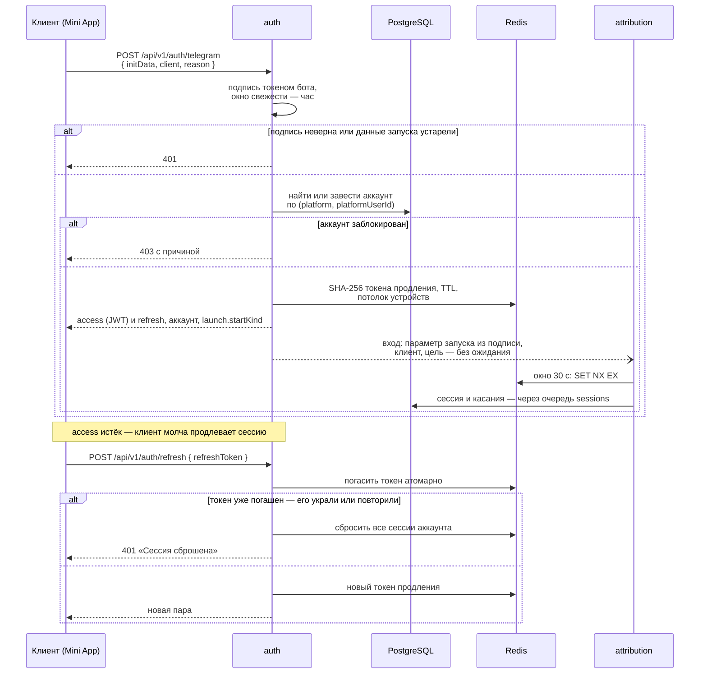

Валидация подписи — **только на сервере**. Роли в токен не входят и
проверяются по базе на каждом запросе с правом: отзыв действует сразу, а не
через четверть часа (`34-stage3-plan.md`, Р1). Сессию и касания вход не
ждёт: упавшая запись атрибуции не отменяет вход. Сессией считается только
запуск (`reason: "launch"`), а не повторный вход посреди работы. Детали и
краевые случаи — `13-reuse-from-vpnsibcom.md` §4 и §6.

### 4.2 Сдача результата забега

Реализовано на этапе 3 (`34-stage3-plan.md`, WP4).

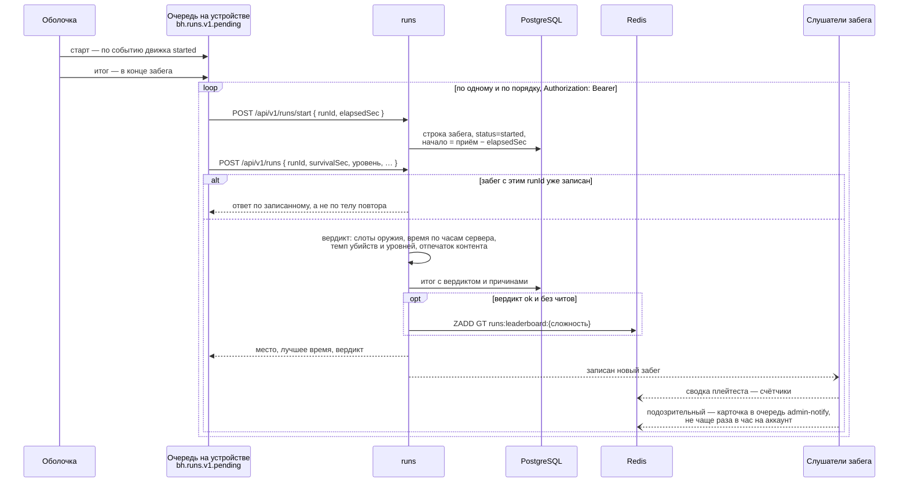

Три свойства, ради которых схема такая:

- **время забега проверяет сервер своими часами.** Старт уходит в начале
  забега и ставит серверное время начала; итог длиннее прошедшего получает
  отказ. Старт, пролежавший без сети дольше `RUNS_START_MAX_DELAY_SEC`, время
  не проверяет — такой забег помечается `unverified_time` (О5);
- **повтор отвечает по записанному.** Идемпотентность — по клиентскому
  `runId`, **не** по хэшу тела: два честных забега с одинаковым счётом дали
  бы одинаковый хэш (`15-engineering-standards.md` §4.1). А ответ на повтор
  строится из базы, иначе забег сдавали бы дважды: с малым временем, чтобы
  пройти проверки, и тем же ключом — с огромным;
- **игрок не ждёт ни сводки, ни чата.** Слушатели зовутся после ответа и
  только на первую запись: повтор из очереди не посчитает забег дважды и не
  пришлёт вторую карточку.

### 4.3 Награда за просмотр рекламы (этап 4, реализовано ядро)

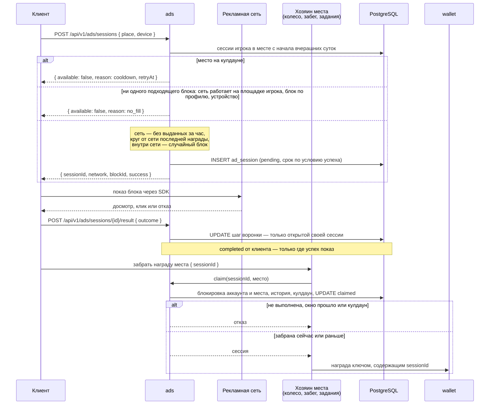

Одна сессия — одна награда: забор и проверка кулдауна идут под одной
транзакционной блокировкой, а повтор после обрыва отдаёт ту же сессию, и
хозяин места дожимает награду тем же ключом кошелька. Клик и целевое
действие выполненной сессию сделает сервер — своим редиректом и постбэком
сети, следующей частью WP12, а не ответом SDK (`35-stage4-plan.md` §3.7,
«Доверие»).

### 4.3.1 Креатив сети с API — Taddy (этап 4, WP12, часть 9)

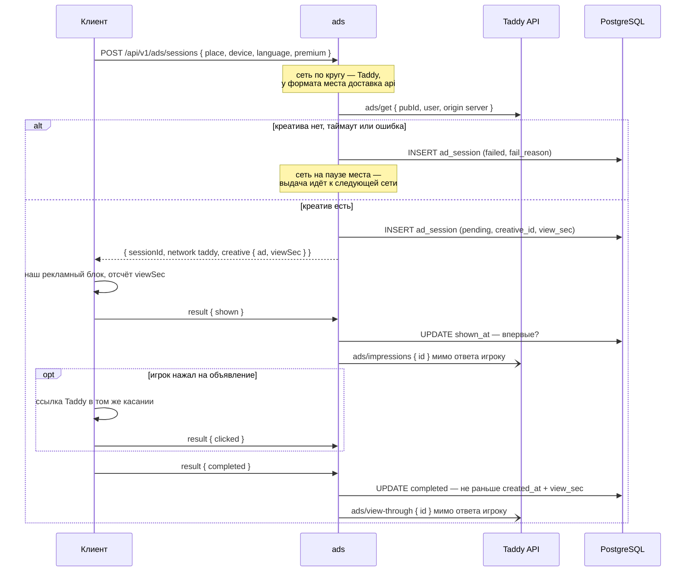

Клик Taddy считает сама — по своей ссылке в объявлении; нам он виден шагом
`clicked` в воронке. Награда — как у любой рекламы (§4.3): хозяин места
забирает выполненную сессию. Учёт аудитории — отдельно: SDK Taddy
поднимается у каждого игрока Telegram, пока у сети задан `pubId`, а `/start`
бота сервер сообщает Taddy сам (`events/start`).

### 4.3.2 Межстраничная при старте забега (этап 4, WP12, часть 10)

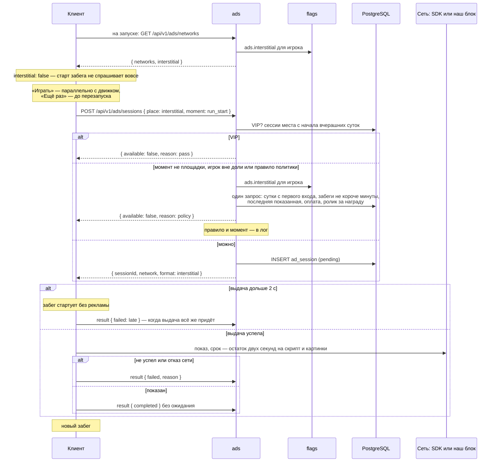

Показывать ли — решает только сервер: клиент не знает ни покупок, ни
роликов за награду на других экранах. Две подряд не бывает: перед
следующей должен закончиться забег не короче минуты, а пауза между
показами — не меньше минуты. Числа политики — настройки панели, доля
игроков — флаг `ads.interstitial` (`35-stage4-plan.md` WP12, часть 10).

### 4.3.3 Задание рекламной сети — AdsGram (этап 4, WP13, часть 6)

```mermaid
sequenceDiagram
    participant C as Клиент
    participant T as tasks
    participant AD as ads
    participant DB as PostgreSQL
    participant S as SDK AdsGram
    participant N as Сервер AdsGram
    participant W as wallet

    C->>T: GET /api/v1/tasks
    T->>AD: Task-блок сети для площадки, адрес награды создан?
    T->>AD: сессия задания: открытая или новая
    AD->>DB: блокировка места task; открытая сессия сети?
    alt открытой нет
        AD->>DB: история места с начала вчерашних суток
        Note over T,AD: потолок суток и пауза — правило строки сети
        AD->>DB: INSERT ad_session (pending, cpa), если правило пускает
    end
    T-->>C: { tasks, networks: [{ network, offer | null, nextAt }] }
    C->>S: <adsgram-task> с нашими слотами: награда, «Перейти», «Забрать», «Готово»
    alt у сети нет задания
        S-->>C: onBannerNotFound — строки нет
        C->>AD: result { failed: no_fill }
    else игрок выполнил задание
        S->>N: проверка выполнения
        N->>AD: GET /api/v1/ads/adsgram/reward/секрет/id в Telegram
        AD->>DB: блокировка места; открытая сессия сети → completed
        AD->>T: AdTaskHooks: подтверждено
        T->>W: награда строки ключом сессии
        T->>AD: забор сессии
        AD-->>N: 200
        S-->>C: reward — элемент снимается, строка «проверяем»
        C->>T: GET /api/v1/tasks, пока doneToday не вырастет
    end
```

Награду даёт только подтверждение сети: шаг клиента «досмотрено» сессию
задания не выполнит — её условие успеха целевое действие. Подтверждение
без открытой сессии не даёт ничего, повтор после выдачи — тоже: сессия
уже забрана, а следующая заводится не раньше паузы. Сорвалась выдача — сеть
получает ошибку и повторяет, а не повторит — награду дожмёт следующее
открытие экрана заданий тем же ключом сессии.

### 4.3.4 Задание ленты сети — обмен трафиком Taddy (этап 4, WP13, часть 6)

```mermaid
sequenceDiagram
    participant C as Клиент
    participant A as Адаптер Telegram
    participant T as tasks
    participant AD as ads
    participant DB as PostgreSQL
    participant X as Taddy API
    participant W as wallet

    C->>T: GET /api/v1/tasks
    T-->>C: networks: [{ network taddy, delivery feed, nextAt }] — сеть не ждём
    C->>T: POST /tasks/networks/taddy/item { language, premium }
    T->>AD: задание ленты: открытая сессия или новая по правилу строки
    AD->>X: exchange/feed — без выполненных и автоматических показов
    alt задание открытой сессии пропало из ленты, игрок переходил
        AD->>X: exchange/check
        X-->>AD: true — дальше как «Проверить» ниже, строка — «Награда получена»
    else не переходил или сеть не видит выполнения
        AD->>DB: сессия → failed task_gone
    end
    AD->>DB: блокировка места task; выполненные из ленты — мимо; INSERT ad_session (creative_id)
    T-->>C: { kind: task, task: { sessionId, title, image, action, link } }
    C->>AD: result shown
    AD->>X: exchange/impressions — показ задания, однажды
    C->>A: openNetworkTask { taddy, link }
    A->>X: POST link { fields: [] } — из клиента игрока, как у SDK Taddy
    X-->>A: { result: https://t.me/бот?start=… }
    A->>A: openLink — бот внутри Telegram
    C->>AD: result clicked
    Note over C: игрок вернулся в приложение — строка проверяет сама
    C->>T: POST /tasks/networks/taddy/check { sessionId }
    T->>AD: проверка у сети
    AD->>X: exchange/check { taskId }
    alt выполнено
        AD->>DB: блокировка места; сессия → completed, если это задание игрок не выполнял
        AD->>T: AdTaskHooks: подтверждено
        T->>W: награда строки ключом сессии
        T->>AD: забор сессии
        T-->>C: { result: confirmed, doneToday, nextAt }
    else не выполнено или сеть не ответила
        T-->>C: { result: not_done | unavailable } — подсказка под кнопкой
    end
```

Награду даёт только ответ Taddy на проверку сервера: клиент её не
выполнит, а запрос с чужой сессией или с заданием, которое игрок уже
выполнял, закрывается без награды. Адрес перехода клиент спрашивает у
Taddy сам: переход сеть считает по адресу и браузеру игрока, а запросы с
одного адреса нашего сервера выглядели бы накруткой.

### 4.4 Публикация конфигурации из админки

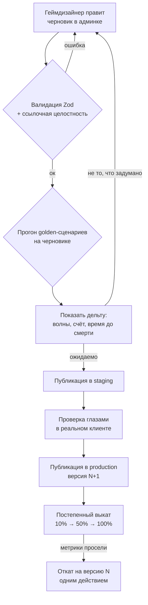

Подробности и рамки — `19-content-admin.md`.

### 4.5 Путь атрибуции: от клика до игрока

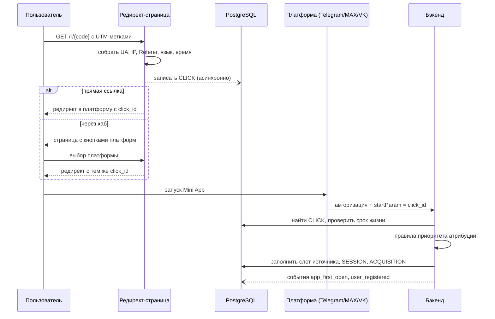

Краулер мессенджера, запрашивающий превью ссылки, кликом **не считается** —
иначе одна отправка в чат порождает фантомный клик и занижает конверсию
(`24-attribution-and-sharing.md` §3.3). Так же не считаются известные
сервисы проверки доступности: они получают страницу 200 без кеша.

### 4.6 Аналитический конвейер

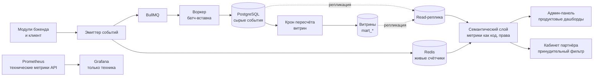

Существенное: **продуктовая аналитика не ходит в горячие таблицы.**
Админ-панель и кабинет партнёра читают витрины на реплике через
семантический слой, живые счётчики — из Redis; Grafana смотрит только
технические метрики Prometheus (`29-admin-panel.md` §5). Иначе открытый на стене
дашборд с автообновлением становится постоянной паразитной нагрузкой на ту
же БД, которая принимает забеги (`22-analytics-and-metrics.md` §1).

### 4.7 Забег внутри оболочки (этап 2, проектируется)

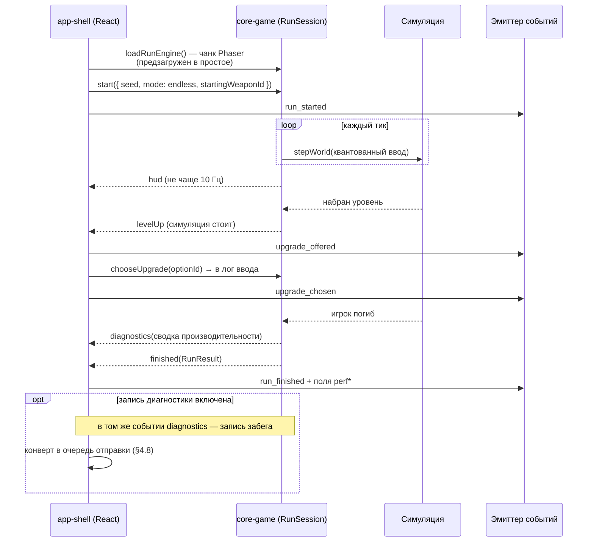

Движок не ходит в сеть и не знает про аналитику: он отдаёт результат, а
отправкой занимается оболочка (`27-design-system-and-app-shell.md` §3.1).

### 4.8 Доставка отчёта диагностики (этап 2, реализовано)

Очередь на устройстве — `app-shell/src/state/report-queue.ts`, приёмник —
`backend/api/src/modules/diagnostics`. Стресс-тест очередь не использует: он
шлёт отчёт сам и повторяет отправку кнопкой.

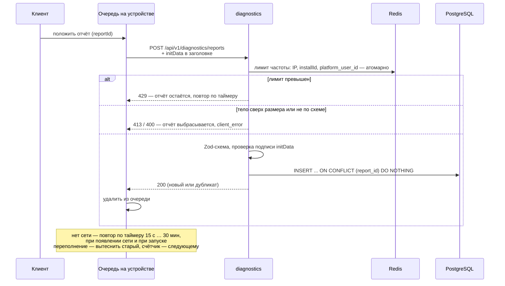

Подпись `initData` здесь не авторизует, а только подтверждает Telegram ID
тестера; неверная подпись не отклоняет отчёт, а обнуляет ID
(`28-diagnostics.md` §5.2).

### 4.9 Выгрузка данных администратору через бота (этап 2, реализовано)

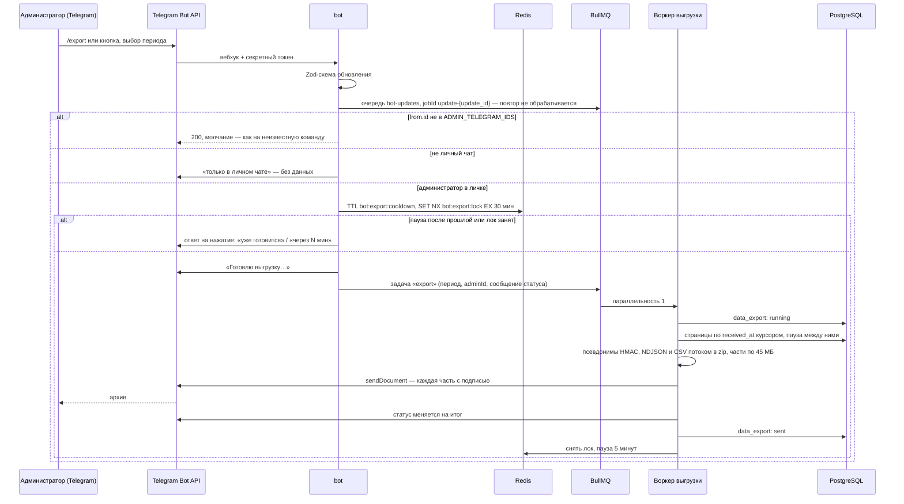

Вебхук отвечает, когда обновление записано в очередь `bot-updates`, а архив
собирает отдельный воркер выгрузки: иначе Telegram посчитает медленный ответ
ошибкой и повторит обновление. Скрытая кнопка — не защита, доступ проверяется
на каждом обновлении (`28-diagnostics.md` §6.1).

### 4.10 Спавн в бесконечном мире (этап 2, реализовано)

Мир не кончается, поэтому у спавна нет «краёв экрана», от которых можно
отсчитывать. Вместо них — два радиуса вокруг игрока: кольцо спавна и радиус
удержания (`26-stage2-plan.md`, WP4.1–WP4.4).

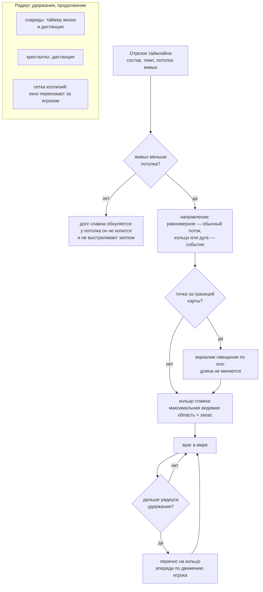

Три свойства, ради которых схема такая:

- **радиус кольца не зависит от устройства.** Он считается от максимальной
  видимой области карты — дальний масштаб на крайнем допустимом соотношении
  сторон плюс запас. Ни зум, ни поворот экрана, ни широкий монитор не
  показывают момент появления врага и не меняют спавн;
- **отставшие не копятся за спиной.** В бесконечном мире от кого угодно можно
  убежать; перенос вперёд сохраняет давление и не даёт пулу забиться теми,
  кого игрок никогда не встретит;
- **спавн никогда не попадает за границу карты.** Из кольца выбираются только
  допустимые дуги — смещение зеркалится по нарушенной оси, длина при этом не
  меняется, значит враг по-прежнему появляется за краем видимости.

### 4.11 Сохранения и лидерборд плейтеста (этап 2, заменено на этапе 3)

Временный путь закрытого теста (`26-stage2-plan.md`, Р19 и WP13) — подпись
`initData` на каждом запросе и Redis со сроком жизни — снят вместе с
переездом клиента на аккаунты (`34-stage3-plan.md`, WP4). Забеги, рейтинг и
профиль — §4.2; сводка и отчёты о запуске, оставшиеся от плейтеста, удалены
на этапе 4, а доступ к инструментам — `/api/v1/tools/access` (§4.12). Неотправленные итоги из
прежней очереди `bh.playtest.v1.pending` клиент переносит в новую при первом
запуске.

### 4.12 Ежедневная статистика в чат администраторов (этап 4, реализовано)

Сводка плейтеста — счётчики в Redis рядом с забегами и запусками — удалена
вместе с маршрутом `/api/v1/playtest/*` (`35-stage4-plan.md`, Р55): её данные
уже лежат в базе. Статистика считается агрегатами по таблицам за московские
сутки (`admin-notify/daily-stats.*`). Доступ к инструментам команды —
`GET /api/v1/tools/access` по праву `tools.dev` и настройке «Стресс-тест для
всех игроков».

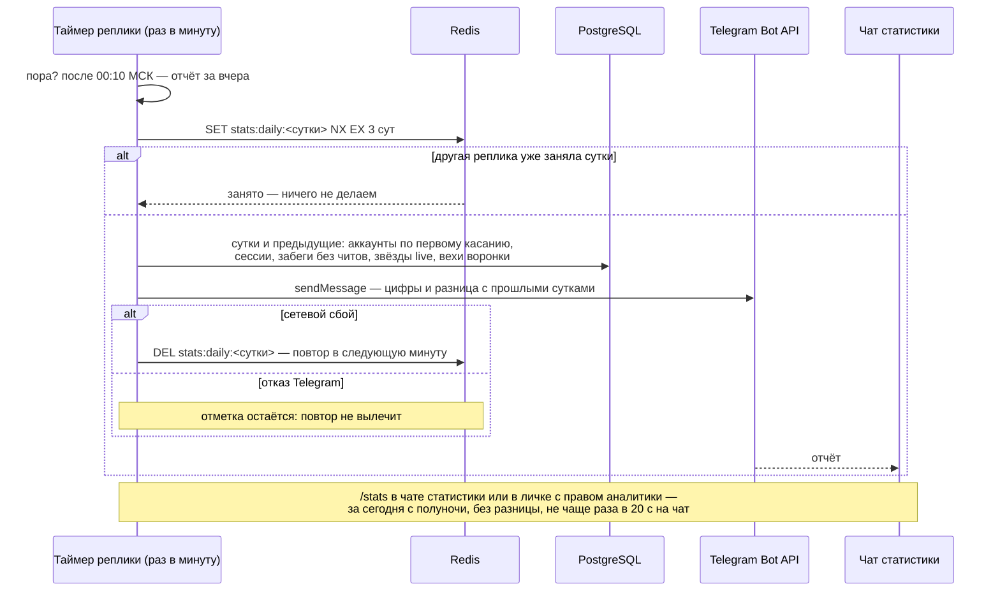

### 4.13 Приём событий закрытого теста (этап 2, реализовано)

```mermaid
sequenceDiagram
    participant C as Клиент
    participant G as IngestGuard
    participant S as EventsService
    participant R as Redis
    participant Q as BullMQ «events»
    participant DB as PostgreSQL

    C->>G: POST /api/v1/events — до 100 событий<br/>+ initData в заголовке
    G->>G: выключатель (404), Origin (403), размер тела (413)
    G->>R: лимит по IP — INCRBY + EXPIRE одним скриптом
    G->>G: подпись initData → Telegram ID или null
    G->>S: пачка
    S->>S: конверт, словарь, версия, схема payload — по событию
    S->>R: лимит по установке и Telegram ID — в событиях
    alt очередь отвечает за 2 с
        S->>Q: add(batch)
        Q->>DB: воркер: createMany skipDuplicates
    else Redis недоступен
        S->>DB: createMany напрямую
    end
    S-->>C: 202 { accepted, rejected, rejectedBy }
    Note over C,DB: база недоступна — 503, пачка остаётся на устройстве.<br/>Повтор отсекает первичный ключ event_id
```

- **Redis лёг — лимит в памяти процесса** с предупреждением в лог раз в
  минуту: терять события тестеров хуже, чем на время сбоя ослабить лимит;
- **Telegram ID — только из подписи**: поле в теле события игнорируется.

### 4.14 Приветствие по /start (этап 2, реализовано)

```mermaid
sequenceDiagram
    participant U as Игрок
    participant TG as Telegram
    participant B as BotRouter
    participant S as StartCommand
    participant P as Прогресс аккаунта<br/>по Telegram ID
    participant R as Redis

    U->>TG: /start в личке
    TG->>B: вебхук или getUpdates
    B->>S: обновление
    S->>R: SET bot:start:{чат} NX EX 3 — двойное нажатие
    S->>P: рекорд, место, забеги (2 с, иначе карточка новичка)
    S->>S: язык, имя без эмодзи → ключ SHA-256
    S->>R: GET bot:card:{ключ}
    alt file_id есть
        S->>TG: sendPhoto(file_id) — без рендера и загрузки
    else нет или Telegram его забыл
        S->>S: SVG → PNG (одинаковые рендеры склеиваются)
        S->>TG: sendPhoto(PNG) + кнопка «Играть»
        TG-->>S: file_id крупнейшего размера
        S->>R: SET bot:card:{ключ} file_id EX 30 дней
    end
    TG-->>U: карточка с подписью на языке игрока
```

### 4.17 Награда за забег (этап 4, реализовано)

`35-stage4-plan.md`, WP4. Итог забега пишется синхронно, как на этапе 3, а
награда — заданием очереди: волна итогов после поста в канале не ждёт опыта и
монет.

```mermaid
sequenceDiagram
    participant C as Клиент
    participant R as runs
    participant Q as Очередь rewards
    participant P as progress
    participant W as wallet
    participant DB as Postgres

    C->>R: POST /runs — итог забега
    R->>DB: забег одной строкой, вердикт
    R-->>C: место и рекорд
    R--)Q: слушатель записанного забега — задание с ключом run_id
    Q->>P: формула награды: монеты и опыт, а забегу с читами, отклонённому или короче 30 с — ничего
    P->>DB: строка награды ON CONFLICT и прибавка опыта — одна транзакция
    P->>W: монеты run:<runId>:coins, награды за уровень level:<аккаунт>:<уровень>
    W->>DB: журнал и баланс, суточный потолок
    P->>DB: сколько легло после потолка
    C->>P: GET /progress/runs/:runId — с растущей паузой, пока не посчитано
    P-->>C: монеты, опыт, новый уровень — экран итогов и шапка
```

Повтор задания безопасен целиком: опыт держит ключ строки награды, монеты —
ключ кошелька. Упало между опытом и монетами — повтор найдёт строку и
доначислит по тому же ключу. Redis недоступен — награда считается сразу, мимо
ответа игроку.

### 4.16 Вход в бота, воронка и «можно писать» (этап 4, реализовано)

`35-stage4-plan.md`, WP2. Кто нажал `/start`, тот уже наш: аккаунт заводится
в канале площадки, до первого открытия игры.

```mermaid
sequenceDiagram
    participant U as Игрок
    participant TG as Telegram
    participant S as platforms/telegram<br/>приветствие /start
    participant A as auth
    participant H as Слушатели входа<br/>attribution, funnel, messaging
    participant DB as Postgres
    participant M as platforms/telegram<br/>обновления о разрешении

    U->>TG: t.me/<бот>?start=c-<код>
    TG->>S: /start c-<код>
    S->>A: enterChannel: имя, юзернейм, параметр
    A->>DB: аккаунт — одна вставка, аватар не затирается
    A--)H: вход с местом «канал» — без ожидания
    H->>DB: сессия и касание (очередь sessions), веха entered, «можно писать»
    S-->>U: карточка приветствия — даже если запись упала
    Note over U,DB: позже — вход в игру, забеги, оплата
    H->>DB: вехи: открыл игру, первый забег, второй, пятый, D1, D7, покупка
    U->>TG: блокирует бота
    TG->>M: my_chat_member: kicked
    M->>DB: «писать нельзя» — если событие не старше записанного
```

Вехи — дата первого раза: одна вставка с `ON CONFLICT` и `COALESCE`, и
повтор события ничего не двигает. Воронка — `count(веха)` рядом с первым
касанием: `pnpm --filter backend-api funnel:report`.

### 4.15 Покупка второго шанса за Stars (этап 3, реализовано)

```mermaid
sequenceDiagram
    participant U as Игрок
    participant C as Клиент
    participant P as payments
    participant DB as Postgres
    participant TG as Telegram
    participant B as BotRouter
    participant Q as Очередь payments

    U->>C: смерть — забег ждёт решения
    C->>P: POST /payments/continue/quote { runId, continueNo, elapsedSec }
    P->>DB: забег: чей, начат ли по часам сервера, не закончен ли
    P-->>C: priceStars — клиент только показывает
    U->>C: «Продолжить за N ⭐»
    C->>P: POST /payments/continue/invoice
    P->>DB: purchase pending — или та же, если счёт уже выставляли
    P->>TG: createInvoiceLink(XTR, payload = purchaseId)
    P-->>C: invoiceUrl
    C->>TG: openInvoice(invoiceUrl)
    TG->>B: pre_checkout_query — в очереди bot-updates с приоритетом
    B->>P: чей счёт, та ли сумма, свежий ли, жив ли забег
    P->>TG: answerPreCheckoutQuery — до 10 секунд
    TG->>B: successful_payment — сообщением в личке
    B->>Q: подтверждение, jobId от id оплаты
    Q->>DB: pending → paid, telegram_charge_id UK
    C->>P: GET /payments/{id} — пока не granted
    P-->>C: granted: true
    C->>C: continueRun — продолжение выдал сервер (Р13)
```

- **Право на продолжение — по `successful_payment`, а не по ответу
  `openInvoice`** (`34-stage3-plan.md`, Р13): ответ Mini App — подсказка,
  что можно перестать ждать.
- **Подтверждение идёт через очередь оплаты**: обновление уже лежит в
  очереди `bot-updates` (T-0027), а подтверждение — своим заданием, которое
  повторяется, пока запись не пройдёт. Redis недоступен — запись сразу, не
  прошла и так — ошибка в лог со всеми полями оплаты.
- **Отказаться от денег можно только на проверке.** После
  `successful_payment` звёзды уже у нас, и дальше остаётся только возврат.
  Его сервер делает сам — через ту же очередь, с повтором: тестовая оплата
  (Р14), продолжение, которое не взяли (оплата пришла к закрытому забегу
  или забег записан без него), вторая оплата того же продолжения и оплата
  без покупки. Заказ возврата пишется в базу раньше обращения к Telegram —
  после перезапуска очередь поднимает незавершённые оттуда.

---

### 4.16 Вход в панель и действие под cookie-сессией (этап 4, реализовано)

Серверная часть панели (`35-stage4-plan.md`, WP17, часть 1). Сессия панели
— не токен игрока: cookie `HttpOnly; SameSite=Strict` только на маршруты
панели, в Redis — хэш токена и срок без продления. Права — тем же гвардом,
что у игры: гвард панели кладёт в запрос тот же `account`.

```mermaid
sequenceDiagram
    participant B as Браузер панели
    participant AD as admin
    participant RO as roles
    participant DB as PostgreSQL
    participant R as Redis

    B->>AD: POST /api/v1/admin/session/dev { devUser }
    AD->>AD: панель включена? флаг разработчика?<br/>лимит по адресу
    AD->>DB: найти или завести аккаунт
    AD->>RO: роли аккаунта — по базе, не из cookie
    alt ролей нет или аккаунт заблокирован
        AD-->>B: 403
    else
        AD->>R: SET admin:session:<sha256> EX ttl,<br/>SADD admin:sessions:<аккаунт>
        AD->>DB: аудит admin.login
        AD-->>B: Set-Cookie HttpOnly SameSite=Strict<br/>Path=/api/v1/admin, роли и права
    end

    Note over B,AD: любой запрос панели — cookie, изменяющий — ещё и X-Requested-With: rubezh-admin
    B->>AD: POST /api/v1/admin/players/:id/ban { reason }
    AD->>R: GET admin:session:<sha256>
    alt сессии нет или истекла
        AD-->>B: 401
    else
        AD->>DB: аккаунт жив, роли всё ещё есть
        AD->>RO: право players.ban
        AD->>DB: блокировка, аудит было → стало
        AD->>R: отозвать сессии игры и панели игрока
        AD-->>B: 201 { account, revokedSessions }
    end
```

Отзыв роли и блокировка действуют сразу: роли перечитываются на каждом
запросе, а сессии панели отзываются в тот же момент. Без входа — не
задан `JWT_ACCESS_SECRET` — панель отвечает 404 на всё, включая вход.

**Вход через бота** — на проде единственный (`29-admin-panel.md` §8). Выше
показан вход разработчика; через бота до выдачи cookie путь другой:

```mermaid
sequenceDiagram
    participant B as Браузер панели
    participant AD as admin
    participant R as Redis
    participant BOT as бот Telegram
    participant A as Администратор

    B->>AD: POST /api/v1/admin/session/bot
    AD->>R: HSET admin:panel-login:<запрос><br/>хэш секрета, код, браузер, сеть, EX 300
    AD-->>B: запрос, секрет, код, t.me/<бот>?start=panel-<запрос> и диплинк tg://resolve
    B->>A: QR и кнопка «Открыть Telegram» — диплинком, запасная ссылка на t.me (запрос открыт вместе со страницей)
    A->>BOT: /start panel-<запрос> (личка)
    BOT->>AD: запрос ещё ждёт?
    BOT->>A: код, браузер, сеть — «Войти» / «Это не я»
    A->>BOT: «Войти»
    BOT->>AD: подтвердить — от Telegram ID нажавшего
    AD->>AD: аккаунт, роли, блокировка
    AD->>R: ждущий → подтверждён (Lua, один раз)
    loop раз в 2 секунды, до 5 минут
        B->>AD: POST .../bot/poll { запрос, секрет }
        AD->>R: подтверждён? — забрать и удалить (Lua)
    end
    AD->>R: SET admin:session:<sha256>
    AD-->>B: Set-Cookie сессии, роли и права
```

### 4.25 Выдача роли владельца или администратора (этап 4, реализовано)

Правило двух ключей (`29-admin-panel.md` §3.4): панель только открывает запрос,
а роль выдаёт подтверждение в личном чате с ботом — тем, кто выдаёт. Остальные
роли, снятие любой роли и машина разработчика (`AUTH_DEV_LOGIN`) подтверждения
не требуют и работают как раньше.

```mermaid
sequenceDiagram
    participant B as Браузер панели
    participant AD as admin
    participant R as Redis
    participant BOT as бот Telegram
    participant A as Тот, кто выдаёт
    participant RO as roles

    B->>AD: POST /api/v1/admin/roles/grant { цель, role: admin }
    AD->>RO: право roles.assign, выдача не себе
    AD->>R: SET admin:role-confirm:<запрос> EX 600<br/>кто выдаёт, кому, какую роль
    AD-->>B: { granted: false, confirm: { ссылка, срок } }
    B->>A: «Открыть бота»
    A->>BOT: /start role-<запрос> (личка)
    BOT->>AD: prompt — Telegram ID нажавшего = открывшего?
    BOT->>A: кому и какую роль — «Выдать» / «Отмена»
    A->>BOT: «Выдать»
    BOT->>AD: confirm — от Telegram ID нажавшего
    AD->>R: GETDEL — запрос забирается один раз,<br/>чужому возвращается с остатком срока
    AD->>RO: grant — права проверяются заново
    RO->>RO: роль, аудит roles.assign
    AD-->>BOT: granted / already / no_right
    BOT->>A: итог в том же сообщении
    B->>AD: «Готово» — список ролей перечитывается
```

### 4.18 Рассылка из панели (этап 4, реализовано)

Базовые рассылки (`35-stage4-plan.md`, WP17; `29-admin-panel.md` §7). Одна
и та же функция условия считает аудиторию в панели и набирает получателей
на старте, поэтому оценка и отправка не расходятся. Темп общий на все
рассылки и реплики: лимитер очереди живёт в Redis.

```mermaid
sequenceDiagram
    participant P as Панель
    participant BC as broadcasts
    participant DB as PostgreSQL
    participant Q as Очередь (Redis)
    participant M as Порт Messengers
    participant TG as Telegram Bot API

    P->>BC: POST /admin/broadcasts/:id/start
    BC->>DB: count(сегмент): можно писать, не заблокирован
    alt аудитория больше порога и нет чужого одобрения
        BC-->>P: 403 approval_required
    else
        BC->>DB: черновик → sending, INSERT доставок ON CONFLICT DO NOTHING
        BC->>DB: аудит broadcast.start
        BC->>Q: задание-пачка
        BC-->>P: { audience }
    end

    loop пачка: темп площадки × batchSec, одна за batchSec на всю очередь
        Q->>BC: задание
        BC->>DB: рассылка всё ещё sending?
        BC->>DB: взять получателей: срок захвата, SKIP LOCKED
        BC->>M: send(игрок, текст, кнопка /r/<код>)
        M->>TG: sendMessage
        alt доставлено
            BC->>DB: sent, sent_at
        else 403 или нет чата
            BC->>DB: blocked, «можно писать» — нет
        else 429 или сбой сети
            BC->>DB: отсрочка, остаток пачки отпущен
            BC->>Q: следующая пачка через retry_after
        end
    end
    BC->>DB: очередь пуста — done
```

Пауза и отмена видны со следующей пачки — через несколько секунд. После
перезапуска идущие рассылки поднимаются сами; лишнее задание безопасно:
одну строку два задания не возьмут.

### 4.19 Выход версии: журнал обновлений и уведомление (этап 4, реализовано)

Журнал обновлений (`35-stage4-plan.md`, Р61, WP31). Публикация отвечает
панели сразу; раздачу ведёт проход под распределённым локом — таймером раз в
минуту и толчком от публикации. Курсор и поколение раздачи — в строке
`changelog_release`, поэтому перезапуск продолжает с места, а публикация
посреди прохода начинает раздачу заново, и старый проход её курсор не
перепишет.

```mermaid
sequenceDiagram
    participant P as Панель
    participant CL as changelog
    participant DB as PostgreSQL
    participant F as Раздача (под локом)
    participant N as notifications

    P->>CL: POST /admin/changelog/publish { version }
    CL->>DB: черновики версии → published_at
    CL->>DB: раздача версии: площадки строк, поколение, курсор с начала
    CL->>DB: аудит changelog.publish
    CL-->>P: { published, release }
    CL-)F: толчок

    loop пачка по 500, не больше 40 за проход
        F->>DB: аккаунты площадок после курсора: не заблокирован, заходил за 90 дней
        F->>N: deliverMany(app_update, ключ app_update:<версия>)
        N->>DB: INSERT … ON CONFLICT DO NOTHING RETURNING
        F->>DB: курсор — только своего поколения, пачка неполная — done
    end
```

В бота выход версии не дублируется: о крупных обновлениях команда пишет
рассылкой (§4.18, T-0019).

Игрок спрашивает `GET /api/v1/changelog` — строки своей площадки по версиям
из памяти реплики, открыл журнал — `POST /api/v1/changelog/seen` с самой
поздней публикацией из ответа; знак меню — версии, вышедшие после.

### 4.20 Конверсии закупленной рекламы (этап 4, реализовано)

Трекинг закупок (`35-stage4-plan.md`, Р86, WP43). Ссылка сети отдаёт адрес
с макросами, переходник сохраняет подставленное сетью на клике, а
регистрация и покупки новичка уходят в кабинет сети. Конверсии выводятся из
фактов проходом раз в минуту — ни забег, ни оплата о сети не знают.

Слой «событие → назначение» (T-0069): игра порождает события
`registration`, `purchase_first`, `purchase_repeat` (и закладывает
`d1_return`), а получатели — назначения `adsgram`, `s2s`, `partner` — адаптеры
с общим контрактом. Какое назначение что получает, проход берёт из одного
набора (`destinations/destination-targets.ts`); сервис отправляет то, что
подготовило назначение. Сейчас подключён один адаптер — AdsGram.

```mermaid
sequenceDiagram
    participant AG as AdsGram
    participant U as Пользователь
    participant L as links (/r/:код)
    participant DB as PostgreSQL
    participant C as ad-conversions (под локом)
    participant D as назначение AdsGram
    participant S as secrets

    AG-->>U: реклама: /r/<код>?campaign=…&record=…
    U->>L: клик
    L--)DB: link_click + network_params (белый список профиля сети)
    L-->>U: запуск игры с c-<клик>
    Note over U,DB: вход: acquisition.first_start_ref = клик, аккаунт создан после клика

    loop раз в минуту
        C->>DB: дописать регистрации: первый забег от 30 с за 7 суток или первый запуск
        C->>DB: дописать покупки: live, оплачена, без возврата, отлежалась 10 минут, за 30 суток
        Note right of DB: ON CONFLICT DO NOTHING — повтор не задваивает
        C->>DB: созревшие pending, до 100
        C->>D: подготовить запрос по событию
        D->>S: токен конверсий
        alt токена нет
            C->>DB: ждёт, причина no_token, проверка через 5 минут
        else нет record и campaign
            C->>DB: skipped, причина no_macros
        else
            C->>AG: confirm_conversion?token&record&goaltype (или tgid и campaignid)
            alt 2xx
                C->>DB: sent
            else 408, 429, 5xx, таймаут
                C->>DB: повтор через 1, 5, 15, 60 минут … до суток
            else отказ по сути
                C->>DB: failed — повторить можно из панели
            end
        end
        C->>DB: макросы кликов старше 31 суток → NULL
    end
```

Токен в логи не попадает: адрес постбэка пишется с `token=***`. Аккаунты
команды пишутся пропущенными (`team`) — их отправляют руками, чтобы
проверить связку с кабинетом.

### 4.21 Ограничение рейтинга (этап 4, реализовано)

`35-stage4-plan.md` WP44, часть 2. Доски — проекция в Redis, поэтому
модуль забегов сам убирает ограниченного и возвращает его по сроку;
модуль ограничений зовёт его хуками и о рейтинге не знает.

```mermaid
sequenceDiagram
    autonumber
    participant P as Панель
    participant R as restrictions
    participant RR as runs: RatingRestrictions
    participant DB as Postgres
    participant Z as Redis: доски
    participant G as Игрок

    P->>R: наложить «рейтинг» (или блокировку)
    R->>DB: account_restriction
    R->>RR: хук «наложено»
    RR->>Z: ZREM из досок всех сложностей
    G->>RR: итог забега — рейтинг закрыт?
    RR-->>G: да: забег ranked = false, rating_restricted<br/>сообщили — «не в рейтинге», молча — место из тени
    loop раз в минуту, под локом runs:rating-restrictions:lock
        RR->>DB: кому рейтинг закрыт сейчас
        RR->>Z: ZREM — вдруг вернулся гонкой
    end
    Note over R: срок вышел или сняли
    R->>RR: хук «снято» (задача restrictions раз в минуту)
    RR->>DB: лучший рейтинговый забег — сданные под ограничением не в счёт
    RR->>Z: ZADD GT
    alt не вышло
        R-->>R: строка не сведена — повтор через минуту
    end
```

В тени (молчаливое ограничение) игрок видит доску, профиль, итог забега
и карточку `/start` с собой на месте, которое занял бы лучшим забегом,
включая сданные в тени, — среди настоящих игроков. В досках его нет, и
другие его не видят; карточка игрока в панели показывает правду.

Сомнительный рекорд, поставленный до ограничения, ограничение не чистит —
модератор снимает конкретный забег с рейтинга (часть 3б):

```mermaid
sequenceDiagram
    autonumber
    participant P as Панель: «Рекорды в рейтинге»
    participant S as runs: RunsService
    participant DB as Postgres
    participant Z as Redis: доски

    P->>S: не учитывать забег, причина
    S->>DB: ranked = false — только если был рейтинговым
    alt рейтинг игроку открыт
        S->>DB: лучший оставшийся рейтинговый забег сложности
        S->>Z: точная запись его времени или ZREM
        S->>DB: ещё раз — вдруг сдан забег между чтением и записью
        S->>Z: ZADD GT, если он лучше
    else рейтинг закрыт ограничением
        Note over S,Z: доску не трогаем — хук «снято» вернёт игрока<br/>по сроку уже без снятого забега
    end
    S->>DB: аудит players.run.unrank с причиной
```

«Вернуть» — тот же путь в обратную сторону: вернуть можно только забег,
снятый модератором, — с честным вердиктом, без читов и не под
ограничением.

### 4.22 Предпросмотр черновика из панели (этап 4, реализовано)

`35-stage4-plan.md` WP32, Р83. Панель показывает черновик тем же
компонентом, что игрок: страницей клиента `preview/` во фрейме. Сети и
входа у страницы нет — черновик целиком приходит сообщением.

```mermaid
sequenceDiagram
    autonumber
    participant F as Панель: форма
    participant R as Панель: рамка телефона
    participant P as Клиент: preview/
    participant API as API: /api/v1/media

    F->>R: черновик на каждое изменение
    R->>P: iframe src = VITE_PREVIEW_URL<br/>(политика панели: frame-src — только он)
    P->>R: postMessage «готова» — адресу панели из VITE_ADMIN_URL
    R->>R: от своего источника и своего фрейма?
    R->>P: postMessage черновик — источнику страницы
    P->>P: от адреса панели и от родительского окна?<br/>схема черновика — реестр по виду
    P->>API: картинка по хэшу, если задана
    P-->>F: слайд тем же SlideView, что у игрока
    Note over R: «готова» не пришла за 6 с — объяснение,<br/>какой адрес не настроен
```

Страница — своя сборка (`apps/web-telegram/vite.preview.config.ts`):
вторым входом игры общий с игрой модуль ушёл бы в общие чанки, и
раскладка первой загрузки поехала бы от страницы, которую игрок не
открывает. Встроить клиент во фрейм политика позволяет Telegram Web и
панели — и больше никому.

### 4.23 Ответ бота на обычное сообщение (этап 4, реализовано)

Обработчик «по умолчанию» маршрутизатора бота (`28-diagnostics.md` §6.1.2,
T-0020): срабатывает, только если ни один обычный обработчик обновление не
взял. Окно в 10 минут на человека держит Redis; нет Redis — бот молчит.

```mermaid
sequenceDiagram
    autonumber
    participant U as Игрок
    participant T as Telegram
    participant R as BotRouter
    participant F as BotFallbackReply
    participant RD as Redis

    U->>T: «привет» в личном чате с ботом
    T->>R: обновление
    R->>R: обработчики по порядку: никто не взял
    R->>F: обработчик по умолчанию
    F->>F: личка, есть текст, не бот?
    F->>RD: SET bot:fallback:{id} NX EX 600
    alt ключ уже был или Redis недоступен
        F-->>R: взято, ответа нет
    else первое сообщение в окне
        F->>T: sendMessage: подсказка и кнопка «Играть»
        T-->>U: подсказка, куда писать команде
    end
```

### 4.24 Внешний возврат звёзд (этап 4, реализовано)

Игрок вернул звёзды сам — по спору или через поддержку Telegram (`refunded_payment`,
`35-stage4-plan.md`, T-0023). Деньги уже ушли, поэтому из покупки забирается то,
что от неё осталось. Свои возвраты (тестовая оплата, продолжение, которое не
взяли, вторая оплата) ничего не забирают: там выдачи не было или она не нужна.

```mermaid
sequenceDiagram
    autonumber
    participant T as Telegram
    participant H as Обработчик оплаты
    participant Q as Очередь payments
    participant C as PaymentConfirmation
    participant DB as Postgres purchase
    participant V as PurchaseRevocation
    participant S as Магазин
    participant W as Кошелёк
    participant P as VIP
    participant R as Ограничения аккаунта
    participant N as Карточка в чат команды

    T->>H: refunded_payment (charge_id, время)
    H->>Q: задание refunded, jobId от charge_id
    Q->>C: refunded(charge_id, время)
    C->>DB: markRefunded: paid → refunded, refundReason
    alt покупки с таким charge_id нет
        C-->>Q: лог refund_unmatched, выполнено
    else refundReason = external
        C->>V: revoke(покупка, момент возврата)
        alt товар из магазина
            V->>S: отзыв shop_item
            loop каждый ресурс кошелька
                S->>W: revokeUpTo(ключ начисления, ключ отзыва)
                W->>W: строка refund_revoke на min(начислено, баланс)
            end
        else VIP
            V->>P: отзыв vip
            P->>DB: cutPeriod: период обрезан до момента возврата, следующие сдвинуты
            P->>T: выключить продление; отказ площадки не мешает
            P->>DB: продление cancelled, by = game
        end
        V-->>C: строки отзыва
        alt первый раз или покупки аккаунту ещё не закрыты
            C->>R: imposeBySystem: «Покупки», бессрочно, автора нет, аудит от системы
            C->>N: хук onExternalRefund: карточка «Возврат звёзд»
        else повтор, покупки уже закрыты
            C->>C: ни второго наложения, ни второй карточки
        end
        C->>C: если первый раз или повтор закрыл ещё открытый аккаунт — лог payment_refunded с revoked
    else наш возврат
        C->>C: ничего не забирается
    end
    alt отзыв упал
        C-->>Q: ошибка — повтор с растущей паузой
        Note over Q: после последней попытки — тревога в чат администраторов (T-0004)
    end
```

- **Повтор обработки безопасен и доделывает отзыв.** Отзыв вызывается при каждой
  обработке возврата, а не только при первой: упал на втором ресурсе — повтор
  не спишет первый заново (ключ отзыва `refund:{purchase}:{resource}`) и
  доберёт остальное. У VIP обрезанный период второй раз ничего не отнимает.
- **Забирается не больше начисленного и не больше баланса.** Потраченное не
  возвращается, баланс в минус не уходит (CHECK в базе). Списание в истории
  имущества — «Возврат звёзд за покупку» в разделе покупок.
- **VIP: неиспользованный остаток периода.** Прошедшая часть остаётся игроку,
  будущая убирается, следующие периоды цепочки сдвигаются назад на убранное;
  продление выключается, чтобы Telegram не списал следующий месяц.
- Модуль оплаты не знает ни кошелька, ни VIP: каждый владелец товара
  регистрирует свой отзыв в `PurchaseRevocation`, как уже регистрирует выдачу.
- **После отзыва покупки аккаунту закрыты до разбора (T-0024).** Система
  накладывает бессрочное ограничение «Покупки» (причина «Возврат оплаты»), в
  аудите автора нет, а команда сразу получает карточку «↩️ Возврат звёзд».
  Магазин и VIP с ним не выставляют счета, оплата по уже выставленному счёту
  отказывает, продление подписки проходит. Снимает ограничение человек в
  панели.
- **Повтор закрывает аккаунт, если первая попытка не успела.** `markRefunded`
  отмечает возврат уже на первой попытке, поэтому у повтора `firstTime`
  ложно: без проверки сбой на наложении оставил бы аккаунт открытым без
  следа. Повтор накладывает ограничение и шлёт карточку, только если покупки
  ещё не закрыты; закрытому аккаунту — ничего.

### 4.26 Приём обновлений бота (этап 4, реализовано)

Сначала очередь, потом ответ (`28-diagnostics.md` §6.1.3, T-0027): обновление
записано в Redis до того, как Telegram получит «принято», поэтому перезапуск
процесса не теряет его, в том числе сообщение об успешной оплате. Опрос
(`polling`) кладёт обновления в ту же очередь и сдвигает смещение только после
записи всей пачки.

```mermaid
sequenceDiagram
    autonumber
    participant T as Telegram
    participant W as Вебхук bot
    participant Q as BullMQ bot-updates
    participant K as Воркер очереди
    participant R as BotRouter
    participant H as Обработчик

    T->>W: POST /bot/webhook + секретный токен
    W->>W: секрет за постоянное время, Zod-схема обновления
    W->>Q: add, jobId update-{update_id}, приоритет: оплата 1, остальное 2
    alt записано
        W-->>T: 200 accepted
    else Redis недоступен или нет ответа за 2 с
        W-->>T: 503 — Telegram повторит доставку сам
    end
    Q->>K: задание
    K->>R: dispatch(обновление)
    R->>H: обработчики по порядку, по умолчанию — последний
    alt handled или unhandled
        K-->>Q: выполнено — id помнится час
    else failed (обработчик упал)
        K-->>Q: ошибка — повтор с растущей паузой, до 5 попыток
        Note over K,Q: последняя попытка — лог bot_update_abandoned, id помнится сутки
    end
```

- **Повторы одного `update_id` не обрабатываются дважды**: id задания —
  `update-{update_id}`. Так же отсекается повтор после ответа 503, если запись
  всё же дошла, и пачка опроса, которую забрали заново.
- **Повтор задания безопасен**: запись оплаты идемпотентна по id оплаты, второй
  ответ на `pre_checkout_query` Telegram не примет, приветствие отсекает
  двойное нажатие своим окном.
- **Оплата — первой**: `pre_checkout_query` надо ответить за 10 секунд, поэтому
  её задания идут с приоритетом 1. Приоритет получают и обычные обновления —
  2: BullMQ берёт задание без приоритета раньше любого приоритетного, и оплата
  встала бы за всеми `/start`.

### 4.27 Закрытие недельного сезона (этап 4, реализовано)

Раз в 15 минут (`seasons/season-close.job.ts`, планировщик BullMQ с одним id)
сервер закрывает **все** просроченные сезоны: сервер лежал две недели — закроет
обе, по порядку. Включается ключом `seasons.start-date`; пока он пуст, проход —
одно чтение настройки.

```mermaid
sequenceDiagram
    autonumber
    participant J as Задание BullMQ
    participant S as SeasonsCloseService
    participant R as Redis
    participant P as Postgres

    J->>S: closeDue(now)
    S->>S: сезоны с начала до последнего закончившегося
    S->>R: SET seasons:close:lock токен NX PX
    alt лок занят другой репликой
        S-->>J: ничего, следующий проход через 15 минут
    else лок взят
        S->>P: какие из сезонов уже закрыты
        loop каждый незакрытый сезон по порядку
            S->>P: транзакция: INSERT season ON CONFLICT DO NOTHING
            alt строка не вставлена (закрыла другая реплика)
                P-->>S: 0 строк — пропустить, события нет
            else вставлена
                S->>P: INSERT season_result — rank() по времени, при равенстве раньше показавший
                S->>P: INSERT season_reward пачками — награда за место или за порог
                S->>P: UPDATE season: players, rewarded
                P-->>S: коммит
                S->>S: лог season_closed
            end
        end
        S->>R: снять лок, только если токен свой
    end
```

- **Три слоя защиты, каждый ловит своё.** Расписание с одним id — задание берёт
  одна реплика. Лок Redis с токеном — вторая, всё же запустившая закрытие,
  уходит сразу, а чужой лок не снимается. Первичный ключ `season_key` — если
  лок потерялся: вторая транзакция ждёт на вставке строки сезона, после
  коммита первой получает ноль строк и ничего не пишет.
- **Итоги — из `run`, не из Redis.** Окно `finished_at` — понедельник 00:00
  включительно, следующий понедельник 00:00 исключительно (UTC); только
  `ranked = true` и законченные забеги. Аккаунты с закрытым рейтингом на
  момент закрытия исключены целиком: без места и награды.
- **Награду игрок забирает сам** (`POST /api/v1/seasons/:key/claim`): монеты
  по ключу `season:<сезон>:<аккаунт>`, затем `pending → claimed` условным
  `UPDATE`. Сбой между шагами награды не теряет: повтор найдёт монеты по ключу.

### 4.28 Счётчик онлайна: пинг, пересчёт, ответ (этап 4, реализовано)

Любой запрос под сессией игрока — активность (`AuthGuard` не ждёт Redis), а
клиент шлёт пинг только в тишине. Пересчёт раз в 15 с — одно задание BullMQ на
все реплики. Пороги применяет сервер (`online/online.service.ts`).

```mermaid
sequenceDiagram
    autonumber
    participant C as Клиент
    participant G as AuthGuard
    participant O as OnlineService
    participant R as Redis
    participant J as Задание online (раз в 15 с)
    participant A as Панель

    C->>G: любой запрос с токеном
    G--)O: touch(аккаунт) — без ожидания
    O--)R: ZADD online:app:площадка, PFADD online:day:сутки
    C->>O: POST /online/ping { inRun }
    O->>R: ZADD или ZREM online:run:площадка
    O->>R: GET online:counts
    R-->>O: готовые числа
    O-->>C: online, inRun, todayPlayed — null ниже порога, nextPingSec
    J->>O: recount(now)
    O->>R: ZREMRANGEBYSCORE старше окна, ZCARD, PFCOUNT
    O->>R: SET online:counts
    O->>R: рекорд выше прежнего — SET online:peak
    A->>O: GET /admin/online
    O-->>A: по площадкам, итог и рекорд, без порогов
```

- **Запись не блокирует ответ.** Сбой Redis при отметке активности — строка
  `warn` не чаще раза в минуту; запрос игрока проходит.
- **Читают готовое.** Пинг делает один `GET`; считает только задание, поэтому
  нагрузка на Redis не растёт с числом игроков.
- **«Сегодня играли»** — HyperLogLog на игровые сутки (Москва): точность около
  1%, память постоянная.

### 4.29 Отчёты политики источников: браузер → API → Redis → панель (этап 4, реализовано)

Политика Telegram-сборки просит браузер сообщать о каждом заблокированном
адресе (`report-uri`, Р108), а сервер копит сводку, по которой список
разрешённых адресов рекламных SDK дополняется точно. Приём открыт без входа,
лимит — по адресу; из тела берутся только директива и имя хоста
(`csp-reports/csp-report-parse.ts`).

```mermaid
sequenceDiagram
    autonumber
    participant B as Браузер игрока
    participant X as Caddy
    participant S as CspReportsController
    participant R as Redis
    participant A as Панель

    B->>X: POST /api/v1/csp-reports (application/csp-report)
    X->>S: проксирует запрос
    S->>R: лимит rl:csp-reports:ip — не больше 300 в минуту с адреса
    S->>S: тело → директива и хост, остальное отбрасывается
    S->>R: Lua: HINCRBY csp:count, HSET csp:last, EXPIRE 30 суток
    Note over S,R: пар уже 200 и пара новая — INCR csp:overflow
    S-->>B: 204
    A->>S: GET /admin/csp-reports (diagnostics.view)
    S->>R: HGETALL csp:count, csp:last, GET csp:overflow
    S-->>A: директива, хост, число, момент; свежие сверху
```

- **Базы нет.** Сводка живёт в Redis, ограничена 200 парами и устаревает за
  30 суток после последней записи; кнопки сброса нет.
- **Сбой Redis не роняет приём:** лимит уходит на память процесса, запись
  отчёта теряется со строкой `warn` не чаще раза в минуту.
- **Чужого не хранится:** ни путей и параметров адреса, ни адреса страницы, ни
  данных игрока — ни в Redis, ни в логе.

### 4.30 Журнал запросов: исходящие и входящие (этап 4, реализовано хранение)

Команде видно, какие запросы приходят на сервер и какие уходят наружу (Р92).
Исходящие пишет клиент `infra/outbound` через сменный приёмник; входящие
считает хук `onResponse` в `http-app.ts`. Читает журнал раздел «Запросы»
панели — задача T-0061.

```mermaid
sequenceDiagram
    autonumber
    participant K as Код сервера (Outbound.forService)
    participant B as BufferedOutboundSink
    participant P as Postgres
    participant C as Игрок, панель
    participant H as Хук onResponse
    participant I as InboundCounter
    participant R as Redis
    participant J as JournalRollup

    K->>B: write(запись о попытке) — в память, вызов не ждёт
    B->>P: раз в 5 с и при остановке: createMany, потолок буфера 2000
    C->>H: запрос обслужен, ответ ушёл
    H->>I: count(метод, шаблон маршрута, статус, время) — без /health*
    I->>R: MULTI: HINCRBY число, HINCRBY корзина, EXPIRE 2 часа
    J->>R: раз в минуту под локом request-journal:lock: HGETALL прошедших минут
    J->>P: INSERT … ON CONFLICT DO UPDATE — прибавляет к строке минуты
    J->>R: DEL ключа минуты после записи
    J->>P: раз в сутки: DELETE старше 7 суток пачками по 5000
```

- **Запись исходящих не тормозит вызов.** Приёмник синхронный и не бросает;
  при всплеске лишнее сверх 2000 записей отбрасывается со счётчиком и `warn`
  раз в минуту. База не принимает пачку три сброса подряд — пачка выбрасывается.
- **Redis лёг — входящие не считаются** 10 секунд подряд, минута теряется,
  запрос игрока не ждёт и не падает.
- **Повтор переноса не задваивает:** ключ минуты удаляется после записи, а
  запоздавшая запись в давнюю минуту прибавится отдельной порцией. Минуту
  берут не раньше, чем через 5 секунд после её конца.
- **Низкая кардинальность:** в ключе — шаблон маршрута, а не адрес; ни
  идентификаторов игроков, ни query в сводке нет.

### 4.31 Донат проекту: заказ, оплата, знак, возврат (этап 4, реализовано серверная часть)

Игрок поддерживает проект звёздами на любую целую сумму в пределах способа
оплаты площадки (Р109, `35-stage4-plan.md`, T-0157) и получает знак «Поддержал
проект». Игровых ценностей у доната нет. Донат идёт цепочкой магазина (§4.15):
счёт, подтверждение очередью, возвраты и довыдача — прежние; отличается вид
покупки (`donation`) и выдача — знак на аккаунте.

```mermaid
sequenceDiagram
    autonumber
    participant K as Клиент
    participant S as DonationsService
    participant R as Ограничения аккаунта
    participant P as PaymentsService
    participant DB as Postgres purchase и account
    participant T as Telegram
    participant Q as Очередь payments
    participant F as PurchaseFulfillment
    participant V as PurchaseRevocation

    K->>S: GET /donations
    S-->>K: stars {min, max, presets, mode} или null; tribute {url, way} или null; supporter
    K->>S: POST /donations/orders {amount}
    S->>R: ensure «Покупки» (закрыто — отказ раньше всего)
    S->>S: сумма целая и в пределах способа, иначе 400 «Некорректная сумма»
    S->>P: shopInvoice(donation, sku donation, цена — сумма, не разовый)
    P->>DB: INSERT purchase pending — новая строка на каждый счёт
    P->>T: createInvoiceLink
    P-->>K: purchaseId, invoiceUrl
    K->>T: окно оплаты
    T->>Q: оплата подтверждена → confirm
    Q->>DB: markPaid: pending → paid, идемпотентно по charge_id
    Q->>F: fulfill(purchase)
    F->>S: fulfill
    S->>DB: UPDATE account SET supporter_at = COALESCE(supporter_at, paid_at)
    Q->>DB: markFulfilled
    opt возврат не по нашей воле или по решению поддержки
        T->>Q: refunded_payment
        Q->>V: revoke(purchase)
        V->>S: revoke
        S->>DB: транзакция: FOR UPDATE по аккаунту, другого оплаченного и не возвращённого доната нет → supporter_at = NULL
    end
```

- **Знак ставится однажды.** `COALESCE(supporter_at, …)` не перезаписывает дату
  первого доната: повтор задания подтверждения и параллельные выдачи безвредны.
  Строка аккаунта блокируется при каждой пометке, поэтому она дожидается
  снятия знака, а не проходит мимо него.
- **Донат не покупка для воронки.** Событие оплаты (`PaymentsHooks.onPaid`)
  несёт вид товара, `FunnelTracker` донат пропускает: донор остаётся «не
  платящим» (`22-analytics-and-metrics.md` §5.4).
- **Знак снимается, только если других донатов нет.** Оплаченные, не
  возвращённые и без заказанного возврата донаты того же аккаунта знак держат;
  обработка возврата повторяется до конца, и повтор отвечает так же.
- **Звёздная часть вида — по условиям.** `stars: null`, если оплата выключена
  стоп-краном `payments.stars`, у площадки нет способа или он не принимает
  игрока, или покупки аккаунту закрыты. Ссылка Tribute от этого не зависит:
  оплата идёт вне игры, знака за неё нет.

### 4.32 Задания «юзернейм бота»: проверка игрока и ночной проход (этап 4, реализована серверная часть)

Игрок вписывает юзернейм бота игры в имя на площадке и, отдельно, в bio
(Р110, `35-stage4-plan.md`, `tasks/T-0162`); сервер проверяет и платит за
игровые сутки. Площадку домен знает только через порт `BotMentions`
(`platforms/ports/bot-mention.ts`): у Telegram это `getChat`, текст имени и bio
из адаптера не выходит. Функция выключена, пока в панели не включён
`bot-mention.enabled` и не назначена награда виду.

```mermaid
sequenceDiagram
    autonumber
    participant K as Клиент
    participant S as BotMentionService
    participant W as BotMentionSweepService
    participant J as Планировщик BullMQ, раз в 5 минут
    participant R as Redis
    participant DB as Postgres bot_mention_task
    participant P as Порт BotMentions
    participant T as Bot API getChat
    participant L as Кошелёк

    K->>S: POST /bot-mention/:kind/check, тела нет
    S->>DB: ensure — задание начато (ON CONFLICT DO NOTHING)
    alt сутки уже награждены
        S-->>K: done_today, площадка не спрашивается
    else пауза площадки жива (bot-mention:pause)
        S-->>K: retry, площадка не спрашивается
    else
        S->>P: check(id игрока, [вид])
        P->>T: getChat
        T-->>P: имя и bio
        P-->>S: checked / retry / unavailable — без текстов
        opt present
            S->>L: grant по ресурсам, ключ bot-mention:аккаунт:вид:сутки:ресурс
            S->>DB: rewardDay — один UPDATE: серия, сутки, отметка проверки
        end
        opt absent, hidden, unavailable
            S->>DB: markChecked — только отметка, награды нет
        end
        S-->>K: outcome, credited, view
    end

    J->>W: run()
    W->>R: SET bot-mention:sweep:lock NX PX 600000
    W->>R: PTTL bot-mention:pause — пауза жива, проход пуст
    W->>DB: due(площадка, сутки, виды с наградой, floor(rate × 240 / 2))
    loop по одному аккаунту, пауза ceil(1000 / (rate / 2))
        W->>P: check(id, оба вида одним вызовом)
        P-->>W: checked / retry / unavailable
        alt retry
            W->>R: SET bot-mention:pause PX afterSec — проход оборван
        else checked
            W->>S: settle для каждого вида — как у игрока
            S->>L: grant, тот же ключ
            S->>DB: rewardDay или markChecked
        else unavailable
            W->>DB: markChecked(unavailable) — до следующих суток не ест квоту
        end
    end
    W->>R: снять лок скриптом по токену
```

- **Одна награда за сутки.** Ключ кошелька содержит дату, а `rewardDay` — один
  `UPDATE` с условием `last_day < сутки`: двадцать одновременных проверок дают
  одну запись на ресурс и один рост серии. Сначала кошелёк, потом отметка —
  сбой между ними лечится повторной проверкой по тому же ключу.
- **Серия.** Растёт, если прошлая награда — за вчера, иначе начинается заново;
  размер награды от серии не зависит. Убравший юзернейм не теряет
  полученного и не платит штрафа: награды за сутки просто нет. Закрытое и
  пустое bio порт не различает — исход `hidden`, награды нет.
- **Половина темпа бота.** Пачка и пауза считаются от `ratePerSec / 2`: вторая
  половина — рассылкам, уведомлениям и проверкам игроков. `retry` площадки
  обрывает проход и ставит общую паузу — ручная проверка отвечает `retry`, пока
  она жива.
- **Сутки — на момент ответа площадки.** Проход идёт минуты и может пересечь
  полночь по Москве: аккаунт, проверенный после неё, получает награду за новые
  сутки, а выбор очереди идёт по суткам начала прохода.
- **Две реплики.** Лок прохода не пускает вторую; токен в значении не даёт
  снять чужой лок, срок 10 минут — страховка от упавшего процесса.

---

## 5. Топология развёртывания

```mermaid
flowchart TB
    subgraph dev["Локальная разработка"]
        DV["Vite dev-серверы<br/>5173 / 5174 / 5175"]
        DA["API :4000"]
        DPG[("Postgres<br/>127.0.0.1:5432")]
        DR[("Redis<br/>127.0.0.1:6379")]
        DV --> DA
        DA --> DPG
        DA --> DR
    end

    subgraph vps["VPS 2 vCPU / 4 ГБ — только production"]
        CAD["Caddy :80 / :443<br/>единственный вход, TLS через DNS Bunny"]
        STAT["статика по версиям<br/>/srv/rubezh/web/*/current"]
        PAPI["API + воркеры BullMQ<br/>порт не публикуется"]
        PPG[("Postgres")]
        PR[("Redis")]
        FRPS["frps<br/>туннели разработчиков"]
        BAK["backup.sh раз в сутки<br/>дамп → age ключом владельца"]
        SPOOL[("очередь журнала<br/>том wal-spool")]
        PITR["контейнер backup<br/>журнал раз в минуту, база и зеркало<br/>раз в сутки → age двумя ключами"]
        WATCH["backup-watch.sh<br/>раз в 10 минут"]

        CAD --> STAT
        CAD --> PAPI
        CAD --> FRPS
        PAPI --> PPG
        PAPI --> PR
        BAK -.дамп.-> PPG
        PPG -.archive_command.-> SPOOL
        SPOOL --> PITR
        PITR -.базовая копия.-> PPG
        WATCH -.здоровье.-> PITR
    end

    S3[("Bunny Storage, S3<br/>база, журнал, зеркало репозитория<br/>14 дней")]
    GH["GitHub<br/>репозиторий"]

    TGP["tgrasp.ru<br/>прокси Bot API"]
    TG["Telegram Bot API"]
    DEVM["машина разработчика<br/>frpc"]
    PLAYER(("Игрок"))
    OWNER(("Владелец"))

    PLAYER --> CAD
    DEVM -.WebSocket.-> CAD
    PAPI -.long polling и отправка.-> TGP
    TGP --> TG
    BAK -.документ в личку бота.-> TGP
    TG -.бэкап.-> OWNER
    PITR --> S3
    GH -.git clone --mirror.-> PITR
    WATCH -.тревога в чат админов.-> TGP
    OWNER -.восстановление своим ключом.-> S3
```

Порты, смещения staging и правила публикации — `20-env-and-ports.md` §2.

**Прод с 26.09.2026** — свой VPS целиком наш, стек `infra/prod` (`09-ci-cd.md`
§10): свой Caddy в compose, статика каталогами версий, наружу — только Caddy.
Staging появится, когда сервер вырастет (`20-env-and-ports.md` §6); CDN Bunny
встанет перед статикой к публичному лончу. Из российской сети Bot API
недоступен в обе стороны, поэтому бот ходит через прокси `tgrasp.ru` и
забирает обновления long polling'ом, а не вебхуком (`20-env-and-ports.md`
§5.2). Бэкапов два, независимых: дамп владельцу в бота и бэкап на момент
времени в Bunny Storage вне сервера — включается, когда задана зона
(`20-env-and-ports.md` §5.4). Grafana и Prometheus — техническая часть, появляется на этапе 5;
продуктовая аналитика — в админ-панели (`29-admin-panel.md`).
Этапы, на которых эта топология меняется при росте нагрузки, — 
`14-scalability.md` §3.
